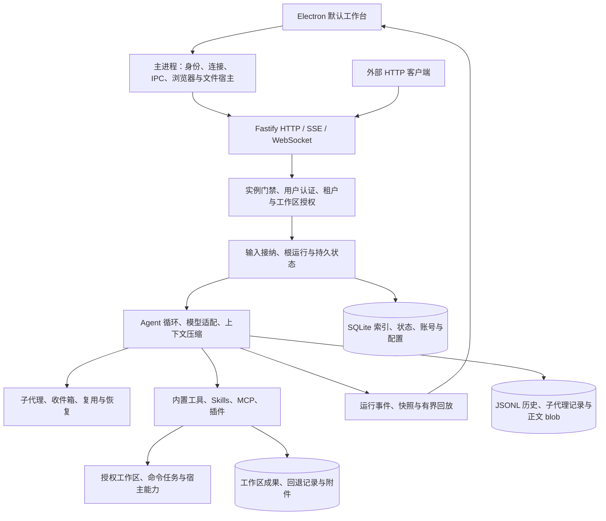

# 系统架构与功能地图

源码核对：2026-11-17。桌面只有一个默认界面；代码中的 work/code 是历史协议、工具 profile 或存储标识，不代表当前有两套 UI。用户操作见[桌面使用指南](../../../aether-code/docs/user-guide.md)。

## 一次任务如何执行

“会话”“轮次”“运行”“尝试”有不同身份。继续、重新发送、网络重连和回退不能只按最后一条消息判断；客户端需要保留对应 session/run/turn/attempt 和事件游标。主代理与子代理共享运行基础，但子代理有自己的上下文与任务状态。已完成代理可复用，进程重启后的继续依赖持久记录与恢复协议，不是恢复原进程。

## 功能域与入口

| 功能域 | 当前行为与边界 | 实现入口 | 使用说明 |
|---|---|---|---|
| 启动与配置 | 环境、项目/用户配置、SQLite 可变配置、managed 配置；监听参数提前确定 | [main.ts](../../src/main.ts)、[server-listen.ts](../../src/server-listen.ts) | [快速开始](getting-started.md)、[配置示例](../../.env.example) |
| HTTP 与健康 | 根路径和 /api/v1 混合挂载；SSE、WS、文件响应单独处理 | [server.ts](../../src/api/http/server.ts) | [API 约定](api-spec.md)、[全路由目录](http-routes.md) |
| 账号、第三方与租户 | 恢复凭证、可撤销账号 session、API Key/JWT、OIDC/OAuth2/平台凭证、重新验证 | [auth](../../src/auth/)、[accounts.ts](../../src/api/http/routes/accounts.ts) | [账号](../account-login.md)、[第三方](../account-external-login.md) |
| 对话与根运行 | 接纳收据、补充、队列、持久执行、显式停止、快照/重连 | [chat.ts](../../src/api/http/routes/chat.ts)、[root-admission](../../src/storage/root-admission/) | [运行指南](../runtime-guide.md)、[客户端集成](third-party-integration.md) |
| Agent 与协作 | Agent 配置、研究/执行/通用角色、消息、状态、复用、重启恢复 | [agents.ts](../../src/api/http/routes/agents.ts)、[subagent](../../src/core/subagent/) | [运行指南](../runtime-guide.md) |
| 模型与用量 | 提供方适配、模型配置与能力、思考开关、主/子/轻任务模型、上游 usage | [models.ts](../../src/api/http/routes/models.ts)、[llm-adapter](../../src/core/llm-adapter/) | [思考配置](../thinking-mode-config.md)、[性能测量](bench/performance.md) |
| 上下文与历史 | 当前上下文、完整历史、microcompact/摘要、缓存与磁盘正文分工 | [storage](../../src/storage/)、[core](../../src/core/) | [压缩](../context-compression-design.md)、[存储维护](../operations/session-storage-maintenance.md) |
| 记忆与知识 | 全局/会话策略、提取/召回、文件入库、检索与知识注入 | [memory.ts](../../src/api/http/routes/memory.ts)、[knowledge.ts](../../src/api/http/routes/knowledge.ts) | [运行指南](../runtime-guide.md) |
| 附件与多模态 | 工作区附件、图片/文档解析、视觉或 OCR、模型能力差异 | [chat.ts](../../src/api/http/routes/chat.ts) | [多模态](../multimodal-design.md) |
| 内置工具与 Skills | 工具注册、选择、权限、可用目录与管理目录；历史工具名不等于当前注册工具 | [tools](../../src/tools/)、[session-toolkits.md](../session-toolkits.md) | [系统工具](system-tools.md) |
| MCP | stdio/HTTP 等传输、连接与工具发现、命名空间、诊断 | [mcp.ts](../../src/api/http/routes/mcp.ts) | [运行指南](../runtime-guide.md) |
| 插件 | 安装、挂载、权限、后端执行与桌面页面/工具栏等贡献 | [plugins.ts](../../src/api/http/routes/plugins.ts) | [唯一公开 HTML 参考](../../../aether-code/docs/plugin-api/dist/index.html)、[内部实现](../plugins.md) |
| 工作区与文件 | 默认会话目录、绑定、权限、上传下载、树/搜索与路径身份 | [workspace](../../src/workspace/)、[workspace.ts](../../src/api/http/routes/workspace.ts) | [桌面功能地图](../../../aether-code/docs/feature-map.md) |
| 成果与撤回 | 文件变更、历史回退、成果刷新、冲突和持久事务；不是任意外部副作用回滚 | [changes.ts](../../src/api/http/routes/changes.ts)、[conversation.ts](../../src/api/http/routes/conversation.ts) | [运行指南](../runtime-guide.md)、[桌面使用指南](../../../aether-code/docs/user-guide.md) |
| Git、终端与命令 | 授权仓库、终端 WS、异步命令任务、运行时隔离模式 | [git.ts](../../src/api/http/routes/git.ts)、[terminal.ts](../../src/api/http/routes/terminal.ts)、[command-jobs.ts](../../src/api/http/routes/command-jobs.ts) | [安全架构](../security-architecture.md)、[容器部署](../../deploy/workspace-runtime/README.md) |
| 代码理解 | LSP、诊断与代码图查询；不能从源码目录存在推断前端已挂载所有编辑功能 | [lsp.ts](../../src/api/http/routes/lsp.ts)、[codegraph.ts](../../src/api/http/routes/codegraph.ts) | [桌面预览边界](../../../aether-code/docs/editor-code-oss.md) |
| 浏览器与工作台 | 浏览器宿主连接、标签/会话归属、页面操作、workbench 挂载 | [browser.ts](../../src/api/http/routes/browser.ts)、[workbench.ts](../../src/api/http/routes/workbench.ts) | [浏览器工作流](../../../aether-code/docs/browser-workflow-reliability.md) |
| 调度、待办与流程 | tasks、cron、todos、flows、消息；不同机制有独立状态与取消语义 | [routes](../../src/api/http/routes/) | [运行指南](../runtime-guide.md)、[路由目录](http-routes.md) |
| 设置、安全与监控 | 角色控制、权限模式、性能快照、存储诊断、版本信息、手动刷新 | [settings.ts](../../src/api/http/routes/settings.ts)、[performance.ts](../../src/api/http/routes/performance.ts) | [安全架构](../security-architecture.md)、[性能测量](bench/performance.md) |
| SDK 与发布 | 生命周期封装、embedded/remote、桌面打包运行时 | [sdk-package](../../sdk-package/)、[build.ts](../../scripts/build.ts) | [SDK 说明](../../sdk-package/README.md) |

路由目录按源码列出完整挂载路径。桌面地图逐项覆盖当前 features 目录与可达 UI；这两份清单共同用于检查新增功能是否漏写文档，不以目录数量代替业务验证。

## 存储和隔离

SQLite 仍保存需要查询与事务的结构化数据，如账号、配置、会话/运行索引、知识与记忆相关状态；主会话和子代理的大段历史由本地 JSONL/正文文件承载，内存仅保留有界缓存、活动流和工作集。不能只备份 agent.db 就认为备份了全部会话、工作区与凭据。

租户认证、工作区路径授权、工具审批和执行环境是不同边界。full-access 不授予跨租户访问，也不取消删除命令硬拦。远端文件属于远端引擎，桌面本机路径不能直接替代远端路径。部署能力与实测限制见安全和运行时文档。

## 核对与维护

本轮基于源码接线核对功能，未重新执行全部业务、真实第三方授权或 Docker 隔离验收。已有测试结果仍保留原日期和条件。全部文档状态见[清单](../documentation-inventory.md)；新增功能时同时更新此表、对应专题和桌面地图。
