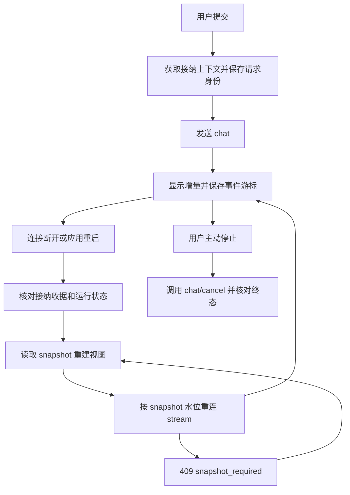

# 外部客户端接入引擎

源码核对：2026-11-17。这里的“第三方”指自行开发的 HTTP 客户端；第三方身份登录另见[账号适配](../account-external-login.md)。桌面 Aether 的行为以[使用指南](../../../aether-code/docs/user-guide.md)为准。插件扩展使用[HTML SDK 参考](../../../aether-code/docs/plugin-api/dist/index.html)。

## 接入前确认

准备引擎 base URL、部署是否要求实例令牌、用户身份方式、可用模型和授权工作区。/health 只证明进程可响应，不能证明模型已启用、密钥正确或有工作区写权限。先依照[快速开始](getting-started.md)启动，查询 /meta 判断版本，再按[API 约定](api-spec.md)处理根路由与 /api/v1 前缀。

恢复文件不是账号数据库。远端新实例没有旧账号记录时，导入恢复凭证不会迁移原会话。账号注册/登录/绑定必须针对同一个引擎服务；不要把模型 API Key、实例令牌、账号恢复凭证互相替代。

## 最小 JSON 请求

下面是 Node fetch 代码片段，变量由宿主安全配置提供。accountAccessToken 应是已有账号登录结果，不要在源码里写凭证。

```js
const baseUrl = process.env.AETHER_URL ?? 'http://127.0.0.1:12323'
const headers = { Accept: 'application/json' }
if (process.env.AETHER_INSTANCE_TOKEN) {
  headers['X-Aether-Instance-Token'] = process.env.AETHER_INSTANCE_TOKEN
}
if (process.env.AETHER_ACCESS_TOKEN) {
  headers.Authorization = 'Bearer ' + process.env.AETHER_ACCESS_TOKEN
}

async function requestJson(path, { method = 'GET', body } = {}) {
  const response = await fetch(baseUrl.replace(/\/$/, '') + path, {
    method,
    headers: body === undefined ? headers : { ...headers, 'Content-Type': 'application/json' },
    ...(body === undefined ? {} : { body: JSON.stringify(body) })
  })
  const result = await response.json()
  if (!response.ok || result.code !== 200) {
    throw new Error(method + ' ' + path + ': ' + response.status + ' ' + result.message)
  }
  return result.data
}

const profile = await requestJson('/auth/account/me')
console.log({ userId: profile.id }) // 仅示例；不要输出令牌或全部用户资料
```

使用旧 API Key 时用 X-API-Key；不要放入 Bearer 并期望按 API Key 处理。同时提交两种凭据时 API Key 优先。账号访问令牌短期有效，刷新需持久保存 requestId、单飞重试，并原子保存新的令牌对，详见[账号机制](../account-login.md)。

## 流式对话

最小对话可 POST /api/v1/chat，body 包含 message 与稳定的 sessionId，可增加已配置的 model/agentId。这是传输示例，不包含完整的生产接纳收据和恢复状态机。

```js
const response = await fetch(baseUrl + '/api/v1/chat', {
  method: 'POST',
  headers: {
    ...headers,
    Accept: 'text/event-stream',
    'Content-Type': 'application/json',
    'X-Aether-Run-Lifetime': 'durable',
    'X-Aether-Tool-Profile': 'general',
    'X-Aether-Subagent-Protocol': '2'
  },
  body: JSON.stringify({ message: '说明这个工作区的结构', sessionId })
})
if (!response.ok) throw new Error(await response.text())
// response.body 交给能够跨 chunk 缓冲、处理 CRLF/多行 data/id 的 SSE 解析器。
// 完整接入还要维护下节中的事件身份、游标、收据和快照。
```

不能按网络 chunk 直接 JSON.parse：UTF-8 字符和 SSE 帧都可能跨 chunk。使用流式 TextDecoder、空行分帧、多行 data 拼接并保留 id。POST 和带自定义认证头的连接适合 fetch 流，不宜假设浏览器原生 EventSource 能完成所有请求。

[stream-projection.ts](../../src/core/stream-pipeline/stream-projection.ts) 定义事件投影。文本字段含 content/thinking 和用户/助手消息 ID；结构字段含 run、userMessage、subagentEvent、usage、toolStart/toolArgs/toolEnd、ask_user、toolCall/toolResult、permissionRequest、messageBlock、flow、todo、fileChange、finalResult。历史兼容字段不保证总是成对出现。按事件、消息、工具调用 ID 合并，避免同一内容显示两遍；控制字段不进入正文。

## 断网、重启和继续



- 用户在准备阶段点停止时，原对话请求可能返回 `499/49900`（还没有本轮记录），也可能只返回本次 `run.status = "cancelled"` 的 SSE 回执（已接纳但未开始执行）。两种情况都不产生本次助手答复，不能拿上一轮的正文来填充。见[运行、恢复与幂等](api-spec.md#运行恢复与幂等)。
- 请求超时不代表服务端未接纳。重试前查询收据，不能再生成一个 requestKey 当新用户输入发送。
- 重连是观察同一次运行；用户说“继续”则是带前驱身份的续跑，不能用断线重连代替。
- namespace/generation 变化、历史回退和旧 attempt 过期后，应刷新上下文与快照，拒绝旧事件污染新轮次。
- 子代理 v2 的 watermarks、分页记录与快照投影必须在同一水位上恢复；先恢复父视图，再按协议取子记录。历史档案不必一次全部加载。
- 等待提问/审批时保留 requestId/runId；只答复仍有效的请求，不能重放旧审批。
- usage 是带 scope 的用量数据。区分本轮/会话/子代理及累计值，不把每一帧累计值再次相加。供应商缓存命中与本地上下文估算不是一个指标。

接纳协议的规范化正文与收据读取见 [root-admission](../../src/storage/root-admission/)。可对照当前桌面 [useChat.ts](../../../aether-code/src/renderer/src/core/engine/useChat.ts) 的协议接线，但桌面内部模块不是第三方稳定 SDK。

## 附件、工作区与成果

附件先通过 /api/v1/workspace/upload 落到授权工作区，再传服务端认可的相对路径和附件元信息。不要传一个只在客户端存在的绝对路径，期望远端引擎读取。多模态支持取决于解析器、模型能力与宿主，详见[附件输入](../multimodal-design.md)。

文件树、成果、会话历史是相关但独立的视图。服务端回退成功后，按操作范围刷新历史、运行、成果、目录和已打开文件；路径不存在时关闭或标记失效预览。冲突或部分失败要展示实际结果，不能仅隐藏一条消息并声称文件已撤回。引擎无法撤回外部服务中任意工具已经造成的副作用。

## SDK、版本与验证

[agent-engine-sdk](../../sdk-package/README.md) 当前主要封装 embedded/remote 生命周期，没有旧文档声称的完整业务命名空间。外部客户端可在 sdk.start() 后使用 baseUrl 和标准 HTTP 协议；账号、恢复、实例令牌及 SSE 状态仍由集成方处理。

接入验收至少覆盖：错误/过期凭据、模型不可用、重复提交、断网收据恢复、过期游标、进程重启、待答复恢复、显式停止、子代理复用、回退后重发、远端路径与附件、用量去重。全部测试使用隔离数据、合成文件与自有测试账号；一组源码审阅或路由目录生成不能替代这些运行验收。
