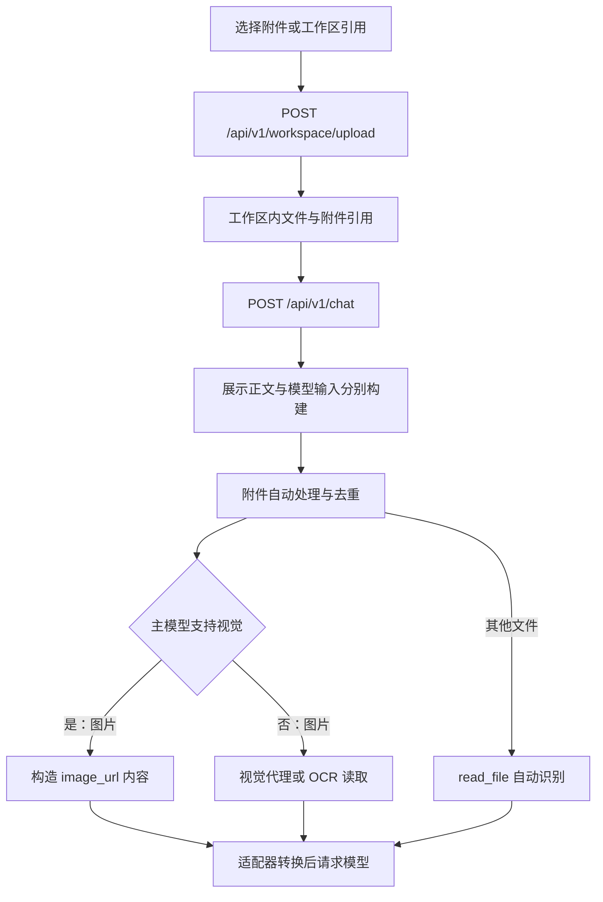

# 附件与多模态输入

本文按 2026-11-17 源码核对，说明文件上传、展示正文、模型输入和持久历史之间的关系。

## 输入链路

上传路由位于 [workspace.ts](../src/api/http/routes/workspace.ts)，不是 `/workspace/file` 的 multipart 接口。[server.ts](../src/api/http/server.ts) 注册 multipart 的 100 MiB 限额；二进制读取、文本预览和知识库上传另有各自上限，不能把它视作所有文件操作的统一大小限制。

## 自动处理与工具读取

[attachment-auto-processor.ts](../src/api/http/routes/attachment-auto-processor.ts) 合并附件和工作区引用并去重。主模型支持视觉时将图片作为模型图片内容；否则先尝试已配置视觉代理，再通过 `read_file` 的 OCR 路径读取。其他文件通过统一读文件能力处理。是否已真实视觉内联由处理结果决定，不能仅凭文件扩展名声称“模型已经看过”。

当前公开工具名是 `read_file`。旧文档要求先调用独立 `read_image` 或 `smart_read` 的说明已不适用。文件工具与办公检查工具负责文本、Office、PDF 和 OCR 等具体解析；支持范围、分页和返回长度以当前工具 schema 为准。

[chat.ts](../src/api/http/routes/chat.ts) 区分 displayContent 和 modelInputContent，展示层不必显示注入给模型的所有辅助文字。[OpenAI 适配器](../src/core/llm-adapter/openai.ts) 可把合法图片工具结果转换为工具文本加用户图片消息；无效、被剥离或视觉关闭的 payload 不应被当作可用图片。

## 保存与恢复

附件源文件属于工作区；显示消息、模型历史、外置大正文与最终成果是不同数据。默认 JSONL 历史可保存模型输入表示，超阈值内容可进入外部压缩 blob。因此不能保证“base64 永不落盘”或“图片只存在本轮，下轮自动消失”。

压缩后的模型历史可能不再包含完整图片输入，但物理记录和源附件不会因此自动删除。备份与恢复应包含主库、sessions、被引用的 blobs 和所需工作区文件；结果发布还可能依赖 result-assets。详见 [运行与数据指南](runtime-guide.md)。

## 限制与验证

视觉代理、OCR、Office 解析器和模型能力受部署依赖及配置约束；上传成功不代表解析成功。引擎记录实际处理结果和失败原因，不应伪造图片理解。客户端也不能用显示标签代替服务端资源授权。

实现入口为附件自动处理器、文件工具和模型适配器；本次文档更新未执行真实图片、商业视觉模型或操作系统 OCR 的端到端测试。
