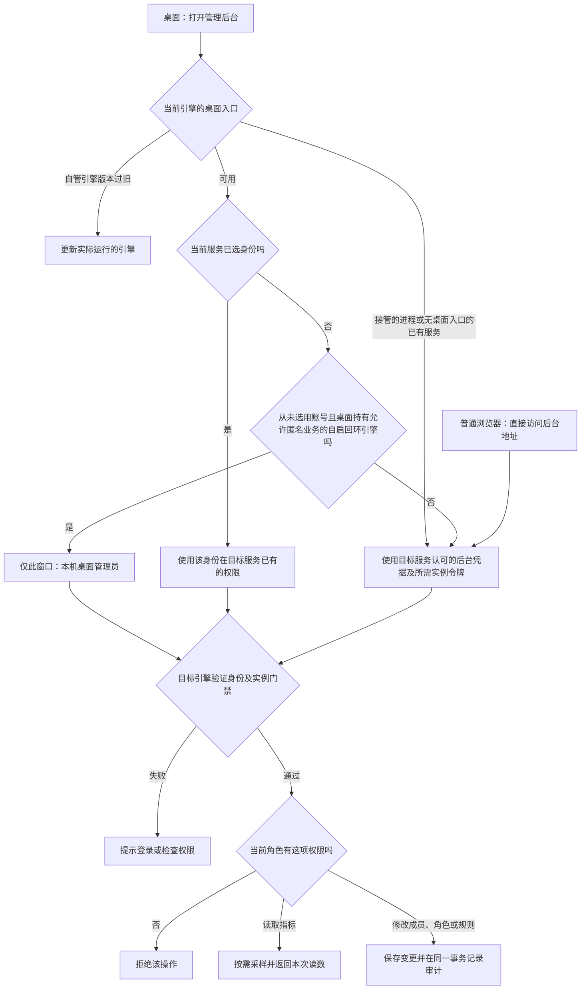

# Aether 引擎管理后台

启动引擎后，直接在浏览器打开启动日志里的「管理后台」地址，默认是 `http://127.0.0.1:12323/admin/`。管理页与 API 共用端口，随引擎启停；无需运行另一个 Web 项目，也不会自动弹出浏览器。远程管理员请使用指向该服务的 HTTPS 地址，或者通过安全隧道访问本机回环地址。远程明文 HTTP 页面不能提交凭据。

## 进入后台

| 从哪里打开 | 怎样进入 |
|---|---|
| 桌面已选个人账号或服务身份，目标引擎支持桌面入口 | 在「设置 → 引擎管理」点「打开管理后台」。后台按**该身份在目标服务已有的管理权限**决定可见内容；普通成员不能因此成为管理员。 |
| 未设置过个人账号，使用桌面自己启动并仍持有的本机回环引擎 | 服务允许匿名业务访问时，点「打开管理后台」即可进入。首次无需运行命令、创建管理员密钥或填写实例令牌；操作以「本机桌面管理员」记入审计。若服务强制业务认证，则需有管理权限的身份。 |
| 其他引擎上未选身份，或从普通浏览器直接打开 `/admin/` | 在该服务的后台登录页输入管理员凭据；已配置实例令牌的独立服务还需该令牌。桌面接管已有进程、地址恰好是 `localhost`，都不会带来本机管理权。 |

本机临时授权只属于这一个管理窗口；关闭窗口、切换账号或引擎、停止引擎都会撤销。已退出或过期的个人账号也不会回退为「本机桌面管理员」。把同一网址复制到普通浏览器，不会带走这份授权。旧的自管引擎不支持此入口时，先更新实际运行的版本（开发版见下节）；桌面接管的已有进程或不支持桌面入口的独立引擎，使用浏览器登录。



## 一打开地址就看到 401，没有登录表单

先在桌面「设置 → 引擎管理 → 当前连接 → 连接详情」确认**服务地址**。端口不一定是 `12323`；反向代理发布在子路径时保留该前缀。用实际地址测试登录页，例如：

```powershell
curl.exe -I http://127.0.0.1:12323/admin/
```

无需提供密钥。新版登录页应返回 `200`、`Content-Type: text/html` 和 `X-Aether-Admin-Surface: 1`；支持桌面身份入口的版本还返回 `X-Aether-Admin-Desktop: 1`。这两个标头仅说明页面能力。未登录时访问 `/admin/me` 返回 `401` 则是预期行为。如果连 `/admin/` 都返回 `40100 Invalid or missing instance token`，应先查哪个服务在响应，重新填写或生成管理员密钥不能修复登录页。

如果页面已打开，显示「无后台权限」（403），说明当前身份没有这个实例的后台权限。请联系该服务的管理员；重新输入实例令牌不会给普通账号增加角色。若显示「需要登录」（401），先确认引擎连接仍然正常，再到「设置 → 个人账号」核对服务地址并重新验证身份。

- **桌面开发版**：看同一处的「引擎入口」。常规 `npm run dev` 会把源码编译到引擎仓库 `.tmp/aether-code-dev/<本次构建>/dist/main.js`；启动终端也会打印这条路径。整次桌面开发进程使用同一入口，所以刷新网页、重编同级仓库的 `dist/`、点击「重启引擎」都不会换掉这个快照。等进行中的任务结束，退出旧桌面开发进程，再从 `aether-code` 目录运行 `npm run dev`。如果显式设置了 `AETHER_IDE_ENGINE_ENTRY`，启动脚本直接使用那个入口；请改为新版入口，或移除该覆盖后再启动。对照[桌面启动脚本](../../../aether-code/scripts/dev.mjs)。
- **桌面已安装版或导入版**：核对「连接详情」显示的运行时来源和入口，更新或切换到包含管理页的版本。若连接的是已有服务，则更新实际运行的服务。
- **反向代理或网关**：用相同检查对比引擎直连地址和对外地址；直连正常时，检查代理是否将 `/admin/` 及其下的资源转发到同一实例，并保留页面标头。保持管理数据接口的身份验证。

## 创建第一个管理员或恢复管理权

没有可用管理员身份时，可在服务器上用下列命令初始化或恢复管理权。符合上表第二行条件、只需在桌面管理本机引擎的用户可跳过这一步。

先启动一次引擎以初始化主数据库。在服务所在电脑的**安装目录**运行以下命令，把 `--data` 换成该实例实际的 SQLite 文件；桌面在「设置 → 引擎管理 → 连接详情 → 数据库文件」显示它的路径。输出目录应只有管理员可读：

```powershell
node dist/admin-cli.js admin create --data ".\data\agent.db" --out "$env:LOCALAPPDATA\Aether\private\panel-admin.key" --name "运维管理员"
```

打开指定文件，把里面的后台专用密钥填入登录页。如果是独立部署且已配置实例令牌，还需填入相同的实例令牌。这条离线命令也用于管理员失去原密钥时的恢复：为可访问实例数据目录的本机运维创建一位新主管理员，不覆盖输出文件、不更换业务账号 Key。妥善保护数据目录、私有文件及其备份；恢复后在后台撤销旧密钥。

已有默认租户管理员 API Key 也可登录；受信方签发的 JWT 需显式声明 `tenantId: "default"` 与 `admin` 角色。普通个人账号、外租户管理员及实例令牌本身都不能充当后台管理员。本机桌面管理员是上表条件下的临时窗口身份，不会写入个人资料或改变账号角色。后台专用密钥不能用来调用业务 API。关闭普通业务认证不会关闭后台认证。

## 页面与权限

| 页面 | 管理员可以做什么 |
|---|---|
| 服务器概览 | 查看版本、认证与运行时间；按需读取主机 CPU、内存、可用数据卷容量，以及当前引擎进程 CPU、常驻内存、JS 堆和事件循环。显示主库、WAL 文件大小与可获取的队列计数。无法获取的指标显示为不可用。 |
| 后台成员 | 搜索、分页、创建、编辑、启用／停用、删除；按成员签发和撤销专用密钥。明文仅签发时返回，存储的是摘要。停用成员或撤销密钥后，下一次请求立即重新验证。 |
| 角色与权限 | 查看内置角色；创建和维护自定义角色，逐项选择权限。主管理员持有全部权限，只读管理员查看概览、指标与规则，审计管理员还可查看成员、角色与审计记录。内置角色不能删改，正在使用的角色不可删除。 |
| 审计日志 | 查询变更的时间、操作者、操作、目标和结果。权限不足的操作会留下受频率限制的拒绝记录；审计中不写凭据和请求正文。 |
| 监控规则 | 为主机 CPU、内存、数据卷、进程内存或排队任务自定义阈值；新建、编辑、暂停、删除和手动检查。检查结果区分正常、达到阈值、停用及指标不可用；支持 JSON 导出、原子恢复。 |
| 实例设置与连接 | 查看实际认证状态，生成候选实例令牌及找到部署命令。候选值不会直接轮换正在使用的令牌。 |

管理 API 在服务端逐项检查 `status.read`、`metrics.read`、`members.read/write`、`credentials.write`、`roles.read/write`、`audit.read` 和 `rules.read/manage`。成员可在侧栏看到自己的角色名称，无需查看角色目录的权限。只有同时具备 `rules.read` 和 `metrics.read` 的成员会看到「检查当前指标」；仅能查看规则的成员可以阅读阈值。修改角色、成员或凭据与对应审计在同一事务提交。后台状态独立保存在实际主数据库旁的 `<主库文件>.admin.sqlite`，随实例备份 SQLite 数据时应同时纳入；规则导出的 JSON 不含成员、密钥、审计或会话，不能替代数据库备份。

**审计保留**：本机管理库按记录数量保留最近约 10 万条事件。重复的登录和部分拒绝记录会合并；尚未启用管理存储时，不会仅因匿名访问就新建数据库。需要长期留存时，请将管理库纳入部署方的归档方案。

**指标口径**：主机 CPU 按操作系统可见的总容量统计；引擎进程 CPU 以单逻辑核心为 100%，可能超过 100%，不含独立子进程。容器里主机可见数据与容器配额可能不同。进入服务器概览或手动刷新会按权限采样；进入或刷新规则列表只读取规则，点击「检查当前指标」才会采样。没有持续轮询、历史趋势或后台告警推送。规则上限 100 条，导入上限 64 KiB；恢复只补缺项，冲突整批回滚。运行时配置、操作系统服务、防火墙及主机备份需使用相应部署工具管理。

## 给用户开通主账号和扩容

进入后台的「个人账号」页，点「签发开通码」，将弹窗中仅显示一次的码交给用户。开通码属于签发它的服务，7 天内可兑换一次。用户在桌面「设置 → 个人账号 → 创建主账号」输入；已有独立个人账号可在原账号中启用。码用过后不能再次查看或撤销已开通的账号；尚未使用的有效码可以在记录中撤销。

开通后，在本页「主账号配额」找到该主账号，点「调整配额」。默认上限为 3，不计算主账号；停用的子账号仍占名额。可改为 0–100 的整数，但不能降到现有用量以下。它只影响所选主账号，不会删除子账号；家庭成员由其所属主账号在桌面管理。

| 后台权限 | 管理接口 |
| --- | --- |
| `accounts.activation` | `POST /admin/activation-codes` 签发；`GET /admin/activation-codes` 查询状态；`DELETE /admin/activation-codes/:id` 撤销。列表与审计不返回开通码明文。 |
| `accounts.read` | `GET /admin/account-families`，分页查询已开通的主账号及其用量。 |
| `accounts.quota` | `PATCH /admin/account-families/:id/quota {limit,expectedLimit}`。原上限已变化时返回 `409`；先刷新，核对后再改。后台页面同时需要目录读取权限才能选择账号。 |

开通码及配额变更和审计事件一起写入业务库；事件随后同步到管理库的审计列表。备份时两个库都应纳入。

## 实例令牌从哪里来

| 启动方式 | 未设置时 | 下次启动 |
|---|---|---|
| Aether 桌面内置引擎 | 桌面为自管子进程生成临时令牌并自动连接 | 新的子进程使用新的临时值，不需要管理员提取 |
| 独立 Node 服务或容器 | 不自动生成；未设置代表实例门禁未启用 | 继续使用启动配置中的值；改配置后需重启，日志只打印状态和查看方法 |

若要启用实例令牌，在已连接的后台展开「配置实例令牌」，生成并复制候选值；也可使用下方的 `token generate`。在服务器的私有启动配置设置 `AETHER_INSTANCE_TOKEN`，重启，再在需要连接的客户端填入同一个值。生成或复制不会保存到服务，也不会中断现有客户端。更换**已生效**的值并重启后，使用旧值的客户端需要更新。

在服务安装目录、以相同的服务账号和启动环境运行：

```sh
node dist/admin-cli.js token status
node dist/admin-cli.js token show
node dist/admin-cli.js token generate
```

- `status` 只报告 `not-set`（未设置）、`configured`（设置了非空值）或 `empty`（显式设成空字符串）。最后一种配置会拒绝所有受实例门禁保护的请求，管理员也无法连接后台；请在启动配置中改为有效值或移除该变量并重启。
- `show` 仅在当前本机终端显式输出配置中的完整值。在生产服务上使用私有终端；不要把输出贴入日志或聊天。它根据**本次命令**的目录与启动环境计算，不读取另一个运行进程。若配置刚改但服务尚未重启，CLI 与运行进程可能不同；后台的状态反映正在运行的进程，网页不回显旧令牌。
- `generate` 使用 32 字节随机数输出新的 64 位十六进制候选值，不读取现有值，不写文件。源码开发且未构建时，用 `npx tsx src/admin-cli.ts` 替代 `node dist/admin-cli.js`。

服务使用其他工作目录时，在那个目录执行 CLI，传入 CLI 文件的绝对路径；宿主服务管理器注入的环境变量不会自动出现在管理员的普通终端。如用仓库 Compose，在相同服务容器里执行 `docker compose exec agent-engine node dist/admin-cli.js token status` 或将最后一个参数换成 `show`。修改 Compose 注入的环境变量后，通过 `docker compose up -d --force-recreate agent-engine` 重建容器，使它读取新配置。

`AETHER_INSTANCE_TOKEN` 是客户端与实例之间共用的连接令牌；管理员 API Key 是后台登录身份。二者与模型供应商密钥、数据库加密密钥 `ENCRYPTION_KEY` 和 JWT 签名密钥 `JWT_SECRET` 各有用途，不要互相代填。仓库 Compose 为兼容已有客户端，未显式配置时普通业务仍允许匿名；复制新版 `.env.example` 后，Compose 默认仅向宿主机 127.0.0.1 发布端口。已有部署也可将 `AETHER_PUBLISHED_PORT=127.0.0.1:12323` 限制到本机。对外提供服务时显式开启 `AUTH_ENABLED=true`，使用 HTTPS 并设置私有密钥；Compose 不再提供示例 JWT 签名密钥，使用 JWT 的部署应提供自己的签名密钥。
