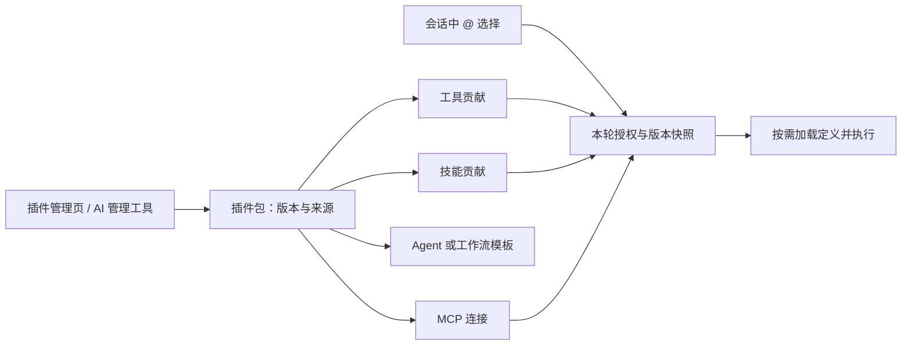

# Aether 自定义插件管理：源码调研与设计建议

调研日期：2026-11-11。范围：DeepSeek Harness 插件机制，以及 Aether 引擎、Work 前端的接入可行性。本轮只下载和阅读源码、编写本报告，没有安装第三方依赖、运行第三方插件或修改产品实现。

## 1. 结论

可以做，而且适合成为 Work 左侧独立的「插件」页面，并提供一个按需启用的 `@插件管理` 工具包。AI 与手动页面应操作同一个插件服务，共享校验、版本管理、安装与启停规则。

这里有两个互补功能：

- **管理插件**：创建、编辑、查看、删除、导入、启停、检查与测试。
- **使用插件**：把插件提供的工具、技能或连接，明确选入某个会话或绑定 Agent。

安装、启用、当前会话选用必须分别建模。安装十个插件不应使普通会话自动携带十组工具 schema。

建议采用「声明式插件包 + 受管理的工具宿主」，逐步开放扩展能力。现有技能、MCP、工具注册、导入、持久审批可以复用；不需要把 Aether 整个重写为 Cordis，也不宜直接把第三方 JavaScript 导入引擎主进程。

## 2. 参考仓库与证据边界

已按要求执行浅克隆：

- 仓库：<https://github.com/deepseek-ai/deepseek-harness>
- 本地目录：`D:\dev\deepseek-harness`
- 调研 commit：`fcc0ad462172522aaf5c93a7b2e01f6b9f0b0159`
- 该提交时间：2026-11-04 16:40:00 +08:00。
- 根包版本：`0.2.2-rc.1`，Node 要求 `>=24.9.0`，MIT 许可。

这是一份针对上述提交的静态源码调研，不是对其完整运行效果的实测。结论同时参考实现、类型、使用文档与现有测试文件，未把测试文件存在等同于测试已经运行通过。

Aether 当前工作树含其他任务的未提交改动。调研时已经看到 Agent、技能、知识库、自动化四类管理工具包；技能更新服务和动态工具包查询也已推进。上一轮「仅支持一个 Agent 管理包」「技能修改只能覆盖目录」的观察已经过时，不能继续当成当前缺陷。

## 3. DeepSeek Harness 实际做了什么

### 3.1 产品层面的能力

| 维度 | 当前实现 | 对 Aether 的意义 |
|---|---|---|
| 独立插件页 | 侧栏 Plugins 页面，管理 bundle、插件条目、配置与状态 | 可以直接借鉴导航和管理流程 |
| 手动安装 | npm、Git 地址、绝对本地路径、tarball 等 spec | 可借鉴来源解析；不是任意仓库即插即用 |
| GitHub | 经 Git/pnpm 解析源，支持固定提交及包子目录的安装形式 | Aether 需要自己的格式识别和锁定来源机制 |
| AI 创建 | 在工作区写持久 bundle，再调用 `plugin_manager install_bundle` | AI 创建依赖文件生成与正式发布流程 |
| 配置编辑 | 配置表单/patch；插件可贡献配置页 | 不等同于现成的通用插件源码编辑器 |
| 启停 | profile bundle 和条目分别启停 | 需区分保存的启用选择与实际运行成功 |
| 热更新 | 依赖可撤销 effect 与 HMR；部分变更明确要求重启 | 不能统一显示「保存即生效」 |
| 更新恢复 | 注册表包检查版本、更新失败尝试恢复旧版本 | 是安装事务与恢复流程，不是任意副作用回滚 |
| 市场 | 多索引源，版本、兼容性、来源预览 | 可以后做；首版不必建设市场 |
| AI 管理工具 | `plugin_manager` 提供列表、启停、安装和移除等操作 | 页面与模型共用管理服务 |

关键源码：

- [架构](D:/dev/deepseek-harness/docs/architecture.md:7)：产品本身采用 everything-is-a-plugin / Cordis 组合。
- [侧栏入口](D:/dev/deepseek-harness/packages/client/ui-plugin-manager/src/client/index.ts:83)：`PANEL_ID = 'plugins'`，插件页是全局页面。
- [状态刷新](D:/dev/deepseek-harness/packages/client/ui-plugin-manager/src/client/index.ts:117)：监听管理变更及重连，重新读取目录。
- [模型管理工具](D:/dev/deepseek-harness/packages/boot/plugin-manager/src/tools.ts:87)：`plugin_manager` schema、权限与服务调用。
- [安装 spec](D:/dev/deepseek-harness/packages/boot/plugin-manager/src/install-spec.ts:15)：来源类型与绝对路径约束。
- [版本更新](D:/dev/deepseek-harness/packages/boot/plugin-manager/src/index.ts:713)、[安装流程](D:/dev/deepseek-harness/packages/boot/plugin-manager/src/index.ts:872)。

### 3.2 持久插件格式

持久插件不是一个任意命名的 JS 文件，而是一个符合其约定的包：`package.json` 中声明 `dsh.bundle.patch`，patch 指向要挂载的插件条目，可另外声明 Host/Client 入口、元数据与资源导出。

例如其内置装饰插件模板包含：

```text
package.json
cordis.patch.yml
index.js
client.js
locale/*.json
icon.svg
```

模板与声明可查 [package.json](D:/dev/deepseek-harness/packages/preset/agent-preset/skills/cordis-plugin-development/templates/decoration/package.json:1)。这套格式依赖 DSH/Cordis 服务、类型、slot 与运行时，不能直接作为 Aether 原生插件执行。

### 3.3 AI 创建的真实流程

其 [Creator 开发说明](D:/dev/deepseek-harness/packages/preset/agent-preset/skills/cordis-plugin-development/SKILL.md:8) 明确要求：

1. 发现当前可用服务、工具和 UI slot。
2. 读取必要 API 文档和模板。
3. 在普通工作区编写插件包。
4. 检查语法和清单。
5. 通过 `plugin_manager` 正式安装。
6. 根据 `application` 回执判断已应用、等待重启或失败，再验证实际功能。

因此「AI 创建插件」是编写、校验、安装、验证的闭环，不只是让模型输出一段代码。Aether 应补自己的插件开发说明和 API 查询能力，避免 AI 凭空猜测可调用接口。

其 UI「让 Agent 创建插件」实际打开 Creator 预设的新会话，不会自动发送用户需求，也不是在插件列表内打开通用源码编辑器。证据：[创建菜单](D:/dev/deepseek-harness/packages/client/ui-agent-preset/src/client/CreatePluginMenuItem.tsx:27)、[新会话流程](D:/dev/deepseek-harness/packages/client/ui-agent-preset/src/client/index.ts:216)、[配置编辑器](D:/dev/deepseek-harness/packages/boot/config-editor/src/index.ts:82)。用户要求的手动源码 CRUD、我的插件草稿库，仍需要 Aether 自己补齐。

### 3.4 不要误判旧动态插件机制

仓库保留动态 Cordis runner 与历史工具卡片，但当前 `tool-cordis` 面向模型只提供只读 API 发现工具。不能因为看到 `cordis_define` 历史卡片，就判断当前模型有该创建工具。

动态 runner 的定义按会话隔离、保存在进程内，重启清空；持久 bundle 安装则跨重启保留。这是两套不同生命周期。

证据：[runner 注册表](D:/dev/deepseek-harness/packages/extensions/cordis-host-runner/src/registry.ts:141)、[runner 文档](D:/dev/deepseek-harness/packages/extensions/cordis-host-runner/README.zh.md:58)。

### 3.5 借鉴范围与限制

- 持久安装的 Host 代码在宿主进程内执行，影响同一 profile 的全部会话，不能当作工作区内的普通工具调用。
- 动态 runner 使用 `node:vm` 和服务 façade；源码明确说明这不是安全隔离边界，Host 函数仍可能成为逃逸途径。其同步求值 timeout 也不能约束全部异步执行。
- 插件管理工具要求完整访问或本次调用批准；构建脚本另有授权。`approvedBuilds` 参数不能只因模型填了一个布尔值或列表就被视作可信的人类批准。
- 安装恢复会恢复部分 profile 文件；外部脚本、网络请求或插件已经造成的业务副作用不能靠恢复 manifest 自动撤销。
- 热更新并非总能完成；保存、已选择、已安装、实际 active、要求重启是不同状态。
- GUI 的 `updateBundle` 版本更新限符合条件的第三方 registry 包，Git/local 来源没有通用版本升级入口；模型 `plugin_manager` 的动作列表也没有同名更新操作。不能把 GUI 能力直接当作 AI 工具能力。证据：[更新来源限制](D:/dev/deepseek-harness/packages/boot/plugin-manager/src/index.ts:177)。

证据：[VM 的明确边界](D:/dev/deepseek-harness/packages/extensions/cordis-host-runner/src/sandbox.ts:1)、[管理与构建授权](D:/dev/deepseek-harness/packages/boot/plugin-manager/README.zh.md:31)、[构建授权限制](D:/dev/deepseek-harness/packages/boot/plugin-manager/README.zh.md:72)。

## 4. Aether 当前能复用什么

| 已有基础 | 可复用内容 | 仍缺什么 |
|---|---|---|
| ToolRegistry | 注册/卸载、schema、执行、取消、并发管理 | 插件 owner、版本身份、宿主生命周期 |
| `load_tools` | 精简模型工具视图、按需加载定义 | 插件目录统一接入与动态授权身份 |
| 四类管理包 | 手动选择、会话保存、审批恢复、目录查询 | 用户安装插件不能依靠源码常量识别 |
| 技能管理服务 | 创建/编辑/启停/删除、哈希冲突、路径校验 | 统一插件包不只是技能目录 |
| 技能导入 | 压缩包检查、staging、版本备份、路径限制 | GitHub 解析、通用插件 manifest、来源锁定 |
| MCP | stdio/HTTP/SSE 等、项目/全局配置、连接测试 | 插件级依赖归属、最小环境、宿主与授权管理 |
| 持久审批 | 冻结具体变更、批准后执行原快照 | 插件安装/发布/更新的同类操作对象 |
| Work 管理页 | 单列导航、列表到详情编辑、脏草稿退出处理 | 插件列表、工具配置和版本界面 |
| 目录变更回执 | AI 成功修改后刷新，隔离不同引擎 source | 插件目录、`@` 与 Agent 工具集的统一刷新 |

关键入口：

- [引擎插件包候选映射基础](D:/dev/ai-agent-engine/src/tools/toolkits.ts:12)。
- [可信工具实现注册](D:/dev/ai-agent-engine/src/tools/registry-factory.ts:166)。
- [工具注册表](D:/dev/ai-agent-engine/src/core/tool-registry/registry.ts:17)。
- [技能编辑服务](D:/dev/ai-agent-engine/src/skills/management-service.ts:239)。
- [现有导入管线](D:/dev/ai-agent-engine/src/skills/import-pipeline.ts:1)。
- [冻结管理操作的审批](D:/dev/ai-agent-engine/src/tools/management/approved-mutation.ts:11)。
- [Work 导航定义](D:/dev/aether-code/src/renderer/src/contrib/work/WorkView.tsx:128)。
- [前端目录解析](D:/dev/aether-code/src/shared/toolkits.ts:34)。

特别说明：现有技能加载器读取的 `plugin.json` 是技能元数据及正文入口，不是可执行插件系统。[external-loader.ts](D:/dev/ai-agent-engine/src/skills/external-loader.ts:126)

## 5. 推荐的插件实体与格式

### 5.1 插件、工具包、工具、技能之间的关系



插件是分发、安装和版本管理单位；工具包是会话能力选择单位。一个插件可贡献多组能力，一个工具有自己的参数 schema 和执行实现，技能主要描述工作方法。

管理包与被管理插件也分开：`@插件管理` 负责创建/编辑插件；用户的 `@订单查询` 插件负责调用订单工具。

### 5.2 原生 manifest 的建议字段

以下是设计草案，不是当前已实现或可导入的格式：

```json
{
  "manifestVersion": 1,
  "id": "acme.order-tools",
  "name": "订单查询",
  "version": "1.0.0",
  "engine": { "apiVersion": "1" },
  "description": "查询订单与生成订单报表",
  "contributions": {
    "tools": [{ "id": "lookup", "definition": "tools/lookup.json", "handler": "lookup" }],
    "skills": [{ "path": "skills/order-report/SKILL.md" }]
  },
  "runtime": { "kind": "mcp-stdio", "entry": "dist/server.mjs" },
  "capabilities": {
    "network": ["https://orders.example.com"],
    "workspace": "read",
    "secrets": ["orders-api-token"]
  }
}
```

生产协议还需定义平台/运行时要求、依赖锁、输出格式、上限及兼容性。来源、安装位置、内容 hash、实际授权和 secret 值由引擎存储，不能信任清单自报。工具名称应由引擎生成命名空间，避免插件冒充 `agent_create`、`write_file` 等内建身份。

首版适合支持：技能、声明式 HTTP 工具、MCP 连接/受管理的 MCP 工具宿主、Agent 模板。UI/hook 等可修改整个产品运行行为的插件应后做。

## 6. 手动与 AI 创建流程

### 手动创建

选择模板 → 填名称和用途 → 定义工具输入/输出或选择已有 MCP → 配置凭据引用 → 保存草稿 → 校验 → 有界测试 → 发布启用。

简单模板优先：HTTP API 工具、只读数据查询、文档处理、已有 MCP 服务包装、技能组合。高级源码编辑作为单独区域，沿用现有编辑器能力，不把大段 JSON 与复杂权限全部塞进列表页。

### AI 创建

用户 `@插件管理` 提需求 → AI 查询插件 SDK/模板 → 创建草稿文件与清单 → 校验并返回诊断 → 修正 → 测试 → 发布。

要求：

- AI 与页面使用同一套 PluginService。
- 创建草稿不等于安装启用；代码测试本身也是执行，需要按实际工具权限处理。
- 编辑使用 `expectedRevision` / 内容 hash，保存产生新修订，避免 AI 覆盖用户刚修改的内容。
- 变更审批冻结具体文件 hash、来源、依赖、能力与目标版本；批准后不得重新解析 branch 再安装不同代码。
- 成功回执携带结构化 `pluginChange`，刷新管理页、`@` 目录与 Agent 可选工具。
- 不再暴露一套重复的预览工具/`do_*` 工具；一次规范调用通过持久审批恢复完成。

可设计一个 `@插件管理` 包，包含列表、详情、创建、编辑、移除、来源检查、导入、校验、测试、发布/启停等规范入口。具体工具数量应围绕最终服务接口决定，避免为了 CRUD 拆出大量相似 schema。

## 7. GitHub 与第三方导入

### 7.1 正确的导入顺序

```text
输入来源
  → 解析 repository / ref / subdir
  → 解析 ref 并固定 commit
  → 下载到 staging，只读检查清单和目录
  → 判断格式、兼容性、工具、依赖和能力
  → 展示安装预览
  → 发布安装事务
  → 配置/测试
  → 启用，供会话选择
```

分支、tag 可以作为用户输入，但最终安装记录应锁定 commit 与内容摘要。更新是再解析一次来源并比较新旧差异，不是每次启动自动拉取 HEAD。

### 7.2 各种 GitHub 内容的支持范围

| 仓库内容 | 合理的处理方式 |
|---|---|
| Aether 原生清单 | 完整校验后安装 |
| 标准技能目录 / SKILL.md | 识别为技能贡献并导入；不是新增可执行工具 |
| MCP server | 经适配器定义启动方式、运行时、凭据与工具范围 |
| 只包含 API/OpenAPI 描述 | 可生成声明式工具草稿，再验证 |
| DSH bundle | 依赖 Cordis API；不能直接运行，简单配置型贡献可研究转换 |
| 含任意 hook / UI / 宿主代码 | 需要对应 SDK 和运行时，首版明确不兼容 |
| 普通业务代码仓库 | 可作为插件开发素材，不能显示「导入成功即可用」 |

`deepseek-harness` 本身是参考宿主项目，不是一个可直接装进 Aether 的工具插件。

### 7.3 导入必须处理的工程问题

- monorepo 插件选择与子目录，repo 不等于单个插件。
- 下载取消、超时、大小/文件数量限制、符号链接/目录联接、路径穿越与解压膨胀。
- GitHub `/tree/...` 地址中的 ref 与 path 存在歧义，应显式解析/选择，不能简单按固定段数切割。
- 私有仓库凭据用执行端 secret 引用，不能把 token 拼进 manifest、命令日志或会话正文。
- 导入阶段不执行仓库脚本、安装 hook、Git filter 或包生命周期脚本；依赖准备作为单独的受控阶段。
- 记录仓库、commit、subdir、hash、license、依赖锁及修改来源；hash 标识内容，不代表作者可信。
- 离线、认证失败、格式错误、缺运行时、缺配置、版本不兼容分别返回，避免统称「安装失败」。

## 8. 会话工具暴露与子代理

### 8.1 动态目录

当前前端已从 `/toolkits` 查询支持情况，但 `parseWorkToolkits` 仍只接受源码中已知的四类 ID；mention 校验和历史名称也依赖静态目录。因此用户插件不能只在引擎返回一个名字就完成接入。

应新增经过认证的动态插件/能力目录，返回稳定插件身份、版本、贡献、当前可用性与原因。沿用单列 `@` 菜单和行内标签的视觉，同时保持独立结构化选择字段作为授权来源；手写 token、历史文本、第三方 README 不能授权。

对插件工具采用「简短目录 → 选择/加载完整 schema」，并固定排序和定义 hash，避免工具顺序随目录扫描变化而影响模型前缀缓存。

### 8.2 运行快照

每个已接纳 root run 应冻结 `pluginId + revision/contentHash + toolId + capability grant`。审批恢复、排队消息、故障重启、已完成子代理再次唤起，都应有明确版本解析规则。

- 正在运行的任务继续使用已接纳版本。
- 用户编辑发布新版本，供下一轮或新任务使用。
- 子代理继承授权后、适合该职责的执行贡献；插件管理能力仍由 root 控制。
- 插件禁用阻止新接纳；正在执行的调用是等待结束还是显式取消，应有明确策略。
- 卸载可先移除可用性，仍被运行引用的版本延迟回收，避免恢复时找不到实现。
- 历史可查看旧插件名称/版本/结果，即使插件已删除，也不自动重新执行。

## 9. 自定义代码的执行边界

### 9.1 当前真实缺口

当前 MCP stdio 和技能脚本继承 `process.env`，会把宿主环境交给子进程。独立进程可以帮助崩溃隔离，但不等于文件、网络或凭据沙箱。

证据：[MCP 启动环境](D:/dev/ai-agent-engine/src/tools/mcp/client.ts:426)、[技能脚本环境](D:/dev/ai-agent-engine/src/tools/skill/run-skill-script.ts:112)。

此外，当前扩展策略识别 `source=skill/mcp` 或 `mcp_` 前缀；新增 `source=plugin` 若直接注册会漏掉这条门禁。[tool-policy.ts](D:/dev/ai-agent-engine/src/security/tool-policy.ts:31)

### 9.2 推荐执行模型

```text
Agent tool call
  → 引擎校验 scope / 版本 / 参数 / 授权
  → 受管理插件宿主（JSON-RPC/MCP）
  → 可用的宿主服务或已授权外部 API
  → 有界结果、日志、产物回执
```

插件宿主应有：最小环境、显式 secret 注入、取消、超时、并发/输出限制、崩溃回收、进程树清理、健康状态和诊断。运行时与依赖版本必须可识别。

需要限制文件或网络时，采用 broker API 或真正的 OS 隔离执行后端。Windows 下不能仅靠 JSON 清单、`node:vm`、Worker 或子进程就宣称强制限制了所有文件/网络/CPU/内存访问。首版可明确支持受信任的本地执行；不具备的隔离能力应在运行时能力中如实表达。

插件不得直接取得 Electron preload、任意主进程 IPC、完整 AgentContext、完整环境变量或其他插件的 secret。第三方 UI 如后续开放，应先有稳定 slot/API；远程脚本不能直接进入现有渲染层。

## 10. 存储、版本和清理

| 数据 | 建议存储 | 原因 |
|---|---|---|
| 源码、技能、资源、依赖、不可变版本 | 本地硬盘 | 体积大、方便检查和导出，不写入会话大表 |
| 插件安装身份、来源、hash、启停、授权、安装作业索引 | SQLite 小表 | 事务、一致性、查询；不是保存完整包 |
| secret 值 | 执行端专用 secret store | 单独更新、不回显、不放模型上下文 |
| 目录与 schema 缓存 | 有上限内存缓存 | 只缓存必要元数据，按 source/revision 失效 |
| 活跃宿主/调用句柄 | 内存 | 闲置回收，不为每个已安装插件永久启动进程 |
| 日志/导入输出 | 有保留期和大小上限的磁盘文件 | 脱敏、可诊断、不无限塞进 SQLite 或内存 |
| 调用摘要与产物引用 | 既有会话归档 | 支持历史查看和追踪版本；大输出沿用现有外置机制 |

可考虑执行端 `dataRoot/plugins/<tenant>/packages/<pluginId>/<contentHash>/` 存已安装版本，用户编辑的源工程留在正常工作区；项目层只记录引用/选择，避免每个会话复制一份依赖。共享内容存储若跨租户使用，还需单独验证隔离与引用回收，首版不必做。

删除规则应分开：

- 删除自建草稿：移除其草稿文件和索引。
- 卸载已安装插件：撤销贡献，清理不再引用的包文件与索引。
- 第三方插件编辑：优先「创建本地副本」，保留来源，避免升级覆盖本地修改。
- 用户生成的文档/图片/业务文件：不随插件卸载自动删除。
- secret、日志、历史与仍被 root/subagent 引用的版本：按独立策略清理，展示清楚结果。

插件安装/启停是跨会话的管理状态，不应仅因回退一轮聊天而自动逆转。插件产生的工作区文件应走既有文件版本和产物记录；若插件直接调用原始 fs 写盘，会绕过当前撤回机制，需要在宿主 API 中解决。外部系统的发送、提交、删除等副作用不能承诺通过聊天回退统一撤销。

## 11. Work 前端建议

左导航在 Agent 后增加「插件」。沿用现有行高、单色图标、选中背景和页面排版，不增加另一套导航风格。

### 列表

- 搜索、轻量来源/归属过滤；右上「新建」「导入」和手动刷新 icon。
- 每行只显示图标、名称、简短用途与状态，不把权限和长说明铺成多行。
- 首次进入读取一次；管理操作成功后和目录变更回执到达时刷新，避免持续扫描 GitHub 或磁盘。
- 更多菜单：详情、编辑/创建副本、检查更新、导出、删除/卸载。

### 详情和编辑

- 顶部名称、版本、状态与启停。
- 按需展示概览、工具、配置、版本；代码编辑区域独立打开，减少主列表复杂度。
- 显示「已安装但缺配置」「不兼容」「启动失败」「正在使用旧版本」「下轮生效」等真实状态。
- secret 表单只显示已配置/未配置，不回填原值。
- 离开未保存草稿需明确处理；不同引擎/账号/项目间的草稿和导入进度相互隔离。

### 导入与 AI 联动

- URL/文件 → 来源和贡献预览 → 安装作业 → 配置与测试 → 启用。
- 请求超时或断线不能直接认定未安装：用作业 ID 查询最终结果，禁止无条件重复执行。
- AI 创建完成可从回执打开同一个草稿/插件详情；手动编辑成功也刷新会话目录。
- 前端只通过现有引擎请求层调用服务，不自己 clone、执行 npm 或触达远端执行机文件。

## 12. API、状态机和验收建议

建议服务分为 PluginRepository（索引/版本）、PluginImportService（来源检查/安装）、PluginHostManager（宿主）、PluginCatalogue（贡献/可用性）、PluginManagementService（统一 CRUD/发布）几个职责；规模不足时可先合并实现，保持接口边界。

API 至少覆盖：列表/详情、草稿创建和带 revision 更新、校验、测试作业、导入预览与提交、作业查询/取消、发布/启停、卸载、版本列表与回滚、secret 单独写入。具体端点命名留到实施时统一，避免提前锁死未验证协议。

建议把状态拆成独立轴，不用一个 status 混装所有含义：

| 状态轴 | 例子 |
|---|---|
| 内容 | draft / validated / published |
| 安装作业 | inspecting / downloading / preparing / committing / succeeded / failed / cancelled / unknown |
| 选择 | enabled / disabled |
| 运行可用性 | ready / missing-config / incompatible / starting / active / failed |
| 会话 | 未选择 / 当前使用版本 / 新版本待下一轮 |

实施后的关键验收用例：

1. AI 与手动创建同一格式，自建 CRUD、版本冲突、重启恢复一致。
2. GitHub repo/subdir/ref 正确解析；解析后 ref 改动不替换已预览内容。
3. 普通仓库/错误 manifest/路径穿越/超大包被明确拒绝，导入检查不执行代码。
4. 安装失败/取消/断线恢复不会产生半安装或重复依赖；旧版本可继续用。
5. 插件目录、`@`、Agent 权限在成功回执后同步更新，不跨 source 污染。
6. 手写标签不授权，未知/禁用/缺配置插件不能执行，绑定 Agent 白名单不能被扩大。
7. root/subagent/排队/审批恢复固定版本；更新和卸载不破坏正在执行的调用。
8. 自定义工具进入扩展策略，secret 不进入历史和日志，取消结束进程树。
9. 插件输出文件与成果区域、撤回记录一致；卸载不会删除用户产物。
10. 空列表、窄窗口、深浅主题、键盘、读屏和错误状态通过针对性 Electron E2E。

## 13. 建议实施顺序

1. **统一实体和闭环**：原生 manifest、手动/AI 草稿 CRUD、校验/发布/启停、Work 插件页、动态目录、同一会话选择、不可变版本与基本存储。第一种执行能力选择声明式 HTTP 或受管理 MCP，先打通真正能用的插件。
2. **来源和分发**：本地目录/ZIP、GitHub repo/subdir/ref、commit 锁定、导入预览、更新差异、失败恢复、本地副本与导出。GitHub 是本需求的重要验收项，不应仅交付一个占位输入框。
3. **执行和生态增强**：更丰富运行时/依赖准备、可验证的 OS 隔离、资源配额、第三方格式适配、插件市场。
4. **可选产品扩展**：hook/UI 插件、可扩展页面 slot、系统行为扩展。在稳定 SDK 和隔离边界明确后推进。

该顺序是内部里程碑，不代表仅实现第一步就满足用户的 GitHub 导入目标。完整首个交付应至少覆盖一个真实自建插件和一个固定来源的 GitHub 插件，从导入/创建到会话调用的完整链路。

