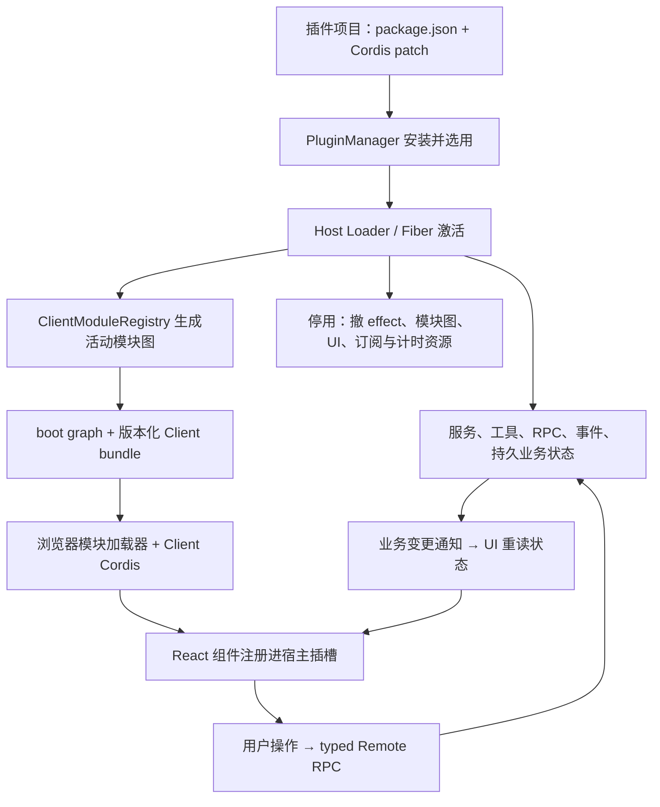

# Harness 插件如何融入客户端：完整链路与 Aether 差距

调研日期：2026-11-12。源码基线：`D:/dev/deepseek-harness`，提交 `fcc0ad462172522aaf5c93a7b2e01f6b9f0b0159`（`0.2.2-rc.1`）。本轮没有修改 Aether 产品代码、安装第三方插件或操作生产数据。

## 1. 更正之前的范围

用户记得正确：Harness 的持久插件可以直接扩展当前客户端，包括侧栏、主页面、输入区、工具结果、设置以及其他插件提供的子区域。它具备应用级插件架构，Host 与 Client 都受插件生命周期管理。

之前 Aether 实现的 `apiVersion:1 / runtime:node / tools` 是单次调用的工具插件。模板、独立测试、ZIP 和 Electron 参数修复改善了这个范围，却没有补上客户端扩展。原研究虽然列出了 Host/Client 差异，实现建议和验收仍收缩到了工具包，未满足“像 Harness 一样把功能融入客户端”的目标。

工作树会继续演进：本轮 00:36 之后已观察到新增 `src/plugins/application.ts`、`/plugins/runtime/apps/:id[/invoke]` 和前端 Schema 表单接入。这提供宿主生成的手动工具操作页，不应再概括为“只能聊天调用”。它仍复用 `runPlugin` 的短进程执行，不等于插件作者可声明自己的 React 模块、页面布局、宿主服务或后台生命周期；本轮只核对这段源码，没有替这组并发实现宣称验收通过。

这次沿源代码追踪了持久安装、模块交付、浏览器加载、插槽挂载、真实 UI 操作、RPC、存储、状态回流、卸载及更新边界。文中区分三类证据：源码闭合、局部原源码执行、尚未实施的 Aether 建议。没有把阅读到的 Harness 测试文件计作本轮通过。

## 2. 整体机制



这里有两条不同通道：**模块图/HMR 管代码与 UI 挂载**，**Remote RPC/事件管业务数据与交互**。只让列表收到通知后刷新，并不能加载插件的 React 页面。

## 3. 插件工程：同一个包可有多个入口

官方最小装饰插件模板实际包含：

```text
package.json          # dsh.bundle、dsh.client、exports
cordis.patch.yml      # 向组合配置插入 Host entry
index.js              # Host apply；纯 UI 插件也可为空
client.js             # 浏览器模块工厂
locale/*.json         # 本地化元数据
icon.svg
```

其 `package.json` 声明 `dsh.bundle.patch`、`exports['./client']` 与 `dsh.client.platform='web'`。复杂包可再提供 `./typert`（宿主协议反射）、`./remote`（客户端远程服务贡献）及资源导出；这些不是每个纯 UI 插件的必填文件。

三种相似字段不能混淆：

| 字段 | 用处 | 不是 |
|---|---|---|
| `dsh.client.inject` | 浏览器包依赖图；确保依赖工厂到达，参与 Client entry 组合 | 任意宿主 API 权限清单 |
| 插件导出的 `inject: ['slots', ...]` | Cordis 服务依赖；服务就绪才激活，依赖变化参与生命周期 | npm 安装依赖 |
| `dsh.client.external` | 该浏览器包从宿主模块表请求的额外模块 | 允许随意访问 Node/网络的授权 |

源码：[官方模板清单](D:/dev/deepseek-harness/packages/preset/agent-preset/skills/cordis-plugin-development/templates/decoration/package.json:1)、[实际管理插件多入口](D:/dev/deepseek-harness/packages/client/ui-plugin-manager/package.json:16)、[Client 打包规则](D:/dev/deepseek-harness/packages/client/tsdown.client.ts:775)。

格式只在 DSH/Cordis 运行时内成立。单纯使用相同的 Node/React，不意味着 Aether 可原样运行这些包。

## 4. 安装怎样让浏览器知道有新插件

1. GUI 与 AI 的 `plugin_manager` 都调用同一个 `PluginManager`。
2. 在 profile 内安装依赖，保存 `package.json`/lock、选用的 bundle 与配置 patch。
3. 有 HMR 时重组 profile，Host Loader 激活相应 entry；没有 HMR 时明确返回需要重启。
4. `ClientModuleRegistry` 观察 `internal/plugin`，从活动 entry 解析其包的 `dsh.client` 和 `./client`。
5. 把实际浏览器产物与元数据组成带 revision 的模块图；首屏通过 `__DSH_BOOT__` 注入，运行中通过 `/plugins/events` SSE 推送变化。
6. 浏览器 `entries.sync(graph)` 对增删变化进行协调；`entries.reload(id,rev)` 处理产物替换。

源码：`plugin-manager/src/index.ts:872`、`:1259`；`app-boot/src/index.ts:328`；`client/modules/src/index.ts:680`、`:891`、`:1043`、`:1118`；`client/hmr/src/index.ts:162`、`:176`；`client/hmr/src/client/index.ts:52`。

安装、启用、Host 激活和某个浏览器页面实际挂载是四个不同事实。保存成功不能直接展示成“界面已生效”。Harness 的结果还区分 `failed`、`overridden`、`restart-required`。

## 5. 前端代码如何进入现有界面

### 模块加载和共享运行时

浏览器产物通过以下形式注册：

```js
window.__ModuleLoader__.load({
  id: '@local/my-decoration',
  factory(require) {
    const React = require('react')
    return { inject: ['slots'], apply(ctx) { /* 注册 UI */ } }
  }
})
```

执行脚本只登记工厂；第一次 import/require 才物化 exports，结果被缓存。`react` 等平台模块由 shell 提供同一实例，避免插件再带一份 React 破坏 hooks/context。非共享依赖被编入包；缺失的 external 会明确失败。带内容版本的 bundle URL 避免旧 URL 指向新字节。

真实默认加载器用当前 document 的 `<script src>` 获取代码。它支持同文档 UI 扩展，既不是自动打开外部浏览器，也不是默认给每个插件隔离 iframe。CSS 会记录插件 owner，供替换和卸载清理。

源码：[客户端打包](D:/dev/deepseek-harness/packages/client/tsdown.client.ts:793)、[工厂包装](D:/dev/deepseek-harness/packages/client/tsdown.client.ts:933)、[默认脚本载入](D:/dev/deepseek-harness/packages/client/modules/src/client/system.ts:16)、[module table](D:/dev/deepseek-harness/packages/client/modules/src/client/system.ts:95)、[import](D:/dev/deepseek-harness/packages/client/modules/src/client/system.ts:383)。

### 插槽和可撤销组件

官方模板实际把组件注册到 `conversation.composer.dock`：

```js
ctx.slots.inject('conversation.composer.dock', () =>
  ctx.slots.register({
    name: 'conversation.composer.dock', id: 'my-decoration', order: 5,
  }, Decoration)
)
```

`inject` 等该区域的声明者存在再注册，并处理 owner 重挂；`register` 返回 disposer。插槽不是 DOM 选择器，组件从声明的 props、hooks、store 和服务取得宿主上下文。

支持 single、list、keyed、chain、hoc 等组合方式，分别对应单一位置、排序贡献、按 key 分发、选择链和包裹层。冲突、排序、作用域和卸载都有规则；父贡献移除还会撤掉它声明的子插槽。

源码：[模板实际注册](D:/dev/deepseek-harness/packages/preset/agent-preset/skills/cordis-plugin-development/templates/decoration/client.js:16)、[SlotCore](D:/dev/deepseek-harness/packages/client/ui-slots/src/index.ts:1025)、[注册与生命周期](D:/dev/deepseek-harness/packages/client/ui-slots/src/index.ts:1174)。

### 插件也能扩展其他插件

插件管理页本身通过 `main` 注册页面，通过 `sidebar.panellist` 注册入口；它又声明 `plugins.tab`、`plugins.bundle.config`、`plugins.detail.section`。其他插件可以向这些子槽贡献功能。因而插件市场不必硬塞进同一个管理组件，产品功能能继续组合。

源码：[管理页及子槽](D:/dev/deepseek-harness/packages/client/ui-plugin-manager/src/client/index.ts:129)、[侧栏入口](D:/dev/deepseek-harness/packages/client/ui-plugin-manager/src/client/index.ts:167)。

更直接的双插件例子：独立的 `ui-plugin-market` 包在 `src/client/index.ts:55` 注册 `plugins.tab/discover`；管理页在 `PluginManagerPage.tsx:1732` 真正调用该槽并传入 `install/openPackage`。市场页 `DiscoverSection.tsx:604` 再把安装操作交回宿主。这证明页面扩展和用户操作确实跨两个包连接，无需在管理页静态导入市场组件。侧栏点击则是 `SidebarRoot.tsx:88` → `layout.selectPanel` → `AppFrame.tsx:49` 的 `main` keyed slot，不应假称必然依赖 React Router。

## 6. 实例：带界面的调度任务完整往返

调度功能由 Host ScheduleService 与 Client `ui-schedule` 配合，官方 Web bundle 装配两者。一次点击保存的真实路径为：

```text
TaskDetail 的保存按钮
 → onCreateTask / ctx.remote.schedule.create
 → HTTP POST api/schedule/create（带 rpcId）
 → Gateway 校验参数、调用权限、服务绑定
 → ScheduleService 串行提交任务
 → storageDomain tasks.put → schedule.json 原子写入
 → schedule/changed
 → Remote mux WebSocket
 → 客户端 catalog source 重新读取、丢弃过期响应
 → 现有 React 页面更新
```

源码：[保存动作](D:/dev/deepseek-harness/packages/client/ui-schedule/src/client/TaskDetail.tsx:268)、[接线](D:/dev/deepseek-harness/packages/client/ui-schedule/src/client/index.ts:230)、[RPC 传输](D:/dev/deepseek-harness/packages/client/connection/src/client/rpc.ts:34)、[Gateway](D:/dev/deepseek-harness/packages/api/gateway/src/index.ts:793)、[提交](D:/dev/deepseek-harness/packages/schedule/schedule/src/index.ts:381)、[状态回流](D:/dev/deepseek-harness/packages/client/ui-schedule/src/client/catalog-source.ts:101)。

定时任务由 Host 维持，浏览器页面负责操作和展示。重启后服务重新打开持久域、恢复待投递目标和调度，UI 重连后重读目录。并非让模型调用的短进程一直 sleep，也不能靠浏览器组件里的 setTimeout 保证重启恢复。

具体限制：默认 Schedule 数据位于同一 `$DSH_HOME/storages/schedule.json`，profile 配置独立不等于每租户数据隔离。Session inbox 与任务 receipt 分两次写入，崩溃期间存在重复投递窗口；不能宣称 exactly-once 或把投递回执当作模型已完成任务。

## 7. 为什么 AI 能写出“融入当前应用”的插件

除了模板，它提供实际运行时查询：

- `cordis_inspect_list`：发现 Host/Client 当前有哪些查询 provider。
- `cordis_inspect_query`：读 Service 方法、Event 模式、Config schema、Tool schema。
- Client `Slots.listSubTree`：读真实存在的插槽、owner、已有贡献和参数。
- Client `Theme.listTokens`：读主题 token，便于继承深浅主题。

这些查询不会执行业务操作。Client 信息由页面同步/应答；页面离线或无法应答会超时失败，不凭空假设 API 存在。正确创建流程是发现可用能力 → 取得模板与精确 API → 写持久包 → 安装 → 检查实际激活 → 操作当前应用里的 UI。

源码：[当前模型只读工具](D:/dev/deepseek-harness/packages/extensions/tool-cordis/src/index.ts:25)、[Client 实时插槽与主题查询](D:/dev/deepseek-harness/packages/extensions/cordis-client-runner/src/client/providers.ts:104)、[Client 查询往返](D:/dev/deepseek-harness/packages/extensions/cordis-host-runner/src/inspect-registry.ts:172)。

另有历史动态 Cordis runner，可把内存定义加载为临时 Client/Host 插件，但当前 `tool-cordis` 只注册两个 inspect 工具，不能从历史 `cordis_define` 卡片推断当前默认创建流程。临时定义与跨重启的持久 bundle 必须分开理解。

## 8. 卸载、更新和运行边界

| 维度 | 核实结果 |
|---|---|
| Host 生命周期 | Fiber 持有 effect，逆序调用清理；服务、监听器、计时器和后台任务应登记 owner。任意未登记外部副作用无法自动撤销。 |
| UI 卸载 | Host 停用发 internal/plugin，模块图移除对应行，SSE 推送，Client 撤 entry/Fiber/插槽与所属样式。 |
| 业务权限 | Client 的按钮可见性与 Host Gateway 授权是两层；RPC 仅暴露显式绑定/反射的方法，事件只外发白名单内容。 |
| 信任模型 | 安装的 Host 代码同进程执行，Client 包同文档执行；这些是受信扩展机制，不是每插件操作系统沙箱。 |
| 代码热更新 | Host 可管理依赖、Client 已构建产物和 bootstrap 各有不同边界；改 TS 源文件不等于浏览器产物已重建。 |
| 协议更新 | Typert Loader 按包缓存 reflection 路径和 Promise，当前生命周期内无通用失效；Host 实现热更新不证明 Remote schema 已更新。 |
| 更新失败 | 源码 watcher 的回退与 profile 重组保证不同；后一条新实现失败时旧实现可能已经停用。 |
| 需要重启 | 无 HMR、不可替换 Host 入口、包路径移动或 bootstrap/协议变化等不能笼统显示热生效。 |

详见 [Host 生命周期完整笔记](harness-host-lifecycle-notes.md) 与 [调度插件完整笔记](harness-interactive-plugin-notes.md)。

## 9. Aether 当前缺什么，以及如何对齐目标

| 能力 | Harness | Aether 当前 |
|---|---|---|
| 插件多入口工程 | Host、Client，可选协议与资源导出 | `node + tools` 严格清单 |
| 客户端加载 | 从已激活插件构造模块图、版本化资源 | 无已安装插件 Client loader |
| UI 贡献 | 具名插槽、组件、导航、子槽 | 已新增宿主按 Schema 生成的操作页；尚无插件自定义组件/插槽，内建 view registry 可复用 |
| 宿主交互 | typed Remote、显式方法、事件订阅 | 已有手动 invoke API；底层仍是一次 stdin，退出后读取 result/artifacts |
| 生命周期 | 激活、依赖、停用、等待清理、重挂 | 有进程超时/取消，没有常驻插件 owner |
| 业务状态 | storage-domain 等 Host 服务 | 有版本文件存储，没有插件独立业务状态 API |
| 后台调度 | Host ScheduleService、恢复与通知 | 有产品自动化服务，尚未成为插件委托接口 |
| AI 发现 | 实时 Service/Slot/Theme 查询 | 有工具模板，没有客户端能力发现 |

Aether 锚点：[严格清单](D:/dev/ai-agent-engine/src/plugins/service.ts:13)、[短进程执行](D:/dev/ai-agent-engine/src/plugins/runtime.ts:79)、[Work 页面枚举](D:/dev/aether-code/src/renderer/src/contrib/work/WorkView.tsx:130)、[已有 View 注册](D:/dev/aether-code/src/renderer/src/workbench/view-registry.ts:42)、[已有调度 API](D:/dev/ai-agent-engine/src/api/http/routes/cron.ts:34)。

新增的手动工具路径：[PluginApplication](D:/dev/ai-agent-engine/src/plugins/application.ts:58)、[调用仍落到 runPlugin](D:/dev/ai-agent-engine/src/plugins/application.ts:69)、[runtime apps API](D:/dev/ai-agent-engine/src/api/http/routes/plugins.ts:32)。

若继续按用户原目标实现，应把它作为“应用插件”能力，保留现有工具型插件作为一种插件类型。建议的最小完整纵向实现是：

1. 定义含 Client/Host 入口的版本化工程规范与 SDK；源码修订与业务数据分离。
2. 在 Work 提供有限、稳定的 `页面/侧栏/会话附加区/成果渲染` 等贡献位置，接入 view registry、主题和组件。
3. 提供带 tenant/plugin/revision 身份的 action/state/subscribe 桥；客户端不取得无限制的 engine.request/IDE preload。
4. Host 管插件激活、服务、任务与资源清理；后台能力委托持久调度，避免每次工具进程承担它。
5. AI 能查询可用插槽、Host API、输入输出、版本与示例；UI/Host/组合插件分别有真正可用的模板。
6. 统一观察 installed/enabled/host-active/client-mounted/failed/restart-required，更新与停用同时撤服务和 UI。

这不要求把整个 Aether 改成 Cordis，但必须补齐这些功能之间的连接。仅增加 `ui.html` 字段或打开预览页不足以证明已经支持插件融合。

推荐首个验收对象是**应用内计时器**：AI 仅接受普通需求；安装后当前 Work 出现可操作入口；开始/暂停/取消与剩余时间正确；Host 持久化截止时间；切换会话、刷新页面、重启后的行为有定义；更新后界面及协议一致；停用清理任务/订阅；卸载移除入口但是否删除业务数据单独决定。所有结果必须来自实际插件，而非产品硬编码的计时器演示。

## 10. 本轮实际执行证据

已直接使用 `tsx` 导入未改写的 Harness `ClientModuleSystem`、`entry-lifecycle` 源文件，并执行官方装饰模板原始 `client.js`；以 Node + jsdom 和已有 React 实例提供最小环境，验证工厂懒注册、同一模块缓存、共享 React、CSS owner、缺依赖失败、失效后新工厂生效。

[局部 Loader 实验报告](../../.tmp/harness-client-research-20261112/report.json) 包含源码 SHA-256 和明确未测试项。该实验没有启动完整 Harness、没有实际安装包或真实浏览器 UI 挂载，不是整套产品验收。完整启动/安装/用户可见效果仍需独立环境实测。

另直接导入原始 `SlotCore` 完成注册表机制验证，20 项检查通过：注册/排序/批量通知、同优先级冲突、不同优先级 shadow、父子贡献递归卸载、同 ID 重挂和旧 disposer 不误删新项；执行前后源码 SHA-256 相同。[SlotCore 实验报告](../../.tmp/harness-client-research-20261112/slot-report.json)。它验证的是 registry 真实代码，不包含 React 可见渲染、完整 Loader/Fiber、RPC 或持久化运行。

本轮三份分项笔记：[Host 生命周期](harness-host-lifecycle-notes.md)、[客户端融合](harness-client-integration-notes.md)、[交互及持久化](harness-interactive-plugin-notes.md)。
