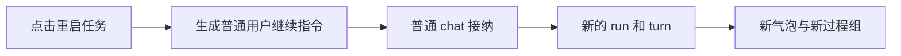

# 会话中断后的续跑：Aether 与 Wuzu Code 实现对比

<!-- documentation-status: historical -->
> 历史资料：保留原有调研、设计或验收条件，不代表当前版本全部行为或本轮测试结果。现行操作与源码入口见[文档首页](../README.md)；文档状态见[全量清单](../documentation-inventory.md)。状态标注：2026-11-17。


调研日期：2026-11-16（Asia/Shanghai）。范围为本机当前工作树，包含未提交修改；HEAD 分别为 ai-agent-engine `5ae9221`、aether-code `7792944`、wuzu-client `00743e92f`。本轮只做源码、协议与既有测试调查，未修改产品实现，未访问真实用户会话、凭据或调用外部模型。

## 结论

截图中的长用户气泡是 Aether 当前恢复设计主动生成的，既不是模型自己说的话，也不是偶发渲染错误。目前“重启任务”相当于在同一个 session 里发送一条预设用户消息，然后建立全新的 run、turn 和回复。`inheritContext` 保住历史，但没有保住原轮身份和显示连续性。

Wuzu Claude Code 的连续体验来自四层配合：恢复原生 session 历史、重新发起模型调用、不展示内部继续指令、把新输出追加到原回复。它还处理旧事件隔离、费用累加和冷历史归并。可借鉴的是完整的任务续接机制，而非单独隐藏一段文字。

源码不支持“停止后恢复了同一次模型计算”的结论。Wuzu 当前兼容代理还会丢弃请求中的历史 thinking/reasoning，再让上游生成新的思考。界面上的连续思考段与模型实际恢复了什么，必须分别判断。不同 Code 引擎的显示也不一致，Claude 路径最接近用户描述。

## 1. 先区分几种“继续”

| 行为 | 是否新模型调用 | 应否新增用户发言 | 恢复什么 |
|---|---|---|---|
| 网络断开后重连 | 不一定；原执行可能仍在运行 | 否 | 事件订阅、快照与显示 |
| 回答审批或提问 | 通常继续后续调用 | 用户回答有独立身份，不伪造任务 | 已停驻的工具与原任务 |
| 手动停止后点继续 | 是，旧请求已经取消 | 不应出现系统生成的用户任务 | 原任务历史、已确认结果、剩余工作 |
| 电脑/引擎重启后继续 | 是 | 不应出现系统生成的用户任务 | 最后持久检查点，不能恢复丢失的进程栈 |
| 编辑后重新发起 | 是 | 是 | 用户修改的新指令，语义不同于继续 |
| 模型供应商的原生前缀/状态恢复 | 取决于供应商协议 | 取决于适配器 | 明确支持的正文前缀或供应商状态，不是通用能力 |

## 2. Aether 为什么出现截图效果

### 2.1 完整调用链

1. [ConversationView.tsx:905](D:/dev/aether-code/src/renderer/src/features/conversation/ConversationView.tsx:905) 的错误操作调用 `restartFailedTask`。
2. [runtime.ts:1079](D:/dev/aether-code/src/renderer/src/features/sessions/runtime.ts:1079) 校验最新失败/中断 run，调用 `nextTurnQueue.restart(runId)`。
3. [next-turn-queue.ts:115](D:/dev/aether-code/src/renderer/src/features/conversation/next-turn-queue.ts:115) 经 IPC 交给主进程持久队列。
4. [next-turn-engine-gateway.ts:121](D:/dev/aether-code/src/main/next-turn-engine-gateway.ts:121) 把“继续本会话中尚未完成的任务，保留已经完成的工作……”设为普通 `draft.text`。这就是截图中的文字来源。
5. [同文件:267](D:/dev/aether-code/src/main/next-turn-engine-gateway.ts:267) 生成普通 `message`；第 293 行附加 `inheritContext=true` 和 `metadata.workRecovery.runId`；第 301 行仍提交普通 `/api/v1/chat`。
6. 引擎源码没有消费 `workRecovery` 的恢复分支。[chat.ts:1434](D:/dev/ai-agent-engine/src/api/http/routes/chat.ts:1434) 走 `createUserAdmission`。
7. [root-runs/index.ts:328](D:/dev/ai-agent-engine/src/storage/root-runs/index.ts:328) 分配新的 `runId`、`turnId`、`userMessageId`、`assistantMessageId`。
8. 新用户消息通过事件发布；[conversation-turns.ts:17](D:/dev/aether-code/src/renderer/src/features/conversation/conversation-turns.ts:17) 根据用户消息及 run/turn 分组，结果自然是新时间点、长用户气泡和另一组过程。



这套设计已有固定恢复项、原请求配置、冻结摘要、精确回执、重复点击去重和未知接纳复核，并非完全没有恢复保护；它的不足是把“继续原任务”实现为“带历史的新任务”。原有流程称为上下文接续；当前继续任务的操作入口和边界见[桌面使用指南](../../../aether-code/docs/user-guide.md)。

### 2.2 主动停止目前还走另一套入口

- 引擎 [chat.ts:408](D:/dev/ai-agent-engine/src/api/http/routes/chat.ts:408) 将主动停止记录为 `cancelled`。
- 前端 `restartFailedTask` 与 gateway 只接受 `failed/interrupted`，不接受 `cancelled`。
- 停止后的 [ConversationView.tsx:908](D:/dev/aether-code/src/renderer/src/features/conversation/ConversationView.tsx:908) 提供“编辑后继续”，由 [runtime.ts:1102](D:/dev/aether-code/src/renderer/src/features/sessions/runtime.ts:1102) 把原文和附件填回输入框。再次发送仍是新轮。
- `resumeStream` 则仅恢复快照与 `/chat/stream` 订阅，不是让已停止任务重新执行，见 [useChat.ts:1476](D:/dev/aether-code/src/renderer/src/core/engine/useChat.ts:1476)。

因此不能只改一个按钮名称，就宣称手动停止、失败、重启中断全部支持同样的续跑。

### 2.3 已有可复用基础

| 基础能力 | 证据 | 对本次改造的意义 |
|---|---|---|
| 同轮审批恢复 | [root-runs/index.ts:508](D:/dev/ai-agent-engine/src/storage/root-runs/index.ts:508) 的 `answer`，第 540 行更新 attempt | 逻辑任务身份与执行尝试已可分离，但不能把终态继续伪装成审批回答 |
| 部分正文与思考持久化 | [react.ts:1117](D:/dev/ai-agent-engine/src/core/agent-loop/react.ts:1117) 的 `persistPartial` | 正常取消/失败时保留部分正文、reasoning、usage 与 partial 状态 |
| 中断工具结算 | [react.ts:1163](D:/dev/ai-agent-engine/src/core/agent-loop/react.ts:1163) 附近的 `settleInterruptedStream` | 不把未完成参数误执行，不遗留不配对工具历史 |
| 引擎重启识别 | [root-runs/index.ts:151](D:/dev/ai-agent-engine/src/storage/root-runs/index.ts:151) | 旧 running 标成 interrupted，明确不自动重执行 |
| 已发布快照/事件恢复 | [chat.ts:1934](D:/dev/ai-agent-engine/src/api/http/routes/chat.ts:1934) 的 snapshot 路径 | 展示恢复已有权威检查点；仍需与模型输入历史的持久边界对齐 |
| 同轮多 assistant 段合并 | [conversation-turns.ts:59](D:/dev/aether-code/src/renderer/src/features/conversation/conversation-turns.ts:59) | 不必覆盖旧消息，只需明确续接归属即可统一过程显示 |
| 可发现、续跑已有子代理 | [chat.ts:1653](D:/dev/ai-agent-engine/src/api/http/routes/chat.ts:1653) 附近 `buildSubagentTeamContext` | 不必默认重新创建整支团队；应按子任务检查点选择复用 |

正常取消能够执行 `finally`/结算；断电、强杀未必能执行。因此“保存部分内容”不能直接等同于“突然重启后最后一个屏幕字符一定进入模型历史”。需要专门验收已发布水位与持久化水位的一致性。

## 3. Wuzu Claude Code 的无缝链路

### 3.1 后端恢复原生 session，而非旧 HTTP 流

- [SdkClaudeProvider.ts:1767](D:/web/wuzu-client/src/main/engine/cliProvider/SdkClaudeProvider.ts:1767) 的 `continueSessionWithId` 找回 native session、cwd、模型、system prompt、skills/MCP 等配置。
- 第 1839 行校验原转录是否存在；缺失时有降级新 native session 的路径，不能把它算成原上下文完整恢复。
- 第 1852 行修复 JSONL 粘行与 parentUuid 链。
- [同文件:2005](D:/web/wuzu-client/src/main/engine/cliProvider/SdkClaudeProvider.ts:2005) 停止时 abort 并 close query；第 2469 行同会话串行等待旧轮收尾，避免并发写旧转录。
- [同文件:3295](D:/web/wuzu-client/src/main/engine/cliProvider/SdkClaudeProvider.ts:3295) 设置 `options.resume`，第 3482 行重新调用 `sdk.query`。

### 3.2 前端复用原回复，并隔离旧尝试的迟到事件

[claudeCliChat.ts:2248](D:/web/wuzu-client/src/renderer/src/stores/claudeCliChat.ts:2248) 的专用继续动作：

1. 找最后一条可继续的 assistant 锚点。
2. 保留正文、思考、工具轨迹，清除旧错误和“已停止”等占位。
3. 不新增用户气泡，也不创建新 assistant。
4. 把已有 usage 作为新尝试的统计基数。
5. 第 2354 行将 `streamingMsgId` 指向原 assistant ID。
6. 创建新的 round 绑定，再发起新的 IPC 调用。

[claudeCliChat.ts:162](D:/web/wuzu-client/src/renderer/src/stores/claudeCliChat.ts:162) 的 `RoundBinding` 以及第 231 行的复用检测，阻止旧轮迟到的 done/error 把新的运行关闭。视觉复用必须配套这种隔离。

正常继续会发固定内部 prompt“请继续上一次未完成的输出，从中断处接着写。”。这条消息真实进入 CLI 转录，只是不展示为用户发言。若原输入根本没有送达，则发送原输入而不是盲目继续；存在未完成子代理时还会构建专门恢复信封。

### 3.3 为什么思考看起来从断点接上

[claudeCliReducer.ts:25](D:/web/wuzu-client/src/renderer/src/stores/claudeCliReducer.ts:25) 查找末尾尚未封口的 thinking 段；第 475 行把新 `thinking_delta` 追加进去。停止时的 `closeDanglingToolStarts` 收口工具，不强制封口 thinking。新尝试又复用相同 assistant，因此新思考可接在旧思考后面。

遇到 `thinking_end` 或工具边界则不能任意跨段拼接。这是明确的显示归并规则，不是模型内部执行指针。

### 3.4 重启、分页、导出也遵循归并语义

- [transcriptParseCore.ts:378](D:/web/wuzu-client/src/main/engine/cliProvider/history/transcriptParseCore.ts:378)：内部继续指令仅设 `resumePending`，不清 `currentAssistant`；普通用户输入才开启新边界。
- 第 437 行在新尝试实际产生响应后接管状态，旧悬挂工具标为“已中断（后续已继续）”，并未冒充成功。
- 第 544、547 行追加正文和思考；同步解析器 [historyReader.ts:384](D:/web/wuzu-client/src/main/engine/cliProvider/history/historyReader.ts:384) 有对应处理。
- 前端首次加载和向前分页继续过滤控制消息，翻页游标仍来自后端，整页只有隐藏消息时不会误判没有更多历史。

值得借鉴的是实时与读档一致；不值得照抄的是 [hiddenContinueResume.ts:91](D:/web/wuzu-client/src/main/engine/cliProvider/history/hiddenContinueResume.ts:91) 附近按固定正文/短前后缀识别控制消息的兜底。Aether 应按可信控制事件身份判断，否则用户恰好输入同样的话也可能被隐藏。

## 4. 不能把所有 Wuzu 引擎都称为同一种恢复

| 路径 | 原生上下文恢复 | 实时展示 | 冷历史 |
|---|---|---|---|
| Claude Code | `options.resume` + 新 `sdk.query` | 复用原 assistant，思考/正文可继续追加 | 隐藏控制 user，保持原 assistant 归并 |
| Codex | `thread/resume` + 新 `turn/start` | 不插 user，但创建新 assistant 占位 | 是否合并受原 rollout 的 `task_complete` 边界影响 |
| Lobster | 通过 session ID 续轮 | 隐藏 `_continueResume` 指令 | 注释明确不保证真正断点续写 |
| OpenCode runner 分支 | 所查路径只执行 `opencode run <prompt>`，未传 resume/session 参数 | 不能套用 Claude 的保证 | 本次未证明具有原生会话续接 |

Codex 的实际停止是 `turn/interrupt`，见 [CodexCliProvider.ts:477](D:/web/wuzu-client/src/main/engine/cliProvider/CodexCliProvider.ts:477)；恢复和新调用在 [CodexAppServerManager.ts:381](D:/web/wuzu-client/src/main/engine/cliProvider/codexAppServer/CodexAppServerManager.ts:381)、第 441 行。

Codex 前端新建 assistant 的证据在 [codexCliChat.ts:1133](D:/web/wuzu-client/src/renderer/src/stores/codexCliChat.ts:1133)。其冷历史跳过隐藏输入时不清 `currentId`，但真实 user 或 `task_complete` 会清，见 [codexHistoryReader.ts:547](D:/web/wuzu-client/src/main/engine/cliProvider/history/codexHistoryReader.ts:547)。这种实时/冷历史潜在差异不应复制到 Aether。

Lobster 限制见 [lobsterCowork.ts:2846](D:/web/wuzu-client/src/renderer/src/stores/lobsterCowork.ts:2846)。OpenCode runner 见 [openCodeRunner.ts:57](D:/web/wuzu-client/src/main/openCodeProxy/openCodeRunner.ts:57)。

## 5. 思考恢复、正文续写、上下文复用不是同一件事

### 5.1 Wuzu 当前代理链路的反证

Claude provider 实际把 `ANTHROPIC_BASE_URL` 指向本地代理（[SdkClaudeProvider.ts:2776](D:/web/wuzu-client/src/main/engine/cliProvider/SdkClaudeProvider.ts:2776)）。代理选择真实模型后在 [openCodeProxy.ts:613](D:/web/wuzu-client/src/main/httpServer/handlers/openCodeProxy.ts:613) 调用 `anthropicMessagesToOpenaiChat`：

- [cliProtocolTranslator.ts:151](D:/web/wuzu-client/src/main/httpServer/handlers/cliProtocolTranslator.ts:151) 收集 text/tool/image，没有历史 thinking/signature 回传分支。
- 第 212 行明确跳过只剩 thinking 的中断 assistant，避免发空消息。

Codex 的 `wire_api: responses` 也指向本地代理（[CodexAppServerManager.ts:690](D:/web/wuzu-client/src/main/engine/cliProvider/codexAppServer/CodexAppServerManager.ts:690)）。[openCodeProxy.ts:990](D:/web/wuzu-client/src/main/httpServer/handlers/openCodeProxy.ts:990) 调用转换器，其中 [responsesProtocolTranslator.ts:320](D:/web/wuzu-client/src/main/httpServer/handlers/responsesProtocolTranslator.ts:320) 明确跳过 reasoning item。

所以在这些兼容通道中，新思考能够接在旧思考后面显示，并不意味着旧 thinking 已原样回传模型，更不意味着复活了被取消的计算。原生 SDK 某些 signed-thinking/截断恢复声明，也不能替代当前实际代理链路的证据。

### 5.2 我们当前适配器的基础和缺口

- Aether 的 OpenAI 兼容转换会把保留的 `reasoningContent` 映射为 `reasoning_content`，见 [openai.ts:479](D:/dev/ai-agent-engine/src/core/llm-adapter/openai.ts:479)、第 498 行。是否被具体服务接受、使用，仍取决于模型、thinking 配置和网关。
- `LLMResponse`/`LLMStreamChunk` 主要保存 reasoning 字符串，见 [types.ts:3](D:/dev/ai-agent-engine/src/core/llm-adapter/types.ts:3)，没有通用的供应商 opaque continuation state 契约。
- Anthropic 转换由正文、工具重建消息，没有通用的完整 signed-thinking 块恢复链，见 [anthropic.ts:204](D:/dev/ai-agent-engine/src/core/llm-adapter/anthropic.ts:204)。不能把展示用思考字符串伪装成供应商签名块。
- 低层 OpenAI 兼容适配器已有 `options.prefix`/`prefix:true` 支持（[openai.ts:811](D:/dev/ai-agent-engine/src/core/llm-adapter/openai.ts:811)），但 ReAct 构建请求选项没有接入继续场景。它目前只是正文前缀入口，不能宣称已实现 DeepSeek 中断思考续接；还需按端点和模型验证。
- 供应商缓存命中、会话 ID 复用、原气泡复用都不能证明恢复了同一推理进程；重发历史仍可能产生输入费用。

截图能看到 DeepSeek 模型名称，但本轮未读取这次运行的真实配置或请求，所以不判断该截图使用哪个 apiFormat，也不声称已经对该模型做过在线断点验证。

## 6. 建议的 Aether 实现方式

以下为设计建议，尚未实施。

### 6.1 建立可信的 continue 操作

继续请求携带原 session/run/turn、预期版本、检查点及幂等键。引擎校验最新可恢复任务、原 owner 已结束、没有新一轮竞争，然后创建新的 execution attempt；逻辑 turn、原用户输入与显示锚点保持稳定。旧 attempt 的取消/失败事实保留，不修改为成功。

可扩展现有 root attempt 模型，也可建立显式 continuation 记录；无论选哪种，都不能只让前端按文本猜归属。终态重新执行需要独立接纳和新 authority，不能直接复活旧权限或套用某个工具的审批回答。

继续指令作为引擎生成的控制上下文保留来源与审计证据；普通消息列表不伪装一条用户发言。用户真正手输“继续”仍属于用户输入，不因正文相同而被吞掉。

### 6.2 恢复时先确认执行事实

| 中断处状态 | 继续策略 |
|---|---|
| 模型仅产生部分正文/思考 | 保留部分输出，按供应商能力构建下一请求 |
| 工具参数尚未完整生成 | 保留中断记录，让模型重新决定；禁止执行残缺参数 |
| 工具已确认成功 | 使用原结果，不重放副作用 |
| 工具未启动 | 依据当前需求重新规划 |
| 工具开始执行但缺少可靠结果 | 先查真实命令、文件或外部任务状态，不能一律当成未执行 |
| 提问/审批仍有效 | 保持等待或使用原交互恢复，继续按钮不能绕过保护 |
| 子代理已经完成 | 使用其结果；需要补工再在原子会话发起新 attempt |
| 子代理被用户单独停止 | 保留停止意图，不因主任务继续而自动全体复活 |

复用现有队列的冻结请求和精确回执。未知响应只复核原操作；重复点击、重启或网络重试不得重复创建 attempt。

### 6.3 前端统一逻辑回复，持久层保留真实分段

- 原用户气泡、原过程折叠位置、回复锚点不变，不再生成长“继续任务”气泡。
- 后续正文和可展示思考进入同一逻辑回复；内部保留 attempt/segment 边界，不把新推理冒充原请求未中断。
- 旧事件按 attempt 与事件序号隔离；去重按身份，不能用正文相等去重。
- 旧错误在新执行确认启动后收起；恢复失败仍可诊断。
- usage 累加全部物理请求一次，保留估算/未知标识；继续不归零、不重复累加。
- 成果、变更、附件、计划、复制/导出/搜索、历史分页和回退按同一逻辑轮归属；回退不能只撤最后一次 attempt。
- 正常断线重连不触发 continue；手动停止必须保持停止，只有用户明确继续才启动新尝试。

这可以沿用现有 `sessionConversationEntries` 的多段合并能力，不需要重写已保存的原始消息。

### 6.4 按供应商能力恢复，而非一个通用 prompt 包办

建议显式区分：普通历史重发、正文前缀续写、允许回放的 reasoning、原生 signed/opaque state。恢复时固定原模型与协议；若用户换模型则明确走可迁移历史路径，不把旧供应商私有字段塞给新模型。

先完成通用的原任务连续体验；对截图中的实际 DeepSeek 网关再做受控线缆级验证，比较第一次中断内容、第二次实际请求、返回增量与用量，验证前缀接口是否适用。不能依据注释或界面连贯就宣称逐 token 断点恢复。

### 6.5 与现有存储设计一致

检查点元数据、状态和索引可沿用现有事务存储；正文、思考、工具大结果沿用会话 JSONL/内容文件。不要为了继续能力把完整轨迹复制回 SQLite 或在内存无限保留。流增量按有界批次持久化，在取消/关流时结算；突发崩溃按已确认持久水位恢复，不能将未落盘尾部伪装成完整。

## 7. 实施顺序及验收

建议顺序：引擎 continuation 接纳与 attempt 隔离 → 恢复检查点/工具事实核验 → 前端同轮投影 → 冷历史/回退/成果/用量一致性 → 各供应商增强。引擎和前端应成套交付；只隐藏截图文字不算完成。

最低验收矩阵：

1. 正文中途停止、思考中途停止、工具参数半截停止，继续后保留旧内容、不执行残缺工具。
2. 工具运行中停止，包含已完成、未启动、结果未知三种情况，不重复副作用。
3. 主动停止后保持静止；连续点继续、响应丢失、应用重启均只启动一次新 attempt。
4. 旧 attempt 的迟到 done/error/usage 不能影响新 attempt。
5. 子代理活跃/完成/失败/用户单独停止时，分别复用正确上下文和状态。
6. 实时、刷新、应用重启、分页、导出显示一致，不出现内部用户气泡或重复过程。
7. 一轮跨多个 attempt 的成果、变更、用量、回退归属一致；权限与源码冲突保护不可绕过。
8. 切模型、上下文压缩、原转录缺失和旧检查点失效时如实降级，不能假称恢复成功。

## 8. 本次实际验证

所有测试使用 mock/合成数据或隔离数据库，没有调用真实模型。未运行会扫描本机真实 Codex 转录的 `codexRolloutRealFile.test.ts`。

| 项目 | 范围 | 结果 |
|---|---|---|
| ai-agent-engine | history-capabilities、tool-batch-settlement、root-runs | 3 文件，55 项通过 |
| wuzu-client 前端 | claudeCliChat.lifecycle、claudeCliChat.history、hiddenContinueResume、claudeCliReducer.timeline | 4 文件，54 项通过 |
| wuzu-client 后端 | hiddenContinueResume、claudeSessionRecovery、harnessInjectionFilter、codexRolloutNewFormat | 4 文件，51 项通过、1 项失败 |

Wuzu 的失败位于 `harnessInjectionFilter.test.ts:174`，两个历史解析器返回的 `nativeMessageId` 字段不一致。该用例前面的隐藏继续消息、续写正文及状态断言通过；本轮没有修改参考项目或把结果说成全绿。

引擎运行命令：

```powershell
$resumeAuditTemp = Join-Path (Get-Location).Path '.e2e-tmp\resume-audit-20261116\temp'
New-Item -ItemType Directory -Force -Path $resumeAuditTemp | Out-Null
$env:TEMP = $resumeAuditTemp
$env:TMP = $resumeAuditTemp
npx vitest run src/core/llm-adapter/__tests__/history-capabilities.test.ts src/core/agent-loop/__tests__/tool-batch-settlement.test.ts src/storage/root-runs/root-runs.test.ts --reporter=dot
```

Wuzu 前端运行命令：

```powershell
npm test -- run src/renderer/src/stores/claudeCliChat.lifecycle.test.ts src/renderer/src/stores/claudeCliChat.history.test.ts src/renderer/src/utils/hiddenContinueResume.test.ts test/claudeCliReducer.timeline.test.ts --no-cache --fsModuleCachePath .e2e-tmp/resume-research/vitest-cache --reporter=dot --silent=passed-only
```

Wuzu 后端运行命令：

```powershell
node scripts/run-vitest.mjs run --project node test/main/engine/cliProvider/hiddenContinueResume.test.ts test/main/engine/cliProvider/claudeSessionRecovery.test.ts test/main/engine/cliProvider/harnessInjectionFilter.test.ts test/main/engine/cliProvider/codexRolloutNewFormat.test.ts --reporter=dot
```

本轮未改变 Wuzu 用户动作，不涉及新增埋点；未更改插件公开能力，因此没有新增插件 API 文档或接受文档快照。测试通过验证的是所覆盖的本地恢复/投影契约，不是供应商内部推理状态恢复。
