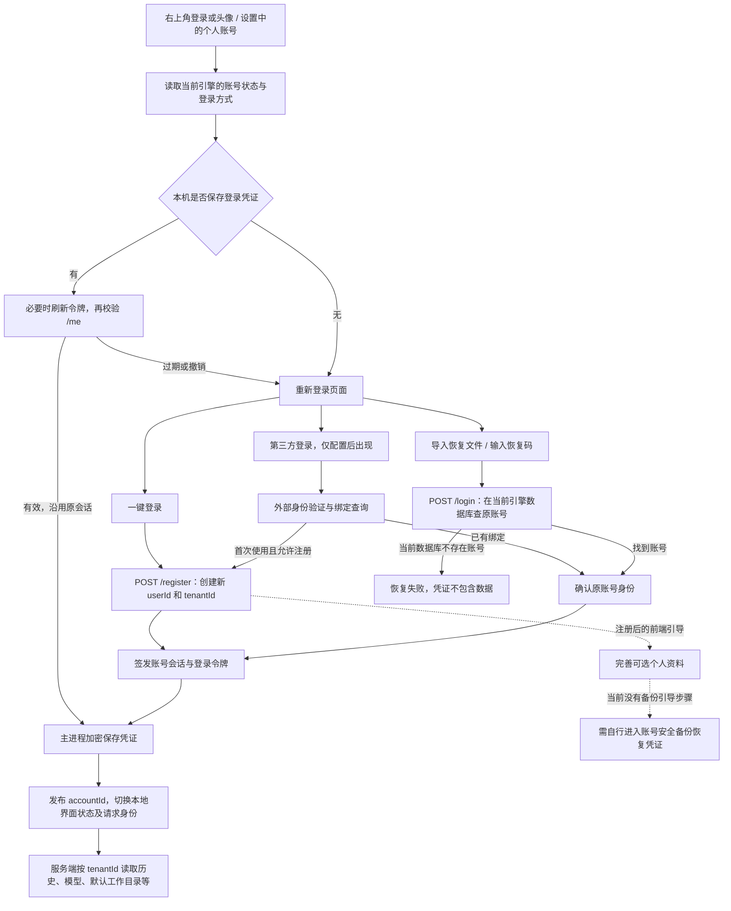
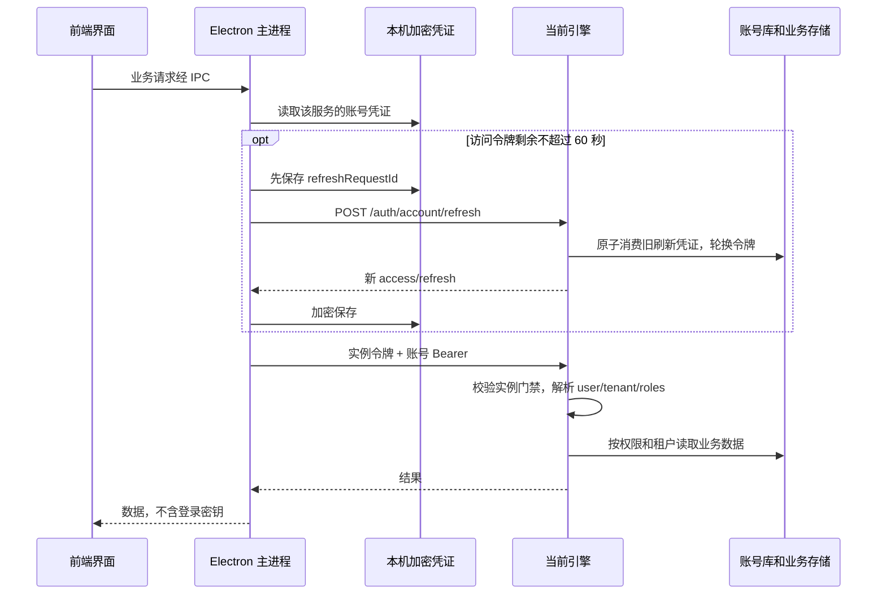
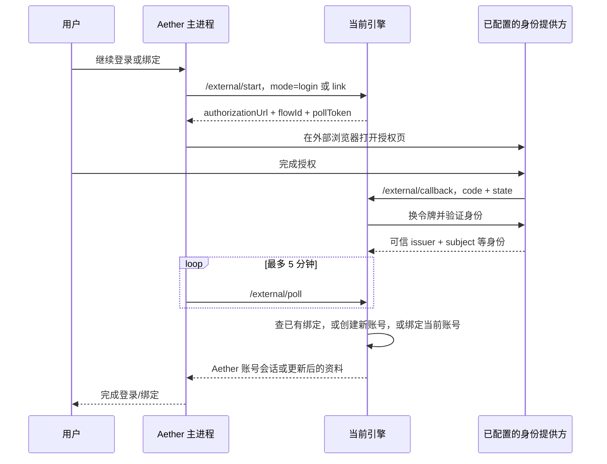

# Aether 账号登录全链路调研

日期：2026-11-17（Asia/Shanghai）

后续状态：本文保留整改前的调研证据；本轮已实施的流程简化与问题修复见 [账号流程简化](./2026-11-17-account-simplification.md)。下文的旧界面文案与问题描述不代表整改后的行为。

范围：`D:/dev/aether-code` 与 `D:/dev/ai-agent-engine` 当前源码、用户提供的设置截图，以及隔离测试。此次未修改产品代码、未操作用户正在使用的窗口、未读取生产账号数据库或密钥。以下“当前行为”指源码实现；未核对截图所运行二进制的构建身份，未使用真实第三方账号进行授权。

## 1. 结论

当前体系已经具备账号注册、恢复登录、令牌刷新、第三方绑定、会话撤销与租户隔离。主要体验问题是：界面没有说明“当前连接的服务”“用户身份”“数据空间”“凭证备份”各自是什么，且一些操作名称与真实副作用不一致。

- “一键登录”实际每次创建新账号和新数据空间，不会自动找回此前账号。
- 账号保存在当前引擎数据库中。连接同一远程引擎可以访问同一账号的服务端数据；独立的两台本地引擎没有自动账号同步或数据同步。
- 恢复文件只是登录凭证。删除引擎数据后，不能靠这个文件重建账号、会话或工作区。
- 匿名本地空间与新账号空间不同，首次登录没有迁移引导。因此登录后可能看到空的历史、模型列表或新工作区，退出后又看到旧的匿名数据。
- 动态复现了“登录后技能目录反而无法读取”。另确认“备份”在缺少本地恢复码时会调用恢复码轮换，可能让其他设备退出。

## 2. 必须分清的四层

| 层 | 解决什么问题 | 当前实现 |
|---|---|---|
| 引擎连接 | 请求发给哪台服务 | 本机内置引擎，或设置中的远端地址；实例令牌用于连接门禁 |
| 用户身份 | 当前请求是谁 | 账号会话；另外兼容高级 API Key/JWT；邮箱仅为资料 |
| 数据空间 | 读取哪一组历史、模型等 | `tenantId`；本地匿名为 `default`，新账号为新的 `account_<UUID>` |
| 本机登录保存 | 重启后如何继续使用该身份 | Electron 主进程通过系统加密存储保存访问令牌、刷新令牌及可用的恢复码 |

模型供应商 API Key 又是另一类配置：它用于调用模型，不等于账号恢复码，也不等于引擎实例令牌。

证据：[引擎目标与请求凭据](D:/dev/aether-code/src/main/engine/host.ts:140)、[身份解析](D:/dev/ai-agent-engine/src/auth/middleware.ts:18)、[新用户和租户创建](D:/dev/ai-agent-engine/src/auth/accounts.ts:109)。

## 3. 当前用户操作与后端总链路

正常启动时恢复已有会话不调用 `/register`。重新登录会签发新的账号 session，普通 `/me` 只校验并返回原账号资料。

### 分层调用

`AccountSettingsView / account-store` → `window.aether.account` → preload → `account:action` IPC → 主进程 `AccountService` → `engineHost.accountTarget()` → 引擎根路径 `/auth/account/*`。

成功登录后，`accept()` 校验返回结构、清理旧身份关联的流/终端/浏览器资源、保存凭证、发布账号身份。`EngineSnapshot.accountId` 参与前端连接身份及持久化键，因此不同账号的草稿和会话选择分开保存。身份提交后的连接清理失败会作为提示返回，不应把已经完成的登录描述成失败。

证据：[preload](D:/dev/aether-code/src/preload/index.ts:175)、[IPC 与切换清理](D:/dev/aether-code/src/main/ipc.ts:135)、[AccountService](D:/dev/aether-code/src/main/account/service.ts:117)、[前端来源身份](D:/dev/aether-code/src/renderer/src/core/engine/source.ts:11)。

## 4. 前端每个入口实际做什么

| 页面操作 | 实际行为 | 用户需要理解的前提或当前缺口 |
|---|---|---|
| 右上角“登录”或头像 | 打开设置的个人账号页 | 没有独立的账号选择器 |
| 概览右侧刷新图标 | 读取 providers、本地凭证，必要时刷新令牌并请求 `/me` | 是刷新账号状态，不是同步所有工作数据 |
| 一键登录 | `POST /register {}` | 每次创建新身份和新租户；过期页也保留此主按钮 |
| 导入恢复凭证 | 选择不超过 64 KiB 的 JSON，检查版本与服务地址，再调用 `/login` | 文件没有业务数据；本机备份导入本机时放宽地址匹配，但依然要在目标数据库找到原账号 |
| 使用恢复码登录 | 输入凭证后 `POST /login` | 提交前清空输入；失败需要重新输入；兼容旧 API Key，但 UI 未说明该兼容入口 |
| 注册后完善资料 | 可填写姓名、邮箱、简介，或者跳过 | 邮箱不能用于登录或找回账号；没有恢复凭证备份步骤 |
| 保存个人资料 | `PATCH /profile` | 姓名空白时随机生成；前端只编辑 name/email/bio，接口另支持 avatarUrl/userData |
| 第三方“继续” | 未登录为 login；已登录为 link | 取决于服务端 provider 配置；不存在默认可用的 Google/微信等入口 |
| 取消第三方登录 | 终止本机授权轮询 | 不等于撤销第三方平台本身的授权；服务端临时 flow 会过期清理 |
| 解除第三方绑定 | 确认后 `DELETE /identities/:providerId` | 要求最近 10 分钟认证，且必须保留其他可用登录方式 |
| 备份恢复凭证 | 有本地 recoveryKey 就导出；没有则先请求 `/recovery` | 后一个分支是轮换恢复码，会撤销其他会话和旧 API Key，界面未说明 |
| 展开“登录设备” | 只展开内容 | 还要再点击“刷新登录设备”才请求列表 |
| 刷新登录设备 | `GET /sessions` | 返回的是登录会话，不是硬件设备清单；没有设备名、IP、系统信息 |
| 撤销登录 | 确认后删除指定账号 session | 撤销当前 session 后页面变为过期状态 |
| 退出登录 | 清理旧身份资源、撤销服务端 session、清除本机凭证 | 保留服务端账号和数据；本机默认匿名模式可回到 default 空间 |
| 退出所有设备 | 在“账号详情”折叠区里发送 `{all:true}` | 当前设备也退出；位置不容易发现 |
| 信任内网 HTTP | 展示精确地址，经确认后保存该服务的 HTTP 信任 | HTTPS/本机无需该步骤；非本机 HTTP 未信任时阻止账号请求 |
| 引擎设置/高级认证 | 配置服务地址、实例令牌、兼容 API Key/JWT | 与个人账号分散在两页，实际认证优先级没有完全体现在 UI |

证据：[账号界面全部操作](D:/dev/aether-code/src/renderer/src/features/account/AccountSettingsView.tsx:135)、[主进程操作](D:/dev/aether-code/src/main/account/service.ts:253)、[引擎连接设置](D:/dev/aether-code/src/renderer/src/features/settings/EngineSettingsView.tsx:550)。

## 5. 登录前后和换设备时，数据到底在哪里

| 数据 | 当前归属/保存 | 登录或切换的效果 |
|---|---|---|
| 账号资料、第三方绑定、账号 session | 当前引擎 SQLite 的 users/account_* 表 | 只在该引擎数据库可识别；不是全局云账号目录 |
| 对话历史 | JSONL 路径含 tenant/session | 新账号不会自动看到 default 的历史 |
| 模型配置、Agent、知识库 | 存储查询包含 tenantId | 新账号通常进入另一组配置，不自动接管旧匿名配置 |
| 记忆 | tenantId + 记忆范围 + 必要的 sessionId | 不同租户不直接共享；同一租户内还受记忆范围控制 |
| 成果记录及 blob | 按租户定位 | 跟随服务端数据空间，不会被恢复文件打包带走 |
| 默认会话工作目录 | `workspace/<tenant>/<session>` | 新身份/新会话进入独立默认目录 |
| 手动选择的本地项目目录 | 实际本地磁盘目录 | 不会因为登录被复制、移动或云同步；本地单机模式可由不同账号选到同一目录 |
| Skills / MCP 配置 | 全局层或工作区文件 | 不是统一的账号私有存储；还受运行模式、权限门禁影响 |
| 前端草稿、已选会话等 | 设备本地，key 包含引擎端点及 accountId | 切账号会切换状态分区；不是服务端备份 |
| access/refresh/recovery 凭证 | 客户端 userData/accounts 中的系统加密文件 | 只用于继续认证，不包含历史和项目文件 |

源码核对：

- [历史 JSONL](D:/dev/ai-agent-engine/src/storage/conversation/jsonl-history.ts:377)
- [模型租户过滤](D:/dev/ai-agent-engine/src/storage/sqlite/models.ts:100)
- [Agent 存储](D:/dev/ai-agent-engine/src/storage/agent/index.ts:68)
- [记忆范围](D:/dev/ai-agent-engine/src/storage/memory/memory-manager.ts:9)
- [知识库](D:/dev/ai-agent-engine/src/storage/knowledge/kb-repo.ts:17)
- [成果存储](D:/dev/ai-agent-engine/src/storage/results/index.ts:53)
- [默认工作目录](D:/dev/ai-agent-engine/src/workspace/manager.ts:193)
- [手选目录的部署边界](D:/dev/ai-agent-engine/src/workspace/manager.ts:517)
- [MCP 文件配置](D:/dev/ai-agent-engine/src/storage/mcp/mcp-config.ts:47)

特别注意：`workspaceManager.isAuthenticated()` 判断的是部署的 `AUTH_ENABLED`，不是当前请求是否已经个人登录。本地内置引擎默认 `AUTH_ENABLED=false`，所以“登录账号”不等于开启操作系统级的本地文件私有化。以上是核对到的数据归属机制，不代表对所有 API 做了完整的安全审计。

### 典型场景

| 场景 | 当前结果 |
|---|---|
| 本机未登录已用一段时间，再点一键登录 | 新账号新数据空间；旧匿名数据仍在 default，不自动迁移 |
| 退出后再次点一键登录 | 创建另一个账号，原账号数据仍在原租户 |
| 退出后导入原恢复文件，仍连接同一引擎 | 找回该引擎中的原身份，并访问仍存在的原数据 |
| 另一台电脑连接同一远程引擎并恢复原账号 | 可以访问该引擎的账号数据；本地 UI 草稿/本地文件不会自动跟过去 |
| 另一台电脑运行全新的独立本地引擎并导入文件 | 若数据库没有原账号，恢复失败；凭证不创建旧数据 |
| 删除 engine data 后只导入恢复凭证 | 不能恢复已被删除的账号记录、历史与文件 |
| 普通应用重启，系统加密存储可用、会话未过期 | 自动读取加密凭证，必要时刷新，继续原账号 |
| 会话超过固定 30 天，或已被撤销 | 必须真正重新登录；点击新建入口不会恢复原身份 |
| 系统加密存储不可用 | 新保存的登录只在本次运行内存中有效；重启需重新登录，界面有提示 |

## 6. 凭证、鉴权与刷新链路

### 保存边界

客户端持久凭证文件为 `userData/accounts/<SHA256(scope)>.json`。本机 scope 固定为 `embedded`；远端 scope 使用规范化后的完整服务 URL（包括端口和路径）。文件中的凭证通过 Electron `safeStorage` 加密，账号状态广播不包含这些密钥。系统安全存储不可用时，只把登录凭证放内存，磁盘写未登录标记。

桌面内置引擎账号库的默认位置为 `userData/engine/state/agent.db`，由 [engineDataFile](D:/dev/aether-code/src/main/engine/runtime.ts:26) 决定。独立部署由 `DATA_DIR` 决定。本次没有读取这些生产路径。

服务端保存恢复码、访问令牌、刷新令牌的哈希。主要表为 users、account_profiles、account_sessions、account_refresh_tokens、account_access_tokens、account_identities，另有审计、限速、第三方临时流程表。刷新重试结果和第三方流程中的敏感内容以密文保存。

| 项目 | 生命周期 |
|---|---|
| Access token | 15 分钟 |
| Refresh token | 单次消费并轮换，依附账号 session |
| 账号 session | 固定 30 天；刷新不续长总期限 |
| 敏感操作的近期认证 | 真正登录后的 10 分钟内；自动 refresh 不算重新验证 |
| 相同 refresh requestId 的重试窗口 | 5 分钟；不同 ID 重放旧 refresh 会撤销该 session |
| 第三方授权流程 | 最多约 5 分钟，客户端每 1.5 秒轮询 |
| 恢复码 | 未轮换前有效；没有邮箱找回替代流程 |

主进程还有 30 秒检查 tick，约每 60 秒校验一次已保存账号状态。临时网络错误保留凭证并显示离线；refresh 明确返回 401 时标为过期，保留账号资料和已有恢复码。切账号会中止旧请求，避免旧响应进入新账号界面。

账号接口及大部分业务请求先受实例令牌门禁约束；实例令牌不授予用户身份。配置 `AUTH_ENABLED=false` 时，没有用户凭证的请求可进入 default，但显式传入错误凭证不会降级为匿名。账号管理接口要求可撤销的账号 session；高级 API Key/JWT 能访问哪些业务由相应权限决定，不直接等于个人账号已登录。

证据：[凭证存储](D:/dev/aether-code/src/main/account/credential-store.ts:17)、[自动刷新](D:/dev/aether-code/src/main/account/service.ts:129)、[后端令牌实现](D:/dev/ai-agent-engine/src/auth/accounts.ts:8)、[请求门禁](D:/dev/ai-agent-engine/src/api/http/middleware.ts:106)。

## 7. 第三方登录全链路

后端支持 OIDC、OAuth2、外部 credential 校验三类提供方。第三类不走浏览器，调用 `/external/credential` 后由服务端请求可信校验地址。默认 provider 配置是空数组；浏览器流程还需服务端配置回调公开地址及加密密钥。截图未显示第三方入口，不能据此认定这些能力已经部署可用。

第三方身份按 `(providerId, issuer, subject)` 唯一识别，不按相同邮箱合并。已登录时“绑定”可保留当前账号；未绑定过的第三方身份在“登录”时会新建账号（须允许注册），容易与此前恢复码账号形成两个数据空间。

证据：[流程接口](D:/dev/ai-agent-engine/src/api/http/routes/account-external.ts:78)、[提供方配置与验证](D:/dev/ai-agent-engine/src/auth/account-providers.ts:151)、[身份关联](D:/dev/ai-agent-engine/src/auth/accounts.ts:250)。

## 8. 前端状态及异常恢复

| 状态 | 页面呈现 | 可进行的主要操作 |
|---|---|---|
| 未登录 | 无用户资料，显示登录区域 | 新建、导入、恢复码、已配置的第三方登录 |
| 已登录 | 隐藏恢复登录区域，显示资料与安全设置 | 编辑资料、绑定/解绑、备份、设备会话、退出 |
| 登录过期 | 保留缓存资料，显示“重新登录” | 恢复登录；仍显示容易误点的新建按钮；已有恢复码可导出 |
| 离线 | 保留缓存资料，登录按钮禁用 | 可本机退出；有恢复码时可备份，无恢复码仍需要联网生成 |
| 账号服务不可用 | 登录按钮禁用、显示错误 | 进入引擎设置或手动刷新 |
| 等待内网连接确认 | 提示服务地址与 HTTP 信任 | 确认后才能发送账号凭据 |

主要操作有 busy 防重入，迟到响应按引擎来源/账号身份检查。问题主要集中在“错误之后怎么继续”：重新验证只有错误文本，没有完成验证后自动继续原操作的流程；不同鉴权错误也没有统一引导到实例令牌、用户账号或管理员权限对应页面。

## 9. 已确认的问题及优先级

| 优先级 | 问题 | 证据等级 | 建议 |
|---|---|---|---|
| 高 | “一键登录”=注册，过期页也突出显示，容易新建空账号 | 前后端代码互证 | 改为明确的“创建新账号”；过期页优先恢复原身份 |
| 高 | 数据所属服务和空间不可见，恢复/同步文案超出实现 | 文件格式探针 + 数据层核对 | 常驻显示本机/远程服务及当前空间，明确恢复文件仅用于登录 |
| 高 | 首次注册没有匿名数据去向说明 | 新 tenant 生成 + 存储分区 | 设计“保留本机空间/迁入账号”的明确选择；迁移需另做完整方案，不能直接改 tenant 字段 |
| 高 | 登录后技能目录被权限拒绝 | 真实 Fastify/SQLite 动态复现 | 分离可用目录读取与管理写入权限，审阅 tenant-admin 的实际界面能力；不应直接给所有新账号实例 admin |
| 高 | “备份”在无本地恢复码时暗中轮换 | 真实主进程代码隔离探针 + 后端轮换实现 | 将“导出已有凭证”与“重新生成恢复码”拆开，明确旧码/其他会话失效后果 |
| 高 | 10 分钟近期认证要求没有原地重验入口 | 前端按钮状态与后端门禁互证 | 敏感操作触发重验对话框，成功后回到原操作，不强迫退出账号 |
| 高 | 可选资料优先于恢复准备，退出会清除本机唯一恢复码 | 注册引导与退出实现 | 引导优先确认可恢复方式，提供恢复码查看/复制/导出与备份状态；允许合理跳过 |
| 中 | 曾经账号登录再退出后，显式保存高级 API Key/JWT 仍可能不发送 | 完整静态分支追踪，未在真实窗口复现 | 明确显示当前生效的认证来源，显式切换时处理 account-managed 标记 |
| 中 | “登录设备”只有当前/其他和时间，无法辨识具体设备 | API 数据契约 | 收集必要设备标签，改称“登录会话”或完善设备信息；展开首次读取 |
| 中 | 没有邮箱验证/邮箱找回，用户填写邮箱却可能误以为可恢复 | profile/login 接口核对 | 在资料与恢复流程解释邮箱作用；若引入邮箱登录需新增完整验证协议 |
| 中 | 新账号对实例级设置权限不足，界面未对应收敛 | guards 与 PUT /settings 静态核对 | 区分设备设置、账号设置、服务管理员设置，按能力展示可操作项 |

### 两个重点证据

技能读取探针在本地单机配置 `AUTH_ENABLED=false` 下执行：

| 请求 | HTTP 状态 | 业务 code |
|---|---:|---:|
| 匿名 `GET /skills?available=1` | 200 | 200 |
| `POST /auth/account/register` | 200 | 200 |
| 新账号 token 读取同一技能接口 | 200 | **41015** |

原因是新账号只有 `tenant-admin`，而整个技能路由组，包括只读列表，都要求 `admin` 或 `skill-manager`。本地匿名被角色门禁放行，个人登录后进入真实角色检查。[技能门禁](D:/dev/ai-agent-engine/src/api/http/routes/skill-imports.ts:247)、[角色守卫](D:/dev/ai-agent-engine/src/auth/guards.ts:21)。

备份的隐藏分支常见于“新设备通过已有第三方绑定登录”：服务端无法重发旧恢复码明文，客户端没有 recoveryKey，于是 `exportRecovery()` 调用 `/recovery`。后端轮换会废弃旧码、旧 API Key，撤销其他账号 session；超过登录后 10 分钟又会拒绝该操作。已登录界面此时没有恢复码重验入口。[备份分支](D:/dev/aether-code/src/main/account/service.ts:294)、[轮换副作用](D:/dev/ai-agent-engine/src/auth/accounts.ts:238)。

高级认证缺口：退出写 `signedOut:true`，读回后仍 `managed:true`；`requestHeaders()` 仅在 `!account.managed` 时才采用高级凭据。设置页显式保存 API Key/JWT 只写另一套 secret 文件，没有清除此标记。因此“已配置”与“生效中”可能不同。[持久标记](D:/dev/aether-code/src/main/account/credential-store.ts:29)、[选择分支](D:/dev/aether-code/src/main/engine/host.ts:164)、[高级凭据保存](D:/dev/aether-code/src/main/engine/remote-auth.ts:46)。

## 10. 建议的产品流程（尚未实施）

建议优先明确产品边界，再调整布局：

1. **本机使用**：清楚标为“本机空间”，说明无需账号即可使用；登录入口说明是否切换数据空间，避免让用户以为必须登录才能保留工作。
2. **连接远程服务**：先选择服务并完成连接门禁，再展示该服务的可用登录方式；地址与服务身份始终可见。
3. **已有账号优先**：恢复文件和恢复码合并为“登录已有账号”的两个输入方式；“创建新账号”独立且明确，不在过期页冒充继续登录。
4. **新建后先保证可恢复**：先绑定可靠登录方式或备份恢复凭证，个人资料稍后完善；同时交代旧本机数据的去向。
5. **安全操作形成闭环**：导出、重置、重新验证分别命名，重验后继续之前的操作。设备会话应可辨识。
6. **权限与界面同步**：普通账号可用的读取能力要可达，实例管理员操作单独展示；明确当前到底采用账号、API Key 还是 JWT。

若目标是“同一个 Aether 账号在任意独立本地引擎登录后，工作自动跟随”，还需要统一身份服务、账号与实例授权关系，以及数据同步/迁移机制。这超出了当前恢复码登录功能，不能仅通过更改登录页面文案达成。

## 11. 验证记录与边界

- 现有后端测试：`accounts` 40、`account-external` 10、`account-providers` 19、`account-terminal` 9、`boundary` 2，共 **80 项通过**。覆盖真实 Fastify/SQLite、令牌轮换和重试、租户/权限、第三方验证、终端撤销。第三方使用隔离身份服务，不是真实用户授权。
- 主进程备份探针：执行真实 `service.ts`，Electron、网络和凭证存储使用测试替身，**4 项通过**：已有码无网络导出、文件仅有 5 个凭证字段、无本地码调用轮换、近期认证拒绝不写备份或覆盖凭证。
- 技能权限探针：真实认证 hook + accountRoutes + skillImportRoutes，复现匿名读取成功、新账号读取失败。
- 没有修改 UI 或后端业务代码，没有重建/重启用户当前应用。前端当前可发现的账号专属 E2E 是帮助浮层测试，不等于已覆盖完整注册、恢复、第三方、切账号流程。本轮前端结论来自源码链路和上述隔离主进程探针。
- 本轮是登录产品与实现调研，不是全部资源权限的安全认证，也不是数据同步功能验收。

诊断证据统一位于 `.e2e-tmp/login-audit/`：

- [后端测试日志](D:/dev/ai-agent-engine/.e2e-tmp/login-audit/auth-tests.log)
- [技能权限复现](D:/dev/ai-agent-engine/.e2e-tmp/login-audit/skill-login-boundary.log)
- [主进程备份检查结果](D:/dev/ai-agent-engine/.e2e-tmp/login-audit/frontend-backup-probe-result.json)
- [前端按钮与状态笔记](D:/dev/ai-agent-engine/.e2e-tmp/login-audit/frontend-notes.md)
- [后端协议笔记](D:/dev/ai-agent-engine/.e2e-tmp/login-audit/backend-notes.md)
- [数据与连接范围笔记](D:/dev/ai-agent-engine/.e2e-tmp/login-audit/integration-notes.md)
