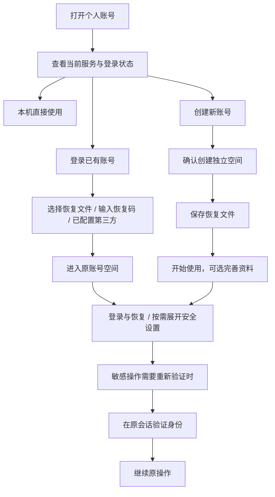

# 账号流程简化与已知问题修复

本次实现同时涉及 `ai-agent-engine` 与同级 `aether-code`。沿用现有账户、租户和凭证存储，不迁移或清除用户数据。

## 用户流程

未配置第三方登录时，不展示相关入口。登录过期时优先显示“重新登录”，不显示“创建新账号”。本机匿名数据保留，创建账号不会自动把旧记录迁入新空间；恢复文件是登录凭证，不是业务数据备份。

## 已实施的修复

| 问题 | 当前行为 |
| --- | --- |
| 一键登录实际创建新账号 | 明确区分登录已有账号与创建；创建前说明独立空间 |
| 注册后不知如何再次登录 | 首步提示保存恢复文件，可稍后；资料按需展开 |
| 导出备份隐式轮换恢复码 | 仅导出现有恢复码，缺失时明确提示；重新生成独立确认 |
| 无法获取已有恢复码 | 提供主进程复制入口，公开状态不携带恢复码明文 |
| 敏感操作超过十分钟只能退出重登 | 恢复码或已绑定第三方原地验证，然后继续原操作 |
| 会话列表需要额外刷新才出现 | 展开时读取，刷新按钮只保留图标；显示创建时间与短标识 |
| 普通账号读取可用技能被拒绝 | 精确开放运行时可用目录；管理与工作区边界保留 |
| 设置可编辑但保存失败 | 后端返回可信管理权限，技能/并发设置按权限展示 |
| 已配置高级凭据但不生效 | 显示实际认证方式；退出后仅显式保存新输入才重新启用 |
| 同服务更换高级凭据沿用旧缓存 | 身份指纹隔离缓存与请求，旧浏览器连接使用旧认证清理 |
| 键盘聚焦账号按钮时看不到焦点 | 为账号页及恢复、重验弹窗补齐可见焦点环 |

## 实现边界

- 账号仍属于当前服务数据实例，不增加统一云账号、跨服务同步、数据迁移或邮箱找回。
- 重新验证只刷新当前会话的真实认证时间，不新建会话、不延长总有效期、不触发身份切换。错误恢复码保留当前登录。
- 重新生成恢复码仍撤销旧恢复码、旧 API Key 和其他登录会话，界面提前说明并要求确认。
- 权限由后端可信认证上下文判断，前端只消费提示，不授予管理员权限。
- 全部测试使用隔离数据与模拟凭据，不操作用户当前 Aether 窗口或生产账号。

## 验证入口

- 引擎：账号、第三方、提供方、终端、权限边界、技能与设置的定向 Vitest，以及 `npm run typecheck`、`npm run build`。
- 桌面：`npm run build`（含文档契约检查与 node/web 类型检查）。
- 主进程：`e2e/account-main-contract.spec.ts`，包括恢复凭证、认证优先级、缓存身份与旧浏览器连接清理。
- 界面：`e2e/account-simplify-ui.spec.ts`、`e2e/account-help-ui.spec.ts`。
- 真实联通：`e2e/account-engine-integration.spec.ts`，Electron → 主进程 → HTTP → 引擎 → 隔离 SQLite。
- 文档站：`npm run docs:check`、`npm run docs:test`。已人工核对本轮 `src/main/ipc.ts` 变更与公开 HTML 权限、平台参考，未改变插件公开 API；审阅后更新契约指纹。

所有专项产物位于两仓库各自 `.e2e-tmp/account-simplify/`。真实第三方服务配置与外部账号授权未参与测试。

验证结果（2026-11-17）：引擎 11 文件 146 项、主进程 15 项、账号与帮助界面 13 项、真实桌面与引擎集成 1 项、文档站 5 项，共 180 项定向测试通过。两仓库构建、类型检查及公开文档契约检查通过。界面检查包括深浅外观、800/1280 窗口、悬浮说明及账号页/恢复弹窗/重验弹窗的键盘焦点。旧 SDK 未安装环境分支没有验证真实安装目录，第三方授权使用受控提供方。
