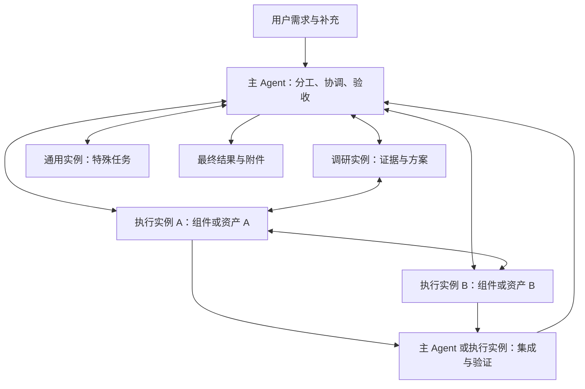

# 内置三类 Agent 与可续用协作团队：可行性调研

日期：2026-11-06。范围：`D:/dev/ai-agent-engine` 与 `D:/dev/aether-code`，复用上一轮对 Wuzu Code、Codex 桌面产物的调查。本轮只做源码调查、隔离验证和方案设计；没有修改产品代码、启动或重启用户窗口、清理会话数据。

## 1. 结论与设计原则

方案可行，而且已有相当多的运行基础。建议内置 **调研、执行、通用三种角色模板**，按实际任务创建一个或多个实例。三种模板不等于固定三个常驻进程；多个执行实例可以同时完成不同组件，也可由主 Agent 指定另一个执行实例负责集成。

主 Agent 和子代理应共享执行内核、历史与压缩机制、工具执行规范和消息接收机制。它们各自拥有独立上下文、任务与权限边界。主 Agent 继续负责理解用户目标、分工、冲突协调、验收和最终交付；执行子代理可以完成实际修改和产物制作。

**已完成只表示上一轮执行完成，不表示子代理被销毁。** 已完成实例应可继续接受新任务，复用同一子会话；运行中的实例接受补充，重启中断的实例在核对最后动作后接续。优先复用与任务相关的已有上下文，而不是见到同一个角色就强行复用。

当前主要缺口不是再写三个提示词，而是实例发现、唤醒调度、跨轮消息语义、严格角色权限、并行写入协调、成果转交和前端状态的闭环。

| 用户要求 | 当前实现 | 判断 |
|---|---|---|
| 主子代理共用运行逻辑 | 两者都使用 `ReActStrategy` | 核心已有；提问、审批、递归和成果发布权限并不相同 |
| 子代理独立上下文、自动压缩 | 独立 child history，走相同压缩流程 | 已有；不能理解为无限上下文或自动释放磁盘 |
| 完成后继续同一子代理 | `resumeRunId` 保留 childSessionId，新增 run | 已有显式路径；自主发现与优先复用不足 |
| 运行时父子、兄弟互发消息 | durable mailbox 与执行边界消费 | 已有基础；接纳不等于已处理 |
| 给已完成代理发任务并唤醒 | send 只接纳消息；resume 单独执行 | 尚未闭环 |
| 查看同伴当前状态 | participants 只提供本轮身份目录 | 缺最新状态、活动、跨轮可复用目录 |
| 同类多个执行者并行 | 模型可多次 start；显式 @Agent 按配置 ID 去重 | 执行基础已有，身份与选择协议需调整 |
| 严格无文件写入的调研者 | 有只读工具名单，但存在动作级写入入口 | 必须先修权限限制 |
| 并行修改与集成 | 共享目录、部分写工具有版本与进程内锁 | 缺文件责任约束，shell/MCP 不受该锁完整保护 |
| 子代理制作办公和多媒体附件 | 可用已授权工具；父可登记共享路径文件 | 缺正式子成果转交，视频生成取决于实际工具 |
| 主界面简洁、细节可收起 | child 独立事件、面板、同会话多轮聚合 | 可增量改造，无需重建前端 |

## 2. 三种角色的准确含义

| 角色 | 工作内容 | 必须限制的行为 | 返回内容 |
|---|---|---|---|
| 调研 Research | 阅读文件和资料、检索、理解代码、分析方案、核对证据 | 不执行 shell/任意脚本，不写用户文件，不生成交付文件，不调用带写副作用的工具动作 | 结论、证据定位、引用、待核实问题，直接返回文字 |
| 执行 Executor | 写代码、修复、测试、生成文档/图表/媒体、处理独立模块，也可承担集成任务 | 受当前授权、任务责任范围和工具能力限制 | 实际修改/产物引用、验证结果、未完成项、需要集成的接口 |
| 通用 General | 职责混合或无法预先分类的工作，特殊情况的调查与执行 | 同样受授权与资源范围限制；不能作为绕过调研角色限制的入口 | 具体成果和证据 |

“调研不产出”应解释为不创建交付文件，仍返回文本结论。引擎保存消息、计划、运行记录和必要内部状态是恢复机制的一部分，不能一并禁止，否则无法保留调研上下文。外部工具执行的索引写入、下载和截图落盘则需单独审查。

调研角色不执行测试命令；需要运行验证时，由主 Agent 分给执行者。peer 消息不能为接收者扩大权限，也不能让调研者借通用代理代做未获分配的写入任务。

三种角色不必绑定三个不同模型。默认继承用户的模型与资源配置，可按角色显式覆盖；实际能力取决于工具注册、模型能力和资源授权。没有视频生成工具时，设置“执行 Agent”不会自动获得视频生成能力。

现有 `implementer/spec-reviewer/code-quality-reviewer` 是实现和审查角色，见 `src/tools/subagent/subagent-tool.ts:41`。不建议直接改名并破坏旧 continuation；可把审查作为调研模板的任务专长，保留旧角色兼容。

## 3. 身份必须分四层，才能既多开又续用

| 身份 | 作用 | 生命周期 |
|---|---|---|
| 模板/配置身份 | builtinRole、模板版本，或用户自定义 agentId | 定义职责、默认能力与资源 |
| 子会话身份 | childSessionId | 持久的上下文身份，可被多次唤醒 |
| 任务身份与版本（建议补充） | 当前工作单元、责任文件、验收、补充要求版本 | 防止把新任务与旧任务成功记录混淆 |
| 执行身份 | runId、resumeFromRunId、当前父执行归属 | 每次真实执行单独记录 |

当前显式协作入口 `src/core/subagent/collaborators.ts:41–65`：按 agentId 找最近一次 child；相同 agentId 去重。即使传入两个不同 child 的续跑记录，只要它们绑定同一个 Agent，也会落到同一去重身份。这个策略适合“再次 @同一个专长继续”，不适合“同一个执行模板同时创建三个实例”。

建议入口明确区分：

- 创建：选模板/配置与任务，由服务端分配新的 childSessionId。
- 继续：指向具体 childSessionId/最新可接续 run，并附上新任务。
- 补充：指向正在运行的实例，把变更入箱，不创建第二个同时运行的实例。

模板版本和工具策略在创建时保存快照；升级内置模板不应静默改写旧子代理的角色与授权。展示名称仅供人阅读，不能用来定位续跑。

## 4. 已完成子代理的唤醒与复用

### 4.1 现有能力

`src/tools/subagent/subagent-tool.ts:164–213` 与 `src/core/subagent/store.ts:424/586` 已支持：旧 run 为终态、归属正确、有 continuation、同 child 无运行中的其他尝试时，创建新的 run，复用旧 childSessionId 和历史。旧执行保持真实成功/失败/中断状态。

新父轮可以在同一父会话内合法续跑，不要求复用旧 parentConversationId。旧执行句柄、内存 join、取消权限不能重新获得；新父轮必须重新接纳执行。跨租户、跨父归属、工作区范围不匹配或扩权仍应拒绝。

因此可以出现：执行者 A 完成组件 → 主 Agent 完成集成 → 用户要求调整组件 → 再唤醒 A 修改。A 保留之前的设计、文件位置、验证和问题背景，无需重新建立一个无历史实例。

### 4.2 统一“追加工作”的建议行为

| 目标状态 | 建议处理 |
|---|---|
| queued/running | 向同实例提交补充；在安全执行边界注入，不并发启动第二次同 child 执行 |
| succeeded | 新任务复用同 child，新 run；上一轮成功保持不变 |
| failed/interrupted | 保留部分结果；先核实最后外部动作和实际文件状态，再续跑 |
| blocked/需要输入 | 先处理原阻塞条件，答复绑定原请求，不当作普通任意消息 |
| cancelled | 只有新的明确任务安排才继续；不能因迟到通知或旧消息擅自重启 |
| 已归档 | 由明确续用请求恢复可见与可执行状态，归档不等于删历史 |
| continuation 缺失或权限失效 | 返回具体原因，必要时新建实例并交接可用摘要；不得假装已恢复 |

建议提供统一 follow-up 语义，由服务端原子判断“向活跃执行发补充”还是“创建同 child 的新 run”。保留现有 resumeRunId 兼容入口。两个同时到来的唤醒请求需去重/串行接纳，避免先查状态再启动造成竞争。

已完成代理不必常驻进程、持续模型调用或占并发槽。磁盘保留上下文与摘要，下次工作时重建内存执行对象。这与用户期待的“保存一个熟悉任务的分身”一致。

### 4.3 优先复用的判断

父 Agent 在派发前查看一个有界、父会话范围的持久目录，至少包含角色、任务短摘要、最新 run、状态、工作区、主要责任文件、成果引用、可继续性及原因。先筛权限和工作区，再判断任务/文件相关性，最后决定补充、续用或创建。

不建议把“同 agentId”当相关性算法，也不建议每轮把所有子会话全文塞进主上下文。已有数据库可查询与聚合最新 child，不必为首版引入向量库或第二套调度存储。

复用通常减少重复调研与往返，但不保证每次 token 都更少。很长、过时或无关的旧历史可能比新的精简任务更贵；模型缓存是否命中取决于提供方与请求前缀，不能承诺电脑重启后保留模型内部缓存。应比较实际输入/输出 token、缓存命中、重复工具工作和完成时延。

## 5. 主子共用内核与自动压缩

子代理在 `src/tools/subagent/subagent-tool.ts:317` 使用 `ReActStrategy`，并使用独立 child history；压缩流程位于 `src/core/agent-loop/react.ts:690–810`。主子共享模型输入估算、旧工具结果压缩、摘要压缩、历史回查和容量保护。

当前压缩触发基于有效上下文窗口和配置比例（默认约 0.92，OSM max 为 0.70），不是固定消息数。先尝试不调用模型的工具结果压缩，再按需生成摘要；系统提示、工具定义和输出预留也影响容量。摘要失败或请求预算不足时不能保证继续无限运行。

需要区分三件事：

1. 自动压缩主要减少送给模型的有效历史，不能当成磁盘清理。JSONL 后端追加摘要并保留压缩前记录；SQLite 历史后端会事务替换被压缩的旧消息，保留摘要、近期/受保护消息及用量归档，不能承诺两个后端都保留全部压缩前原文，也不能保证数据库文件立即变小。
2. 复用子代理恢复的是可重建的上下文和任务状态，不是恢复断电前的模型计算栈或正在执行的外部命令。
3. 新子代理使用相同执行逻辑，不代表自动复制父完整上下文。当前显式 collaborators 初次仅传父最近六条文字片段，总长有界，附件用占位描述，见 `collaborators.ts:91–99`。

建议在摘要之外持久保存身份、任务版本、计划、文件责任、成果引用、未完成消息与请求状态；摘要用于理解背景，不能替代这些权威字段。重复唤醒应恢复计划和未完成事项，但不能把旧完成声明当作新任务已验证的证据。

当前 child 会移除递归创建和 ask_user，并无完整提问/审批通道。因此“功能全部一样”需要额外工作：共享运行内核和交互协议，子代理的提问通过主会话聚合展示，答复和授权精确路由回对应 child/run/request。审批权不能随着普通同伴消息流转。

不必为实现这三类角色开放无界递归。主 Agent 统一派发研究者、多个执行者和集成者，子代理互相通信，已能完成用户描述的协作。以后若开放嵌套委派，需要明确子树取消、资源额度、归属和最终验收责任。

## 6. 消息：随时可接收，安全边界上调整执行

### 6.1 当前已具备的机制

`src/tools/subagent/async-tools.ts` 提供 send、participants、inbox、wait、cancel；`src/core/collaboration/` 提供持久消息与执行边界消费。发送者来自真实执行身份，不能在工具参数中冒充；requestKey 用于相同发送的幂等重试。

接纳、写入接收方历史、模型处理与完成要求是不同事实。当前回执能区分 queued 和历史 integrated，不应把 integrated 显示成“已执行”。父子及兄弟在同一有效根执行内可以通信。

重要不足：

- subagent_send 只写队列，不负责唤醒终态执行。
- participants 只列身份、接纳序号等，没有当前状态/活动；同 participant 续跑后该表的 invocationRunId 也不等于最新执行，不能直接拿来显示“当前正在运行”。
- 目录与邮箱限定 rootRunId/rootAttemptId；根执行关闭会拒绝未消费消息，重启会把未消费消息标为 interrupted。新父轮显式 resume 同 child 不等于自动迁移旧根未读消息。
- controller 的运行中补充绑定精确 invocation；终态不接收，旧未读补充不会自动交给继任执行。这防止过时需求误入新任务，但尚无用户可理解的重新递送策略。
- 模型最后一次输出期间仍可能接纳消息，但 final 路径没有额外的邮箱检查；接纳后可能没有下一轮模型来处理。需增加结束前的消费/封口协议，明确处理接纳与结束的竞争，不能只靠提示词要求“记得看消息”。
- 当前 wait 仅支持主 Agent 等待自己持有的 child，消息也不会提前唤醒该 wait；没有完整的兄弟互等或等邮箱事件原语。父收尾会等待活动 child，当前没有默认整项 deadline，应提供可观察的等待原因与取消/异常收口，避免相互等待。

公开承诺还比实现更保守：`src/api/http/routes/collaboration.ts:43` 的 capabilities 中，一些较广泛的 runtime communication、异步 Agent、child controller mutation 与 JSONL delivery 能力仍标为 false。不能把源码存在等同于当前前端已按正式能力协商启用；改造时应对齐能力声明与实测结果。

### 6.2 推荐的消息语义

建议消息区分 task/update/question/result/note，带持久 messageId、来源 child/run、目标 child、任务版本、可选 replyTo 和关联产物引用。普通同伴笔记无需自动唤醒已完成代理；主 Agent 安排下一步则可以直接唤醒。职责范围内的同伴协作请求可按预先确定的调度策略接纳，范围变化交由主 Agent 协调，无需让用户确认每条内部消息。

新父轮唤醒时必须重新建立当前执行权限。旧未读内容应保留原回执，经过相关性/取消状态校验后建立有明确来源的新递送记录；不能伪造旧 receipt 已被新执行消费，也不能盲目重放所有旧任务。

“随时接收”应做到消息立即可靠接纳；“随时调整”应在下一次模型输入构建、工具批次结束等安全边界生效。长命令或外部生成任务只有在支持取消时才能中断，已完成的外部副作用不能靠补充消息倒转。用户需要能看到待接收、已纳入上下文、已回应等事实，而非虚假的即时处理。

用户最新要求与主任务范围优先；peer 消息是协作资料，不得覆盖用户约束或授予新权限。用 replyTo、任务版本与明确回复责任减少重复转发，主 Agent 负责打破相互等待；不把轮询对方状态或互发“收到”变成持续模型循环。当前已有单条 32 KiB、待消费队列 1024 条和发送幂等限制，但这些容量限制不能识别两个代理用不同请求ID反复回应的语义回环。

## 7. 并行执行与集成



当前 child 继承父 workspacePaths/projectRoot/cwd，因此本来就共享实际文件。不同 childSessionId 仅隔离会话历史，不会自动隔离 Git checkout。

内置文件与 Office 工具有按 canonical path 的进程内锁和部分 expectedHash 检查；这能拒绝部分陈旧写入，但不能替代文件分工。兼容 write_file 可不带版本条件，shell/MCP/外部程序也可能绕过该锁，见 `src/shared/file-version.ts:61`、`src/tools/file/super-file-tool.ts:149`、`src/tools/cmd/command-change-observer.ts:24`。

建议先支持三种执行策略：

| 情形 | 执行方式 |
|---|---|
| 独立组件，明确独占文件 | 共享目录，持久保存责任路径，写工具强制检查范围和版本 |
| 公共接口、依赖锁、构建配置需要修改 | 指定单一责任者，依赖阶段串行集成 |
| 大范围重构、任意写命令或无法约束共享写入 | Git worktree/独立副本，显式合并与验证 |

共享目录里“合并”通常是接入组件、解决接口与运行验证；worktree 里才涉及 Git patch/commit 的合并。不能在共享目录里假定每个 child 都有可直接 cherry-pick 的独立提交。

Office、视频和图片采用独立产物目录与单一最终写者。两个执行者修改同一个 XLSX 的不同 sheet，仍然在竞争同一个二进制文件版本；更适合各自产出数据/章节/素材，再由集成者生成最终文件。统一安装依赖、全仓格式化、构建输出和最终测试应集中协调。

现有并发池默认 5、配置上限 16，按任务组调度；无需为了三模板硬设常驻三实例。并发应跟随可独立工作数量及资源能力，调度等待不能占住内部工具槽。

## 8. 子成果转交与主会话保持简洁

目前子代理可写共享目录文件，父 Agent 再用 deliver_files(path) 登记。正式最终资产保存不可变字节。这个流程可作为首版。

不能直接让每个 child 调父交付接口：`src/storage/results/index.ts:34–42` 要求真实 root owner；继承到 deliver_files 工具名称也不代表调用会成功。child 内联工具图片目前不会自动保留为父最终资产，父按 toolCallId 取资产也只查父本轮回执。

建议新增结构化子成果清单及父接纳流程，至少记录：生产 child/run、任务版本、文件路径或资产 ID、版本 hash、MIME、说明、验证结果、集成/接纳状态。主 Agent 最终登记；集成子代理可以整理验证，但不替父任务发布最终成功状态。不要简单放宽 root owner 校验。

现有 final result 接收图片、文档、视频、音频 MIME，不代表已有所有对应生成能力。当前限制为单件 32 MiB、最多 16 件、总计 128 MiB；真实视频任务可能需要独立的大文件资产方案，而不是把视频 base64 放进消息或 SQLite。

代码改动当前聚合在父 root 上，但 FileChange 缺 child producer；应增加来源引用以便显示谁改了什么、哪个版本被集成。失败子任务可能留下有用文件，不能按失败状态直接删除，也不能把这些文件当成已验收成果。

让主界面干净应采用：主会话只展示关键进度、需要用户决定的问题和最终结果；子日志和内部协作折叠保留在子面板。失败、阻塞和待答问题应可见。重要产物引用必须结构化，避免被有界文字摘要截掉。

## 9. 前端需要增量调整

`D:/dev/aether-code/src/renderer/src/contrib/work/work-subagents.ts:176` 已按 childSessionId 聚合同一代理的多轮；WorkSubagentsPanel 已有独立对话、状态、运行时补充和终态下一步；work-runtime 的续接已发送结构化 resumeRunId。无需重建整个 Work 会话页面。

需要调整：

1. 三类角色作为模板展示，同类实例分开；再次工作更新原 child 的同一条记录，历史 run 在详情中折叠。
2. 已完成代理可以“安排下一步”，中断代理展示可继续性及原因；运行中则是“补充要求”。服务端决定实际路由，前端不能靠本地状态猜测后直接新建。
3. 增加当前任务、等待输入/协作/集成等有事实依据的状态；接纳不显示成已读或已完成。
4. 详情支持附件/资产引用。目前 child follow-up 主要是文本，不能把“与主输入相同”解释为已经具备相同附件链路。
5. 成果保留 producer 和验收状态；目前 work-state 汇总成果时会丢一部分 child/run 来源。
6. 复用已有折叠协作摘要与 Office/图片/视频预览，状态通过真实事件推送更新，避免增加高频统计采样。

遵循用户已有的 macOS 极简要求：少量层级、克制状态色，常用动作采用统一尺寸的图标按钮与 tooltip/无障碍名称。不要在每条会话里塞进角色、runId、receipt 等协议字段。未实施视觉或交互改造，本轮不声称完成前端验收。

## 10. 存储与资源成本

下表是建议沿用并补齐的存储分层；模板版本、任务版本、完整子成果索引等不是已经全部实现的功能。

| 数据 | 位置与处理 |
|---|---|
| 模板版本、child 身份、运行链、任务状态、授权、消息接纳/递送回执、成果索引 | SQLite 持久化，保持事务一致性 |
| 会话正文与历史投影 | 现有历史后端；默认磁盘 JSONL，兼容 SQLite |
| 子工具版本化详情、压缩前证据 | 当前子工具详情还存 SQLite 的 subagent_tool_versions.detail；证据是否完整取决于工具输出与归档限额，不能把 JSONL 当作所有原始输出的唯一完整副本 |
| 文档、图片、视频、独立成果版本 | 本地资产文件，数据库存索引/引用；避免重复大文本或 base64 |
| 活跃执行对象、取消句柄、订阅、热缓存、并发队列 | 内存；终态释放，恢复时从持久状态重建 |

主界面简洁、上下文压缩和磁盘回收是不同目标。多代理通常增加执行记录、通信与总 token；已有上下文的合理复用可以减少重复工作，但不能保证总量下降。需要记录复用率、重复派发率、任务完成时延、实际 token、冲突次数和成果接纳率，而非追求调用子代理的次数。

默认不删除已完成 child；它是可再次使用的上下文。后续清理要基于明确保留策略、引用关系和用户范围，归档与删除分开。不能用纯内存数据库保存唯一副本来追求体积更小。

## 11. 推荐实施顺序和验收

### 阶段一：角色与复用闭环

- 内置三模板及版本；模板与实例身份分离，支持同模板多个实例。
- 修正严格调研的动作级权限，消除 codegraph index 等写入入口。
- 提供父会话范围的持久 child 目录，补最新状态和可继续性。
- 统一 follow-up：运行中补充，完成后新 run/同 child，中断后核实再继续；按原子接纳防双重唤醒。
- 更新主/child 公共行为契约。当前 chat.ts 与 code-agent-prompt.ts 把写代码留主 Agent 的规则，与执行者方案冲突。

### 阶段二：协作与产物

- 明确跨轮未读消息、终态唤醒、提问/审批转发、取消和主任务结束的语义；补 final 前邮箱检查及结束竞争控制，防止最后输出期间收到的补充无消费者。
- 增加文件责任、冲突检测和单一集成者；必要时隔离 checkout。
- 子成果 manifest、父接纳、来源归属与附件引用。
- 前端复用原子面板、同 child 聚合与折叠摘要，补输入和状态闭环。

### 阶段三：按收益优化调度

- 简单任务由主 Agent 直接做；独立且有明显收益的调查、实现、验证可主动委派。
- 先发现并复用相关实例，再创建新实例；不固定每次启动全部三类。
- 收集真实成本与效果，验证是否减少重复工作、总耗时和主上下文噪声。

### 必须通过的验收场景

| 场景 | 预期 |
|---|---|
| 同时创建三个 executor | 三个独立 child，受并发控制；不会按模板去重 |
| executor 完成后再分配相关任务 | 同 child、新 run，保留旧历史和旧成功事实 |
| 已完成后同时到达两次相同唤醒 | 幂等接纳，不双重执行 |
| 正在运行时用户/父/兄弟追加 | 精确路由，安全边界消费，保留来源和任务版本 |
| 重启后普通继续 | 能发现原 child，核实未知副作用后接续，不误用旧 join |
| 根已结束或已取消后的迟到消息 | 不静默丢失或自动重跑，记录明确结果，必要时新授权执行下重递送 |
| 压缩期间接收补充后再次重启 | 已接纳消息、计划与约束不丢失；不重复宣称处理 |
| 调研调用 execute_cmd、write_file、codegraph index | 均被执行层拒绝，任意脚本/MCP不能借角色名绕过 |
| 两执行者修改同一版本 | 冲突可观察，不能静默最后写入覆盖 |
| 子文档/图片产出后交父 | 来源、版本、验证完整；父采用真实文件，子工具ID不冒充父回执 |
| 子提问/权限阻塞 | 主界面出现对应问题，答复返回正确 child/run/request |
| UI 刷新、应用重启、重复接收事件 | 同 child 仍一条，多 run 历史真实，状态与成果一致 |

## 12. 验证记录与证据边界

源码中存在其他任务的未提交改动，未将其覆盖或归为本轮实现。以下测试均为本轮实际执行；源码里看到的其他测试不计入通过数。

| 验证组 | 实际结果 | 说明 |
|---|---|---|
| collaborators.test.ts | 15 passed | 验证现有按配置ID去重、显式续跑、归属及工作区约束；去重通过不代表支持同模板多实例选择 |
| durable-mailbox.test.ts、controller-contract.test.ts、sqlite-react-boundary.test.ts、child-drain-continuation.test.ts | 137 passed、5 failed | 其中前两文件分别32、76项全过；后两为17过1失败、12过4失败 |
| 自动压缩、历史恢复、计划续用定向测试 | 13 passed、2 failed、46 skipped | 两失败均为production-compaction的live child终态断言；skip是名称筛选未执行 |
| 严格调研注册器 mock 探针 | exit 0，确认codegraph/action:index被转发 | 没有真实建索引或写用户项目，证明现有动作级限制不足 |

七项失败均应保留，不能声称集成测试全过。协作组只对其中一个失败用例作最小诊断重跑，得到 `RUNTIME_ERROR: EXECUTION_OWNERSHIP: A live root capability is required`。该夹具构造了child owner，却漏填parentSessionId，导致进入root-only成果准备路径。其余六个失败路径也存在相同的夹具字段缺口，但未逐项复跑确认同一原因。

生产`subagent-tool.ts:302`明确设置parentSessionId，`storage/results/index.ts:212`据此跳过child的根成果准备。因此这些失败不能直接证明生产child或邮箱必然故障，也不能因为发现夹具问题就抹掉红项。未修改产品或测试源文件；下一步应先修正夹具并重验，再验证新能力。

上述初次定向测试合计165项通过、7项失败、46项因名称筛选未执行；额外最小诊断复跑的一次失败不重复计数。已执行命令：

```text
npx vitest run src/core/subagent/__tests__/collaborators.test.ts --maxWorkers=1 --minWorkers=1
npx vitest run src/core/collaboration/__tests__/durable-mailbox.test.ts src/core/collaboration/__tests__/controller-contract.test.ts src/core/collaboration/__tests__/child-drain-continuation.test.ts src/core/collaboration/__tests__/sqlite-react-boundary.test.ts --maxWorkers=1 --minWorkers=1 --reporter=dot
npx vitest run src/core/collaboration/__tests__/production-compaction.test.ts src/core/agent-loop/__tests__/archived-compaction.test.ts src/storage/todo/__tests__/plan-recovery.test.ts src/tools/subagent/__tests__/subagent-capabilities.test.ts -t 'actual ReAct automatically|preserves the exact live child|restart|resumed child|subagent capability intersection|child planning ownership' --maxWorkers=1 --minWorkers=1
```

尚未覆盖“完成→压缩→电脑/引擎重启→普通父继续发现旧child→唤醒→正确接收补充及附件→交付”的完整链路。隔离测试不等于真实模型能够自主选择正确代理；后续实施仍需模型行为评估及独立profile的Electron E2E。

参考调查：[子代理重启续用与调度调研](./subagent-recovery-audit-2026-11-06.md)。Wuzu 可借鉴稳定子任务句柄与续用提示，Codex 桌面可借鉴稳定 thread 身份、独立 resume 和竞争控制；两者都不能据当前可见代码推导出“任意外部工具断电后自动原地恢复”。
