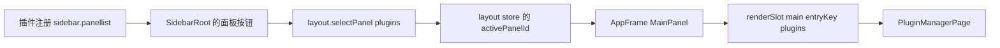

# DeepSeek Harness 客户端插件融合机制：源码追踪

日期：2026-11-12。研究对象：`D:\dev\deepseek-harness`，commit `fcc0ad462172522aaf5c93a7b2e01f6b9f0b0159`。

本笔记聚焦“安装一个带交互界面的插件后，它怎样真正成为宿主 UI 的一部分”。采用持久安装的 `ui-plugin-manager` 页面和独立的 `ui-plugin-market` 页签作为主例，区分旧动态 Cordis runner。本文除注明的团队 probe 外均为源码分析，没有启动完整 Harness、安装插件或进行完整页面/HMR 端到端验证。该 checkout 中两个主例的 `lib/client.js` 均不存在；构建路径由配置与源码确认，不能称作实际构建产物验收。

## 结论

Harness 的“客户端插件”是一份由宿主加载的浏览器 JavaScript 模块。它和应用共享 React、Cordis Context、服务、主题以及 slot 注册体系；插件把 React 组件注册进宿主声明的入口，宿主在真正的页面树中调用这些入口。安装、启用、页面贡献、操作 API、状态订阅与卸载是贯通的。

这不是让工具返回一段 HTML，也不只是把本地网页打开在预览浏览器中。其关键是两条相互配合的链：`包/构建/模块图` 负责代码到达，`Cordis 服务/slot/effect` 负责激活、挂载和回收。

当前 Aether 插件体系已具备 Node 工具插件的创建、编辑、导入、发布、版本与调用链。正在补齐的 Schema 原生操作页能让用户直接操作工具，但仍不等同于作者自定义 React 页面或向宿主侧栏/编辑器贡献组件。自由 UI 要补的是客户端扩展运行时，不是再加一个“打开 HTML”按钮。

## 一、从 package 到浏览器工厂

`packages/client/ui-plugin-manager/package.json:20` 的 `exports["./client"]` 指向 `lib/client.js`，`package.json:43` 的 `dsh.client` 声明依赖包和 `platform: "web"`。同包仍有宿主入口 `lib/index.js`，两种入口用途不同。

其 `tsdown.config.ts:3` 调用公共 `clientBundle(..., {hostPhase:true})`。公共构建器的实际契约：

| 阶段 | 源码证据 | 实际行为 |
|---|---|---|
| 选择入口 | `packages/client/tsdown.client.ts:133` | 正常构建读 `src/client/index.ts`；分阶段构建可读 `lib/types/client/index.js`。 |
| 生成客户端包 | 同文件 `:780` | `entry.client`，输出 `lib`，`platform: browser`，CJS 工厂形式；共享模块保持 external，非共享依赖内联。 |
| 校验依赖边界 | 同文件 `:838` | purity gate 阻止随意把别的插件值 import 内联；跨插件协作应显式声明模块边或使用 Cordis 服务。 |
| 注册工厂 | 同文件 `:919` | 输出包包裹成 `window.__ModuleLoader__.load({id, factory(require){...return module.exports}})`；分块带 chunk 名。 |
| CSS 归属 | 同文件 `:58` | CSS 转成 `<style data-plugin="包名" data-plugin-css="...">`，CSS modules 返回 class map。 |

注册工厂与执行插件 `apply` 是不同阶段。脚本下载执行时首先登记 factory；模块 materialize 产生 exports，之后 Loader 才按服务条件激活。

## 二、宿主如何知道和分发客户端模块

`packages/client/modules/src/index.ts:672` 的 `ClientModuleRegistry` 监听 Host Loader 的 `internal/plugin`，同时扫描当前 Loader entries。它并非扫描磁盘上所有 npm 包：只有当前 Host 已组合的插件入口才进入候选集。

`resolveMeta()`（同文件 `:891`）解析 package.json 的 `dsh.client`，过滤 `platform !== web`，并要求真实的 `exports["./client"]`。构建文件缺失会通过 `MissingClientBundleError` 明确失败（`:1017`、`:1098`），不会把源码当构建产物默默运行。

`compose()`（`:821`）按模块依赖排序，形成带 content revision 的 `{rev,release,entries,batches}` 图。组合脚本和资源通过 `/plugins` 前缀提供（`:234`、`:272`、`:703`）；`bootInjections()`（`:602`）把初始 queue loader、bootstrap 脚本和 `window.__DSH_BOOT__` 注入宿主页面。

静态壳对应 `packages/host/frontend-static/src/index.ts:139`：index 请求先经过 `connection.authorizeIndex`，随后通过 `webServer.renderIndex` 注入上述内容（`:163`），加入相对 `<base href="./">` 以适配挂载前缀。它不是前端自行去 npm 任意 import。

## 三、两层依赖与 React 单例

需要明确区分两个 `inject`：

1. **package 的 `dsh.client.inject`**：包级模块到达与依赖顺序。例如 market 包声明依赖 `ui-plugin-manager`，保证页面宿主模块在其前面可用。
2. **client 源码的 `export const inject`**：Cordis 服务可用性。例如 market 的 `['slots','locale','remote','remote.pluginMarket',...]`，这些服务到齐才运行该插件的 `apply`。

源码本身也明确区分这两层：`packages/client/modules/src/client/manifest.ts:47`、`:100`。模块图有序不代表所有业务服务已经激活。

浏览器启动路径是 `packages/client/web/src/boot.ts:73` 创建 module system，`:87` 调 `bootClient`，`:101` 调 `mountClient`。`boot-client.ts:61` 将其安装成 `loader.internal`，`:71` 启动图中的 entries，`:76` 等待 Loader，再检查必须的基础条目是否激活。

`packages/client/web/src/seed.ts:26` 提供共享模块表，包括 React、JSX runtime、React DOM、Cordis、store、ui-slots、ui-primitives 等。插件使用同一个 React 对象，不应捆绑自己的第二套 React。`modules/src/client/system.ts:253` 先确保依赖到达，`:299` materialize 工厂，`:327` 的 require 从静态表、已缓存 exports 与工厂中查找；缺少模块会显式失败。

## 四、真正的页面与侧栏贡献：ui-plugin-manager

`packages/client/ui-plugin-manager/src/client/index.ts` 给出完整、实际使用的页面插件：

- `:86` 声明服务依赖；`:95` 注册本地化；`:97` 建立 controller；`:98` 将 controller.dispose 绑定 effect。
- `:106` 根据 Remote access 是否允许读取插件列表安装这一组 UI 与订阅。
- `:129` 等待宿主 `main` slot；`:132` 注册 `name:main, key:plugins`，真实 React 组件为 `PluginManagerPage`（`:149`）。
- `:138` 同时声明它自己的扩展入口，如 `plugins.tab`、`plugins.item`、配置页、详情按钮和详情段落。
- `:167` 注册 `sidebar.panellist` 的 `id:plugins` 入口，侧栏图标是 `PluginsPanelIcon`。
- `:153` 提供 `pluginNavigation` 服务，允许其他组件打开列表或指定插件详情，而不需要直接 import 页面的内部 React 状态。

宿主调用路径同样可定位：



`ui-sidebar/src/client/SidebarRoot.tsx:88` 点击时调用 `selectPanel(id)`；`ui-layout/src/client/service.ts:72` 校验页面已注册，再更新 store；`ui-layout/src/client/AppFrame.tsx:46` 调 `renderSlot('main',...,{entryKey:...})`。

这条导航主要使用 keyed slot 和 layout store，不需要假设是 React Router 或 URL 路由。页面最终在同一应用 React 树中：`ui-renderer/src/client/app.tsx:20` 只渲染 root slot；`ui-renderer/src/client/index.ts:90` 安装 SlotRegistry 并提供 `uiRenderer.mount`；`web/src/mount.ts:20` 通过依赖 effect 挂载，renderer 被替换会重新挂载。

## 五、独立插件真正扩展另一个插件页面：ui-plugin-market

这是比“内置页面本身”更直接的证据：market 是另一个 npm package，manager 无需静态 import 其组件。

`packages/client/ui-plugin-market/src/client/index.ts:55` 向 `plugins.tab` 注册 `id:discover`，组件是 `DiscoverSection`；它在宿主声明的槽出现后才安装。其 `:38` 建立独立 controller、locale、远端事件订阅，并用 effect 清理。Host face `src/index.ts:4` 的 `apply` 为空，说明不是每个带 UI 的包都必须另建 Host 业务服务；它可以消费已存在的远端服务。

manager 页面从 slot ledger 得到 tabs，把它们加到 `SegmentedTabs`（`ui-plugin-manager/src/client/PluginManagerPage.tsx:1710`）。用户选择 Discover 后，同文件 `:1732` 调 `renderSlot('plugins.tab', {install,openPackage}, {only:tab})`。这会挂载 market 组件，并把宿主安装动作通过 owner props 提供给它。

真实交互链：

1. `DiscoverSection.tsx:565` 通过注入 hook 读 controller state，`:568` 首次挂载调用 ensure，`:479` 提供搜索框，`:508` 提供手动刷新按钮。
2. controller 的 `market-store.ts:187` 提供 state hooks、search、分页、refresh、增删源等 actions；`:381` 调 `remote.pluginMarket.search`，`:405` 调 `setIndexes`。
3. 安装按钮经过用户选择与确认后，`DiscoverSection.tsx:604` 调来自宿主的 `install(...)`，不是自己另启一个无关联网页。
4. manager 的 `manager-store.ts:1277` 调 `remote.pluginManager.installBundle`，安装状态与日志通过订阅回到同一个页面（`ui-plugin-manager/src/client/index.ts:117`）。

这证明 Harness 同时支持“注册完整主页面”和“给别人的页面贡献一个真实可交互页签”。

## 六、界面动作如何到 Host：明确注册的 Remote

`packages/api/remotes/src/client/index.ts:196` 显式挂载生成的 client-safe Remote contributions，列表包括 pluginManager、pluginMarket 等（`:202`）。它不是把 Host 实现及其 Node 依赖直接打到浏览器。

`packages/api/gateway/src/client/index.ts:214` 的 `$mount` 用 caller effect 拥有贡献；`:301` 读取 typed descriptors，校验重复方法与严格输入；`:688` 给命名空间安装真实方法。调用时 `:458` 通过 `connection.rpc.call('/api', endpoint, {args}, signal)` 发出请求，endpoint 在 `:769` 明确为 `namespace/method`。

因此市场搜索的实际名字是 `pluginMarket/search`，到 `packages/boot/plugin-market/src/index.ts:228` 的 `@Remote search`；它校验 offset/limit，并从配置市场索引取文档、搜索及分页（`:236`）。增删市场源到同文件 `:200` 的 `@Remote setIndexes`，通过 settings.update 持久化（`:214`）。

客户端命名空间卸载后，mount token 被撤销，旧异步调用不会被当成仍有效的成功结果（gateway `:453`、`:459`）。这些生命周期和 RPC 输入边界与“同页执行不可信插件代码的安全隔离”不是一回事。

## 七、安装、热更新、停用与 dispose 的贯通

持久安装主线：

```text
Discover/安装页
 → pluginManager.installBundle（Host @Remote，:872）
 → pnpm 安装 + bundle/兼容性检查（:982）
 → selectBundle 写 profile 选择（:1001）
 → publishAndReload / hmr.reconcileProfile（:1237、:1254）
 → Host Loader internal/plugin
 → ClientModuleRegistry 重组 graph、onGraphChanged
 → /plugins/events 的 graph/rebuilt SSE
 → browser entries.sync / entries.reload
 → factory 导入、Cordis 服务激活、slot 自动出现或撤下
```

`packages/client/hmr/src/index.ts:195` 订阅 graph 变化并广播；browser half `src/client/index.ts:53` 将 graph frame 交给 `entries.sync`、rebuilt frame 交给 `entries.reload`。没有 HMR 时，Host change result 明确返回 `restart-required`（`plugin-manager/src/index.ts:1279`），不能声称所有配置都能无重启生效。

回收有多层：

- `ui-renderer/src/client/registry.ts:209` 的 slots.inject 订阅目标声明生存期；父声明消失会清理当前注册，未来重新声明可重装。每个注入期本身是 Cordis effect（`:242`）。
- register 由 caller 的 ctx.effect 拥有（同文件 `:740`）；注册撤销时也 release 相应 store（`:476`）。依赖级联和页面消失不应遗留“幽灵按钮”。
- `modules/src/client/entries.ts:192` 在替换时先 prefetch，再等待旧 fiber teardown，移除归属 CSS，import 新工厂并 refresh entry；generation 检查阻止过期加载接管界面。
- 同文件 `:219` 移除 Host graph 已不存在的 Loader entry，等待 dispose；`:260` prune 无引用模块。`system.ts:450` 保留活模块的传递依赖后再清缓存和归属 CSS（`:468`）。
- `entry-lifecycle.ts:9` 的 teardown 等待 fiber.inertia；`:23` 删除 `data-plugin` 样式。异步 controller 也有 disposed/epoch 检查，例如 market-store `:178`、`:406`。
- 页面级 `web/src/boot.ts:110` dispose root fiber 和 boot page；HMR transport effect 关闭 EventSource / AbortController（`client/hmr/src/client/index.ts:76`）。

slot 还提供渲染错误边界与权限过期检查：`ui-renderer/src/client/scoped-slots.tsx:77` 拒绝已销毁注册继续 render，`:1082` 包裹 SlotErrorBoundary。正常生命周期之外恶意同页 JS 仍能访问 DOM，不能把这些约束描述成安全沙箱。

## 八、主题、状态和样式为什么能融合

market 组件 import 宿主 `ui-primitives`，CSS 使用 `--dsw-*` token（`DiscoverSection.module.css:46`、`:84`、`:129`）。它不是把整套应用样式复制进自己独立页面。`ui-theme/src/client/index.ts:354` 支持注册主题，`:388` 支持 token overrides；`styles.ts:55` 用 effect 安装并撤销主题样式。

`ui-layout/src/client/theme-presenter.ts:74` 把主题快照映射到 DOM 的 color-scheme、dark attribute、字体和 token，`:105` 清理自身写入。组件状态通过 store/hook 和 registry 订阅响应，slot 改动时自动更新，不能只在打开页面时抓一份插件数组就永远缓存。

## 九、不要混淆旧动态 runner 与持久插件

当前 `packages/extensions/tool-cordis/src/index.ts:22`、`:41` 只注册 `cordis_inspect_list` 和 `cordis_inspect_query`。它们明确只读，并禁止调用业务服务或修改 runtime。`ui-cordis` 仍包含 `cordis_define/run/stop/undefine` 历史调用卡，不能据此声称当前模型有这些写工具。

动态 runner 源码依旧存在：`cordis-host-runner/src/index.ts:150` 每个服务新建 `DynamicCordisRegistry`，`registry.ts:142` 将 definitions/runs 等放在 Map。该定义注册路径没有看到磁盘恢复链；应按进程内定义理解，不等同于 package/profile 持久安装。`cordis-client-runner/src/client/runtime.ts:372` 能把已编译工厂注册到 module loader，但这只解释其动态 UI 能力，不能代替持久管理能力。

## 十、与 Aether 当前代码的差异及建议分层

对照路径以 `D:\dev\aether-code` 为根；engine 对照以 `D:\dev\ai-agent-engine` 为根。这是研究时的工作区快照，部分 Schema 操作页正在由团队补齐。

| 能力 | Aether / engine 当前证据 | 要做自由 UI 时的增量 |
|---|---|---|
| 插件目录管理 | Aether `contrib/work/WorkView.tsx:89` 静态 import `WorkPluginManager`，`:130` 固定 Page union，`:888` 固定分支；管理页已有 CRUD/导入/测试/版本。 | 目录管理继续复用；新增受控的 contribution registry，让已发布客户端页面可增删，侧栏与面板从同一注册源派生。 |
| 工具协议 | Aether `core/engine/plugins.ts:4` 与 engine `src/plugins/types.ts:15` 只接受 `runtime:node` + tools。 | 新 UI 协议声明 entry、assets、sdkVersion、贡献点和权限；不能悄悄给 v1 Node 插件解释额外 UI 字段。 |
| 直接操作工具 | engine `src/plugins/application.ts:54` / `:64`、routes `plugins.ts:32` / `:38` 提供固定发布 revision 的元数据与手动调用；templates `:15` 已声明宿主 Schema 操作页。 | Schema 操作页适合大部分简单工具；作者自由 React/HTML 布局、宿主贡献点仍需独立实现。 |
| 客户端 bundle | 现有插件工具在独立 Node 进程执行，不携带浏览器 module factory。 | 增加确定性构建与产物封存、revision/哈希、静态资源路由、共享依赖/SDK契约；AI 先生成标准工程，再走相同发布链。 |
| 接入宿主 UI | 没有 Harness 这一套动态 React module graph/slot composition。 | 插件 UI host、可撤销入口、mount/unmount、错误边界、状态恢复、语言和主题 SDK。无需一次重写整个 Aether 为 Cordis。 |
| 交互到引擎 | 当前可调用已发布工具，不能等同开放所有 engine HTTP。 | 固定允许的 bridge 方法、Schema 校验、tenant/source/plugin/revision 绑定、取消与结果归属；宿主敏感凭据不交给页面。 |
| 安全容器 | `src/main/browser/service.ts:226` 的 WebContentsView 为 sandbox/contextIsolation，关闭 nodeIntegration；文件预览还有 root/epoch/token/symlink 检查。 | 这些可以复用设计，但不是现成插件 SDK；可信官方 UI 可选共享 React，第三方自由代码适合隔离 frame/view + capability bridge。 |
| 现有 HTML 预览 | `contrib/editor/source-preview-document.ts:102` 去除用户脚本，`:151` CSP 只允许内置 bridge。 | 预览适合内容展示，不应用来冒充有业务 bridge、版本与 dispose 的插件运行时。 |

建议保持三档明确能力，而不是把一切都叫“插件页面”：

1. **工具插件 + 宿主生成操作页**：复用现有 v1；表单、校验、运行和结果由宿主掌握。最小实现就能做到“用户手动用”和“AI 调用”共用一套真实工具。
2. **隔离的自定义插件应用**：作者可写页面，但通过白名单 bridge 调用已发布工具；固定 revision、关闭页面即取消/回收，停用或更新可撤销权限。
3. **深度宿主 UI 扩展**：参考 Harness slot/contribution 接口，允许在侧栏、面板、编辑器等指定区域贡献 UI。只为受信任插件开放同渲染器执行；依赖与样式 purity 不是代码安全隔离。

前端无法完全不动。即使只做第一档，也需要入口、Schema 表单、执行状态、取消、结果展示和版本变化处理；第二、三档才需要真正客户端运行时。应先明确要交付哪一档，再给 AI 工具准确的能力说明，避免生成无法被宿主接入的“独立网页”。

## 验证边界

本笔记做了只读源码交叉追踪，没有运行完整 Harness build 或应用。团队另有 loader 语义 probe：直接 import 原 `ClientModuleSystem` 与 `entry-lifecycle`，用 tsx/jsdom 验证懒执行、`/client` 别名缓存、React 单例/CSS 归属、缺失依赖报错、清样式与 invalidate 换代，证据位于 engine `.tmp/harness-client-research-20261112/report.json`。这只能证明对应 loader 语义，不能推导真实页面安装、UI 挂载或全链 HMR 已实测通过。

## 十一、Harness 的完整贡献面：不止“页面 + 侧栏”

Harness 将浏览器扩展点作为可检查的契约表，而不是让插件猜 DOM 选择器。`packages/extensions/cordis-client-runner/src/client/slot-catalog.ts:29` 定义每项 `ClientSlotEntry` 的 key、kind、scope、owner props、标准 hooks、声明者、现有占用者、替换风险和最小示例。当前生成表有 112 个 key（按源码前缀计数：`conversation` 45、`sidebar` 28、`settings` 13、`plugins` 9，另有 shell/main/contextMenu/rightbar/tool/deliverables/workspace 等）。这是编译期生成目录，不是当前页面的实时快照，也不等于 112 个稳定公开新增位；部分 key 替换已有 UI，部分依赖其他插件的声明。目录注释中的 `cordis_inspect what:"client"` 属于旧入口说明；当前 `tool-cordis` 注册的是 `cordis_inspect_list/query`，实时查询应从 list 返回的 provider/method/schema 选择。slot 只有在声明它的宿主 entry 处于 live 状态时才存在。

### 贡献的技术语义

`slot-catalog.ts:70-77` 的全局规则值得直接移植到 Aether SDK 的设计：UI 只允许 `ctx.slots.register`；注册必须包在 `ctx.slots.inject(key, ...)`，宿主卸载/重挂时自动重做；动态代码不应 import 任意模块，使用宿主提供的标准 props、主题 CSS 变量和受控样式接口；失败注册应进入 load report。该规则是动态 browser-half facade 的模型契约，持久可信包可以由构建器生成更丰富的 imports，但仍应遵守同一 slot 生命周期。

slot 的五种 cardinality 直接决定 Aether 的贡献 API：

| kind | Harness 语义 | Aether 对应设计 |
|---|---|---|
| `single` | 一个位置一个 occupant；适合替换一块区域 | `replace`/`fallback`，默认拒绝覆盖官方 occupant，必须声明 capability。 |
| `list` | 多个并列项，按 `order` 排序；例如侧栏图标、工具栏动作 | `contribute`，带稳定 `id`、order、label，增量卸载。 |
| `keyed` | owner 以 key 选择 cell；重复 key 会替换该 cell | 适合按插件类型/文件类型/消息节点扩展；要把 key domain 纳入 manifest 校验。 |
| `chain` | selector 按顺序选一个 takeover，全部不命中走 owner fallback；`conversation.composer`、`conversation.chat.user.before` 是实例 | 只给高信任插件；需要 `select` 的纯函数边界、fallback 和“只选一个”诊断。 |
| `hoc` | 多层包装 owner 内容；`conversation.hero.frame` 的层必须准确渲染 `children` 一次（`slot-catalog.ts:1068-1111`） | 最高风险。第一期应禁用或只开放官方签名的 wrapper，避免隐藏整个会话界面。 |

列表/面板注册选项普遍有 `id`、`order`、`label`（例如 `sidebar.panellist` `:4207-4258`）；label 是 thunk，语言切换时重新求值，不要求重新注册。`single/keyed` 的替换风险由 catalog 标成 `shadows-shipped-ui` 或 `wraps-owner-content`，这比简单 z-index 约定更可审计。

### A. 应用壳与导航区域（P0）

这些区域对“自定义插件管理”最直接，也不会要求插件接管会话内部状态：

- `root`、`main`、`main.conversation`、`rightbar`：主壳、中心页、会话中心和右栏；layout contract 在 `packages/client/ui-layout/src/client/index.ts:54-121`。`main` 是 keyed panel，配合 `sidebar.panellist` 可形成独立插件页面。
- `sidebar.panellist`、`sidebar.panellist.actions`、`sidebar.footer.action`、`sidebar.brand.mark/name`、`sidebar.settings`、`sidebar.toggle.badge`：左侧导航图标、More 菜单、底部动作、品牌与状态；`ui-sidebar/src/client/contract/slots.ts:31-75`。manager 和 `ui-entry-customization` 已分别证明页面入口和菜单入口的真实用法（后者 `src/client/index.ts:54-73`）。
- `shell.leading`、`shell.bottom`、`shell.overlay`、`shell.quota-notice`：壳层前后缀、全局浮层、配额提示；`ui-layout` 与 `ui-chat` 分别注册。浮层必须由宿主统一管理 focus、Escape 与 z-index，插件不应自行 append 到 body。
- `settings.launcher/trigger/header/action/close/section/section.icon/plugins.tab/onboarding/general.item`、`settings.models.*`：设置入口、设置分区、模型卡、登录/引导。`ui-settings` `:15-100` 和 `ui-settings-models/src/client/slot-contract.ts:33-40` 给出完整 owner props。

**Aether 落地建议：**先开放 `main` keyed panel + `sidebar.panellist` + `sidebar.panellist.actions`，再开放 settings section。插件页只拿 `pluginId/revision` 与 capability face，不拿主窗口任意 DOM；主进程菜单与系统级窗口仍走显式 API。

### B. 会话与输入区域（P1）

Harness 把会话扩展进一步拆成 session scope，避免一个插件把所有会话状态混为全局：

- 会话头部与视图：`conversation.session.header.actions/utilities/corner/lineage/views.actions`，以及 `conversation.view`（`ui-conversation/src/client/contract/slots.ts:231-285`）。可用于“打开插件详情、会话操作、当前视图工具”按钮。
- Composer：`conversation.composer` 是 chain；`conversation.composer.bar`、`conversation.composer.dock`、`conversation.input.left/right/activity/attachments/plan/permission/model` 分别覆盖输入主体、附件、计划、权限、模型与左右工具区（`:290-367`）。`conversation.composer` 的 selector owner 含当前 session、pending interaction，适合审批/问答/子代理等临时接管，但需要严格 fallback。
- Hero/空会话：`conversation.hero.workspace`, `hero.frame`, `hero.brand.mark`, `hero.agentPreset`, `hero.options`（`:292-300`），可做新建会话起始工具或 workspace 选择器。
- 输入触发器：slot 之外，`ctx.inputTriggers.registerSource`（`ui-input-trigger/src/client/service.ts:48-76`）注册 `/`、`@` 等触发源，每个 session lazy 建 controller（`:80-112`）。这比在 textarea 监听 keydown 更适合 Aether 的 `@插件`、`/插件命令`。

**Aether 落地建议：**P1 只开放 list 类型输入 dock、header actions 和独立 slash/@ source；不要让第三方首版替换整个 composer。每个 source 需要 `trigger/name/order/availability/candidates/onPick`、session 绑定和取消；支持后续动态移除时关闭菜单并清理 lexicon。

### C. 消息、工具结果和产物（P1/P2）

- `conversation.chat.flow/node/text-interaction/user.before/message.images/user.images/commandview/reasoning.body/turnTail/assistant-actions`（`ui-chat/src/client/contract/slots.ts:428-501`）覆盖消息节点、用户消息来源装饰、图片、命令、推理体、turn 尾部和助手动作。
- `tool.call.toolview`、`tool.call.images`（`ui-tool/src/client/contract/slots.ts:23-41`）是工具调用结果的 keyed/single 展示面；`ui-deliverables` 还向 `tool.call.toolview` 注入结果卡，并向右栏注册 changes-review tab（`ui-deliverables/src/client/index.ts:85-90`）。
- `deliverables.file.actions`、`deliverables.review.file.actions`（`ui-deliverables/src/client/file-actions.ts:6-24`）是产物文件动作；适合下载、打开、复制路径等宿主授权动作。
- `conversation.user.text.node`（`:221-229`）按 durable source 和行类型选择渲染器，示例 `ui-goal` 将命令引用变成可点击节点；这是“用户消息内嵌对象”的正确入口，不应让插件直接改 Markdown DOM。

**Aether 落地建议：**P1 可提供由宿主 schema 生成的工具结果卡和 file action；P2 再开放 message node/assistant-action renderer。消息渲染必须带 `sessionId/messageId/turnId/revision`，以防旧插件响应写到已回退或已切换的会话。用户原文、附件和工具结果必须保持只读投影，插件只能通过结果 API 申请动作。

### D. 右栏、文档与上下文菜单（P1）

- `rightbar.session`、`sidebar.right.pane.tab`、`sidebar.right.pane.tab.title`、`sidebar.right.tab.guide/guide.actions/guide.entry/menu.item`（`ui-sidebar-right/src/client/contract/slots.ts:43-105`）构成右栏 tab、标题、guide、tab action 和 session-scoped menu。
- 文档预览右栏进一步提供 `sidebar.right.tab.document`, `.actions`, `.unpreviewable`, `.action`, 以及 PDF 专用 `sidebar.right.tab.document.office.pdf`（`ui-sidebar-documentpreview/src/client/document/contract.ts:51-90`，`office/OfficeBody.tsx`）。
- context menu 不是普通 slot：`ui-context-menu/src/client/index.ts:27-42` 提供 `ctx.contextMenus.register({target, order, observe, resolve})`；`:98-134` 管理目标、异步 resolution、通知、关闭和 active store，`:170-177` 才把 overlay 作为 slot 挂入壳。插件可对自定义 target kind 增加数据动作，也可用 `contextMenu.content`/`contextMenu.icon` 替换已有 cell。

**Aether 落地建议：**上下文菜单和右栏是高价值、低侵入扩展点。先实现数据型 menu contribution（target type、observe 权限、resolve actions），由宿主统一显示；第三方 React menu content 后置。右栏 tab 的 `openTab(kind, params)` 需要绑定 session/workspace 身份和取消 token。

### E. 命令、快捷键、事件与通知（P1）

- slash/command：`ui-commands/src/client/service.ts:115-130` 将 `/` 注册成 input trigger；`:139-167` 提供 `commandUi.register`（客户端命令）和 `decorate`（装饰已有 Host 命令），均有 effect disposer。契约 `ui-commands/src/client/contract.ts:95-145` 约束 label、description、icon、availability、popupSelect/action。
- keyboard：`shortcuts/src/client/index.ts:77-87` 提供 `ctx.shortcuts.register` 与 `registerFixed`；注册会同步 catalog、持久化配置、监听 locale，卸载时移除定义。命令与快捷键应分开，避免插件占用未经审批的全局组合键。
- conversation business registry：`ui-conversation/src/client/conversation/event-registry.ts:16-45` 可注册 durable event Definition；`view-registry.ts:5-18` 注册按 target 的 view builder；`interaction-registry.ts:8-34` 注册文本手势处理器；`group-registry.ts:16-42` 注册消息分组规则。它们都返回 effect-owned disposer，重复 id/target 会显式报错。
- toast/notice：`ui-workspace/src/client/toast/register.ts:22-42` 注册 `workspace.toast.content` factory 和 keyed `workspace.toast` entries；每条通知可带 tone、holdMs、动作和撤销。工作区导航通过 `RowToastAction` 将 notice 映射成 keyed slot（`RowActionToast.tsx:10-13`）。
- locale/theme/icon：`ctx.locale.register` 使 label 跟随语言；`ui-theme/src/client/index.ts:354-370` 可注册主题，`:388-397` 可按 source 覆盖 token，`:517-523` 校验 icon replacement。主题 icon sprite 是主题的一部分，不应允许任意外部 SVG 直接修改全局 DOM。

**Aether 落地建议：**命令、shortcut、toast 和事件 registry 可以复用现有 engine 的 capability/permission 体系作为 P1；它们比开放 React 页面更容易做稳定审计。事件 registry 只接受结构化 definition，不允许插件监听宿主任意 DOM/EventEmitter。

## 十二、外部动态插件的可操作范围与风险

`slot-catalog.ts:7-11` 说明该目录是 Host 与 Client 两平面的合法会合点，目录只携带字符串和类型说明，不把宿主的私有 imports 暴露给模型。`CLIENT_NOTES` 又明确动态插件不能 import 设计系统组件，需使用 `React.createElement`、`styles.insert` 和 `--dsw-*` token（`:72-77`）。这是一种“可编译的 UI capability contract”，不是 DOM 注入。

值得特别区分三种行为：

1. **添加 list entry**：例如 manager 的 `plugins.tab`、sidebar 的 `panellist`、会话头部 action。默认低风险，卸载时只撤销自己的 id。
2. **占用 keyed/single cell**：例如 `contextMenu.content` 的 `session/tab`、工具结果的 `toolview`。可能替换官方 UI，catalog 将其标为 `shadows-shipped-ui`；Aether 应要求显式 `replace` 权限与版本兼容条件。
3. **chain/HOC 接管**：例如 `conversation.composer` 或 `hero.frame`。组件可以改变输入提交和整个会话滚动体；应只允许官方签名插件，动态第三方默认拒绝。

模型在 Harness 中如何选扩展点也有完整链路：先调用只读 `cordis_inspect_list/query` 获取已挂载的 provider/slot catalog，再生成代码；当前 `tool-cordis/src/index.ts:22-41` 仍只有这两个 inspect 工具，不能把旧 UI 卡中的 `cordis_define` 当成当前模型拥有的写入 API。对于 Aether，应把“可发现的 slot/command/menu catalog”和“可执行的安装/发布 API”分成两个权限面。

## 十三、Aether 的区域清单与优先级

这是面向当前项目的落地顺序，按“用户价值 / 侵入风险 / 实现成本”综合排序：

| 优先级 | Aether 第一期能力 | Harness 对照 | 主要限制 |
|---|---|---|---|
| P0 | 插件管理主页面：列表、详情、版本、启停、导入、AI 创建；注册一个稳定 Plugins 面板 | `main` keyed + `sidebar.panellist` + `plugins.*` | 复用现有 Node 插件 profile/revision；不允许插件直接注册 React。 |
| P1 | 插件 Schema 操作页、工具结果卡、产物文件 actions、toast、右栏 tab、context menu data actions | `tool.call.toolview`、`deliverables.*`、`workspace.toast`、`sidebar.right.*`、`contextMenus.register` | 所有 action 走 revision/capability/session/workspace 绑定；支持取消和重连。 |
| P1 | `/` 与 `@` 的插件命令/source、会话头部和侧栏 action、快捷键注册 | `commandUi.register/decorate`、`inputTriggers.registerSource`、`shortcuts.register`、`conversation.session.header.actions` | 只允许命名空间和作用域内命令；全局 shortcut 需冲突检测和用户设置。 |
| P2 | 输入 dock、附件/模型/计划/权限面板、会话消息 node/assistant action、图片/推理/turn tail | `conversation.input.*`、`conversation.chat.*` | session-scoped React 与历史回退/分支一致性复杂；先提供宿主生成组件。 |
| P2 | 自定义右栏文档 tab、文件类型 renderer、插件详情页 keyed config | `sidebar.right.tab.document.*`、`plugins.bundle.config/row.config` | 文件/附件访问要走 capability；不把绝对路径和主进程句柄暴露给 JS。 |
| P3 | HOC/chain、完整 composer takeover、全局 theme/icon override、任意消息源 renderer | `conversation.composer` chain、`conversation.hero.frame` HOC、`theme.register/overrideTokens` | 同页代码可隐藏宿主 UI 或截获用户输入；只给官方/签名插件或隔离进程，不开放给任意 GitHub 包。 |

最小可交付闭环应是：`plugin_create/update/publish` → `main + sidebar` → Schema 表单 → `invoke` → 结果/产物卡 → toast/右栏详情 → `plugin_set_enabled/delete` 撤销所有注册。完成该闭环后，再按 P1/P2 增加 slots；不要先做 HOC 或直接加载任意第三方 React。

## 十四、GitHub/第三方安装链对 Aether 的启示

Harness 的插件市场和安装器并不把一个 GitHub URL 当成“直接下载并执行网页”。`packages/boot/plugin-manager/src/index.ts:596-647` 先解析 registry、local path、git 或 tarball spec；registry 规格用 `pnpm view` 读取 name/version/engines/peerDependencies/dsh 字段，Git/tarball 则在安装后才能检查。`installBundle()` 的实际阶段在同文件 `:872-1006`：

1. 对 GitHub 来源先做有界连接检查（`:901-905`），失败时将诊断写入 install-log，不让无响应网络占住安装流程；
2. 选择 registry、运行 `pnpm add`（`:931-941`），记录每次 registry 尝试、进度、requestId 和可取消的 AbortController；
3. 如果 pnpm 留下待批准 build scripts，安装结果把 `pendingBuilds` 提出来，UI 要求明确批准（`ui-plugin-manager/src/client/manager-store.ts:457` 的 retry/approval 状态）；批准的包名保存到 profile，而非隐式全局放行；
4. 安装后只接受声明 `dsh.bundle` 的目标，检查当前 DSH 的 `engines.dsh`/DSH peer 兼容性（`:981-985`）；不满足要求时拒绝激活，支持 exact-version exemption，但工具说明明确警告 exemption 可能造成崩溃/数据损失（`packages/boot/plugin-manager/src/tools.ts:88`）；
5. 按 profile 选择写入 bundle patch，再由 HMR 或重启应用；失败时恢复 profile 文件，保留结构化 `ChangeResult` 和日志。

这条链给 Aether 的第三方导入最低要求：

- **预览再安装**：先获取仓库 manifest、入口、依赖、权限和构建脚本列表，展示可审阅摘要；GitHub 下载失败/超时可重试，不自动落入空插件。
- **协议门槛**：Node 工具 v1 只能进入现有 `runtime:node` 路径；带自定义 UI 的来源必须声明 UI SDK/version、贡献点和权限，不能把 `dsh.bundle` 或任意 npm `main` 误当 renderer bundle。
- **版本与回滚**：固定 revision/hash 与 lockfile，安装失败恢复 profile；升级先卸载/撤销旧 UI，再替换 bundle，无法 HMR 时明确要求重启。
- **构建脚本隔离**：默认不执行第三方 install scripts；需要执行时逐包、逐次取得用户授权，保留日志和取消入口。构建脚本权限不能等同于插件运行时 UI bridge 权限。
- **来源信任分层**：GitHub、tarball、registry、官方源分开标记；Aether 应在 UI 上显示来源、作者、commit/tag、依赖和权限，而不把“能下载”当成“可同页运行”。

Harness 这部分仍是“安装一个宿主 bundle”，不是沙箱：成功安装的 browser-half 会进入同一页面 module table 和 React runtime。因此第三方自定义 React 页面应在 Aether 先走隔离 iframe/WebContentsView + capability bridge，只有官方签名包或用户明确标记可信时才进入同页 slot registry。

## 十五、弹窗与工具栏：没有“万能 Toolbar/Modal slot”

Harness 的弹窗不是插件自行 `appendChild(document.body)`，也没有一个名字叫 `modal` 的通用 slot。宿主壳在 `ui-layout/src/client/AppFrame.tsx:35` 把 `shell.overlay` 作为根级 render slot；`AppFrame.tsx:281` 统一取得该 slot 的渲染结果，随后在布局树中渲染。`ui-agent-team/src/client/mount.ts:40-56` 是实际例子：插件先 `ctx.slots.inject('shell.overlay', ...)`，再注册带固定 `id` 的 `agent-team.disable` occupant。组件 `TeamDisableConfirmation.tsx:4,60-74` 才在该 occupant 内使用设计系统 `Modal`。因此焦点、Escape、遮罩、z-index 和卸载都由宿主 overlay seat 管理，业务插件只负责 open state、文案和 action；Aether 应沿用同样边界。

工具栏也不是一个可以任意塞内容的横向容器。Harness 将会话头部拆成 `conversation.session.header.actions`、`utilities`、`corner` 等 list/single slots（`ui-conversation/src/client/contract/slots.ts:247-283`），将输入区拆成 `conversation.input.dock/overlay/left/right/activity`、`conversation.composer.dock` 以及 model/plan/permission/attachments 等 keyed controls（`:302-362`）。这些 slot 都带 session scope；其中 `input.activity` 的 owner contract (`:605-609`) 要求 occupant 在展开时通过 `onActiveChange` 申请工具栏宽度并在卸载时释放。合同还明确指出 docked composer 内的固定浮层必须 portal 到 document body（`:302-329`、`:338-360`），否则会被滚动容器或 overflow 裁剪。

这对 Aether 插件页的直接含义是：

1. **全局/根级确认与设置**：使用宿主提供的 `shell.overlay` + 受控 `Modal`，插件只能提交结构化 `open/title/actions` 状态；禁止自建全局遮罩。
2. **会话头部按钮**：只开放 header `actions/utilities` list contribution，采用 `id/order/label/icon/availability/onSelect`，由宿主处理溢出菜单、tooltip、键盘焦点和 session 绑定。
3. **输入区按钮或 dock**：第三方默认只能添加 `input.left/right` 的紧凑 action 或 `input.dock` 的列表块；需要接管提交流程的 `conversation.composer` chain 属于 P3，仅官方签名插件可申请。
4. **浮层生命周期**：所有菜单、选择器、日期/权限面板均通过宿主 overlay/portal API，随 session、workspace、plugin revision 取消 token 一起回收；插件卸载后不得留下 portal 节点或全局事件监听。

因此，“给插件做一个工具栏和弹窗”应在 Aether 设计成若干可审计的 slot/capability，而不是开放任意 React DOM。P0 插件管理页只需要根级 overlay、页面 header actions 和 sidebar actions；会话 composer takeover、全局主题覆盖与自定义 overlay renderer 保持在 P3 隔离/签名范围。

## 十六、Aether 现有工具面：可直接提升的插件管理动作

对照当前 `src/api/http/routes/plugins.ts` 与 `src/plugins/management-tools.ts`，Aether 的后端能力已经不止 CRUD。插件页可以先把这些能力做成稳定的“动作工具”，无需等待同页 React 插件运行时：

| 能力 | 现有入口 | 产品化建议 |
|---|---|---|
| 工程模板发现 | `plugin_get_template`、`GET /plugins/project/templates` | 创建向导先选模板，显示协议、文件和确定性测试案例；避免让模型从零复录源码。 |
| Schema 原生操作页 | `GET /plugins/runtime/apps/:id`、`POST /plugins/runtime/apps/:id/run` | 详情页按 `inputSchema` 生成参数表；运行结果用统一 result/artifact 卡，不允许插件自定义 HTML。 |
| 批量测试 | `plugin_test` 的 `cases`（最多 20 个）与 `POST /plugins/:id/test` | 测试页显示每个 case 的业务 result、耗时、stderr 和通过状态，发布按钮读取同一 revision。 |
| 导入预览 | `plugin_import_preview`、`POST /plugins/imports/preview` | 将 GitHub/local/zip 的来源、commit、文件清单、依赖、脚本策略、权限显示为可审阅摘要；预览 job 可取消和重试。 |
| 导出备份 | `GET /plugins/project/exports/:id` | 详情菜单提供导出当前 revision 的 zip；下载记录 revision/hash，支持问题复现和迁移。 |
| 版本与并发保护 | `expectedRevision`、已发布 revision/hash | 编辑器保存前校验 revision；发布、启停、删除失败时展示“已被更新”并重新读取，避免覆盖他人修改。 |
| 运行/变更审计 | `resourceChange` metadata、插件 revision/hash | 增加按 plugin/revision 的动作日志和调用统计，至少保留安装、测试、发布、启停、删除、运行错误。 |

尚未形成独立产品动作但值得补的两项是：**健康检查**（依赖可解析、manifest/schema 合法、最近测试是否通过、运行时错误率）和**回滚**（从历史发布 revision 重新启用，而非把旧源码覆盖到草稿）。这两项都应复用现有 immutable revision/hash 和 capability 校验，不需要开放任意客户端代码。插件“市场/发现”可以继续复用 Harness 的预览→锁定 revision→安装→批准脚本→激活顺序；不要把导入成功等同于已获得运行权限。
