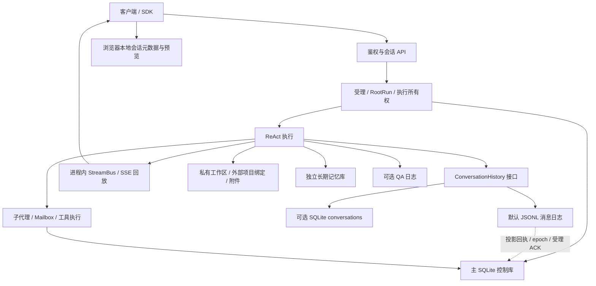
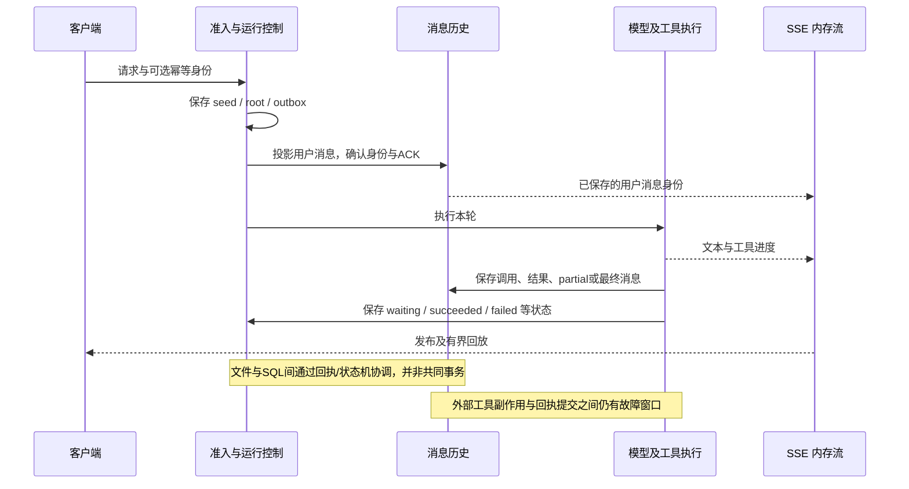

# Aether Engine 会话存储机制深度调研

实施阶段已完成增量优化，见 [实施与验收报告](D:/dev/ai-agent-engine/docs/research/session-storage-audit-2026-11-05/implementation-report.md)。下文“未修改实现”等描述限定于最初调研阶段，当前行为以实施报告为准。

后续实测补充：[实际数据库与JSONL容量审计、存储优化方案](D:/dev/ai-agent-engine/docs/research/session-storage-audit-2026-11-05/capacity-report.md)。该补充检查了用户指定的实际数据目录；本文主体仍是原先的源码与隔离测试调研。

日期：2026-11-05，Asia/Shanghai。范围：`D:/dev/ai-agent-engine` 当前工作树，HEAD 为 `d25d93a68ce44b5bc5498584434b40c9ac9b7441`，**包含调研开始前已存在的未提交修改**。本次只新增调研材料与合成数据探针，没有修改引擎实现，也没有读取实际用户会话、实际数据库、`.env` 或凭据。

结论：这个引擎采用 **JSONL 消息档案 + SQLite 控制状态 + 独立文件/记忆存储** 的混合架构。它已经具备较细的准入幂等、删除时停止执行、条件结果投影、协作回执和上下文压缩能力；但这些保障在不同写入路径、后端和客户端之间并不统一。不能把它概括为“聊天记录写进 SQLite”，也不能把“有历史、有 durable 字段”理解为任意故障后可无损续跑。

## 1. 最值得先记住的结论

1. **默认正文在 JSONL。** 只有 `HISTORY_BACKEND=sqlite` 才选 SQLite 正文后端；即使选 JSONL，SQLite 仍承担 Agent 绑定、运行、受理、协作、回执等控制状态。
2. **存在多种历史视图。** 物理日志、用户归档、当前模型上下文、UI 展示和实时流投影各自不同；`getFullHistory()` 也不等于压缩前全部原文。
3. **两后端压缩语义不等价。** JSONL 保留旧正文供搜索；SQLite 全量压缩删除被替代的正文，只额外保留用量。切回 SQLite 也没有自动反向同步。
4. **断线续看、状态恢复和自动续跑是不同能力。** 默认请求在 root 已受理、执行开始后不因 SSE 断开而停止；受理前的准备阶段仍会取消。进程重启后活动 root/child/command 通常标为 interrupted。完整持久发布恢复模块已有实现，但默认 buildServer 没打开相应注册开关。
5. **删除会话不等于擦除全部关联数据。** JSONL tombstone、`.bak`、迁移旧表、用户受理种子、记忆、计划、改动证据和可选 QA 日志都需独立考虑。
6. **已复现普通 JSONL append 的两个边界缺口。** 坏半行尾之后继续写入可出现“热读可见、冷读丢失”；显式重用已被压缩隐藏的旧消息 ID 可重复归档与计费。这些有具体前置条件，不能泛化为正常新 UUID 聊天都会触发。
7. **旧 API 与新机制衔接不足。** workspace 改名遗漏 JSONL 和多张关联表；general profile 的旧编辑/重生成直接查 SQLite；旧删除入口没有新删除链的完整执行隔离。

入口证据：[存储工厂](D:/dev/ai-agent-engine/src/storage/conversation/factory.ts:15)、[历史接口](D:/dev/ai-agent-engine/src/core/agent-context/types.ts:140)、[默认服务器注册](D:/dev/ai-agent-engine/src/api/http/server.ts:115)、[恢复开关](D:/dev/ai-agent-engine/src/api/http/routes/chat.ts:515)。

## 2. 数据拓扑：会话不是一个对象的一次保存

**数据分散的直接后果：** 单独复制 `agent.db` 不能完成会话备份；删除 `sessions` 表的一行也不能删除会话；恢复聊天文字不能恢复终端进程、工具副作用或模型内部生成状态。

## 3. 本次展开的 32 个维度

| # | 维度 | 核心问题与已查边界 |
|---|---|---|
| 1 | 身份与术语 | tenant/session/turn/run/attempt/message/toolCall/stream/seq 的区别 |
| 2 | 物理位置 | DATA_DIR、sessions 目录、工作区、记忆、改动快照、日志 |
| 3 | Schema | 主表、动态控制表、JSONL 信封、内部 metadata 字段 |
| 4 | 后端选择 | 默认 JSONL；SQLite 回退和迁移不是对称操作 |
| 5 | 创建与绑定 | 空会话、首次 Agent 锁定、失败留下的绑定、并发首次绑定 |
| 6 | 写入时机 | 用户、工具调用、工具结果、partial、最终 assistant 何时提交 |
| 7 | 并发 | tenant 锁、session 队列、DB 子进程事务、多进程边界 |
| 8 | 幂等 | requestKey/bodyDigest、消息 ID、条件 anchor、outbox ACK |
| 9 | 原子性 | 单 SQL 事务、JSONL+SQL 协调、文件与外部副作用非原子 |
| 10 | 故障恢复 | 半行、重复写、重启中断、等待状态、版本和 epoch |
| 11 | 流式交付 | SSE 游标、回放上限、断线生存期、订阅者背压 |
| 12 | 内容投影 | display/modelInput/current/archive/live snapshot 的区别 |
| 13 | 压缩 | microcompact、摘要、预算、原文是否保留、压缩 CAS |
| 14 | 原文检索 | 当前会话搜索、messageId 回读、字面查询、分页成本 |
| 15 | 多模态 | 图片像素与 URL、附件提取快照、文件版本证据 |
| 16 | Token 与成本 | 上下文估计、调用账单、未知/暂定计数、删除后的账单变化 |
| 17 | 编辑与删除 | 新旧 API 差异、tombstone、`.bak`、清理收据 |
| 18 | 截断与回滚 | 历史截断不回滚工具副作用，不是完整会话分支 |
| 19 | 重命名 | 标题、私有目录和 sessionId 被混用导致迁移不完整 |
| 20 | 子代理 | 独立 child session、事件/检查点、父会话结果投影 |
| 21 | 协作与审批 | mailbox、投递确认、pending、controller 生命周期 |
| 22 | 工作区 | scratch 与外部项目根、绑定持久化、lease 与并发 |
| 23 | 长期记忆 | 与聊天正文分库，scope/mode、抽取失败和删除残留 |
| 24 | 任务及自动化 | Todo/plan、Cron、command jobs、文件改动证据 |
| 25 | 缓存 | 活动视图 LRU、用量缓存、物理缓存与失效依据 |
| 26 | 查询规模 | 全量读、两遍扫描、索引、列表聚合、tenant 阻塞 |
| 27 | 认证与隔离 | tenant 边界、userId 非 ACL、代码默认与部署默认 |
| 28 | 隐私与擦除 | 明文、副本、日志、备份、逻辑删除不是物理清除 |
| 29 | 升级迁移 | 启动迁移与 CLI 差异、懒迁移错误、标记文件 |
| 30 | 备份恢复 | 跨 SQL/JSONL/文件的一致快照和恢复验证 |
| 31 | 客户端契约 | localStorage、刷新恢复、Markdown 导出、SDK envelope |
| 32 | 可观测与验证 | 源码证据、定向测试、故障探针、未验证环境边界 |

## 4. 身份模型：排障前先对齐这些 ID

| 标识 | 语义 | 不应混淆的对象 |
|---|---|---|
| tenantId | 访问控制和存储分区 | metadata.userId |
| sessionId | 包含多轮的聊天容器 | 单轮 conversationId |
| conversationId / turnId | 一轮用户交互及后续工具/回答 | 一条 assistant 消息 |
| rootRunId / runId | 一次有状态运行 | JSONL 文件名 |
| attemptId | 等待恢复或执行尝试的身份边界 | 同轮所有尝试的共同身份 |
| messageId / UUID | 稳定消息身份 | SQLite 自增 row ID |
| toolCallId | 调用与结果的配对身份 | 工具名称 |
| streamId:sequence | 某一个流的回放游标 | 可跨重启复用的全局事件位置 |
| generation / epoch | 撤销旧执行或旧投影权 | 普通业务版本号 |

SQLite row ID 在普通全量压缩重建近期消息后可能变化；JSONL 的 dbSeq 也不是所有物理行共同递增的数据库 LSN。JSONL 虽有 parentUuid，但当前读路径没有提供可选分支 DAG。历史 truncate 表示删除后续消息，不表示把文件系统、外部 API 和长期记忆一起回滚。

还存在兼容字段命名：部分最终 SSE usage 帧的 `conversationId` 被赋值为 assistant messageId，须按具体协议解释，不能仅按字段名称跨接口 join。证据：[react.ts](D:/dev/ai-agent-engine/src/core/agent-loop/react.ts:1708)。

## 5. 物理存储和数据所有权

| 数据 | 主要位置 | 是否能独立恢复完整会话 |
|---|---|---|
| 消息正文/编辑/摘要/逻辑删除 | 默认 `dirname(DATA_DIR)/sessions/<tenant>/<session>.jsonl` | 否，缺控制和关联资源 |
| Agent 初始绑定 | 主库 `sessions` | 否，本表不是会话正文库 |
| Root、入场种子、outbox、运行状态 | 主 SQLite 中的 root/admission 表 | 能恢复受理证据与状态，不能重建所有执行副作用 |
| 子代理/协作/投影回执 | 主 SQLite 的多组控制表 | 与父历史原始 anchor、epoch、文件身份关联 |
| 工作区文件/上传附件 | 私有 root/tenant/session；外部项目另有 binding | 文件与聊天文本需一起备份 |
| 工作区 binding | 可由 AETHER_WORKSPACE_BINDINGS_FILE 指定；设置DATA_DIR时默认同目录workspace-bindings.json，否则WORKSPACE_ROOT/.aether-workspace-bindings.json | 保存绑定，不是目标项目内容 |
| 长期记忆 | 默认 `dirname(DATA_DIR)/memory/memory.db` 和配置scope | 不是会话档案的替代品 |
| 文件改动证据 | file_changes 与 change-snapshots | 记录差异/证据，不保证所有工具副作用可逆 |
| CLI/命令结果 | command_jobs、command_job_output 等 | 重启恢复结果与中断状态，不恢复原进程 |
| 浏览器展示数据 | localStorage / sessionStorage / 内存 | 不能代替服务器备份 |
| QA 日志 | 可选 `logs/qa` 或 QA_LOG_DIR | 可能含正文副本，但非规范恢复格式 |

`DATA_DIR` 名称容易误导，它实际是数据库文件路径。还有一个实例隔离陷阱：`/data/a.db` 与 `/data/b.db` 的 JSONL 根目录均为 `/data/sessions`；同目录只改 DB 文件名不能隔离同 tenant/session 的归档。依据：[jsonl-history.ts](D:/dev/ai-agent-engine/src/storage/conversation/jsonl-history.ts:252)。

## 6. SQLite 与 JSONL 的关键差异

| 对比 | 默认 JSONL | SQLite |
|---|---|---|
| 普通写入 | 追加文件，再更新缓存 | 条件 INSERT |
| 持久性 | 普通 append 无显式 fsync；特定受理/结果路径有 sync | WAL + synchronous=NORMAL；不能据此承诺每次提交抗掉电 |
| 全量压缩 | summary 隐藏原文，原行仍在 | 删除被替代正文，保留摘要/近期消息及独立 usage |
| microcompact | update 行保留原工具内容 | metadata 保留原工具内容 |
| 默认窗口 | 未显式传 maxTokens 时不取 HISTORY_MAX_TOKENS | 默认 HISTORY_MAX_TOKENS=20000 后经 OSM 倍率 |
| inheritContext=false | 最后 user 及其后消息 | 只保留最后 user |
| 会话列表 | 遍历 JSONL；mtime、活动消息计数 | SQL 聚合；created_at、user/assistant 计数 |
| 按消息找 session | 未给 session 时需扫租户文件 | SQL 条件查找 |
| 原文分页 | 两遍文件扫描，页正文有界，仍有 O(n) 索引/扫描成本 | 活动表，无等价完整历史归档能力 |
| 单条/单轮删除 | 追加 tombstone，原字节还在 | DELETE 当前行和相关 usage |
| clear | 原文件改为 `.bak`，写 cleared marker | 删除当前正文与 usage；SQL删除也非安全擦除 |
| 后端迁移 | 首次读时可从旧 SQLite 懒迁移 | 没有持续接收 JSONL 新写入的反向同步 |

完整 schema、JSONL 行格式、源码入口和实测结果见 [存储后端分报告](D:/dev/ai-agent-engine/docs/research/session-storage-audit-2026-11-05/storage-backends.md)。

## 7. 一条消息到“可恢复”经过哪些边界

上图是具备受理机制的流程概括。客户端可以使用 requestKey、bodyDigest、namespace、前驱身份查询受理回执；服务端也保存受理种子。具体幂等保证取决于调用入口和身份，不是把任意旧 POST 重发都自动认作同一请求。

并发保障分层存在：通用 history wrapper 按 DATA_DIR+tenant 串行；JSONL 再按 session 排队；破坏性修改使用 mutation lease/generation；SQLite 条件结果把 anchor 检查、插入和回执放在同一事务；JSONL 专用投影用 pending、精确字节、sync、epoch 和 committed receipt 协调。

这些锁中的多个是**进程内**锁。它们不能证明多个引擎进程共享一个 JSONL 目录时仍有单写者和唯一序号。共享部署需要额外验证 owner、路由归属、跨进程锁及重启接管协议；现有局部事务不能替代整套集群一致性证明。

## 8. 压缩之后，到底还保存了什么

- 模型上下文是压缩后的活动消息加摘要；UI 默认 history 也主要读这个投影。
- JSONL archive 可取回被摘要隐藏的原消息，同时服从用户后续编辑、删除；它不等于原始物理文件字节。
- `search_history` 在当前 tenant/session 内按关键词或 messageId 查询；每页最多 10 条，每次正文片段 2,000 字符，可继续翻页。
- 归档保存的 `modelInputContent` 可以保留当时的附件解析结果。图片如果只有 URL 引用，不能据此声称已保存原始像素。
- 普通工具结果在 append 前可能已经截断；JSONL 保留原文只能保留“当时实际写下的内容”。
- microcompact 主要减少模型输入，不减少文件体积；JSONL 新增 update/summary 行，磁盘甚至继续增长。
- 摘要可检索不等于语义无损：模型未必主动查回遗漏事实。工具原文、用户约束和可追溯 messageId 应共同作为恢复机制。

压缩阈值基于模型窗口、系统/工具开销、输出预留和请求预算，默认比例为 0.92，经 OSM 规则调整；还存在回合结束维护。README 的“固定 500000、无损、后台无限上下文”表述不足以精确描述当前实现。详见 [执行与投影分报告](D:/dev/ai-agent-engine/docs/research/session-storage-audit-2026-11-05/runtime-projections.md)。

## 9. 故障与恢复矩阵

| 场景 | 当前能恢复/保证什么 | 不能据此承诺什么 |
|---|---|---|
| 浏览器 SSE 断开，进程仍活着 | root受理并开始后的默认durable请求继续，可重连或读快照；准备阶段仍会取消 | 旧 console 一定正确接入全部恢复API |
| 游标过期或属于另一个 stream | 明确要求 snapshot_required | 无限事件日志回放 |
| 进程正常关闭 | 停止并等待受管执行、命令和 DB 关闭 | 已终止任务自动在下一次启动续跑 |
| 引擎重启时 root 正在运行 | 标为 interrupted，历史及运行证据留存 | 从模型生成到一半的位置继续 |
| root 在 waiting | 保留 pending 和原工具身份，可按恢复协议回答 | 对任意旧请求重复执行都安全 |
| child queued/running/cancelling | 转 interrupted，用量可标 unknown | 子任务原调用栈和进程存活 |
| 协作 root 未正常关闭 | 修复为 interrupted 等明确状态 | 所有消息都已成功执行且副作用恰好一次 |
| command job 进行中 | 结果/输出及 interrupted 状态 | 自动重新绑定任意旧 PID/PTY |
| 普通 JSONL 留坏半行尾后继续追加 | 当前存在已复现冷热不一致缺口 | append 返回即代表新实例能读到 |
| 特定受理/条件结果 ACK 丢失 | 可凭持久记录、身份、原字节重读/修复 | 普通写入也有完全相同保障 |
| 整机掉电 | 本次未测试；fsync和SQLite设置有不同保证级别 | 零消息丢失的 RPO=0 |

SSE 默认回放为 2,048 帧/8 MiB，已结束流通常保留一分钟。完整现代发布模块可按关键事件以及 1 秒或 64 帧阈值保存 checkpoint，但默认生产注册未启用三项相关开关，不能把候选能力当现状。上述时间阈值是在事件到来时检查，亦不是每秒独立定时刷盘承诺。

## 10. 删除、遗忘、回滚与重命名

新的 conversation 删除链先获取修改租约、验证目标、撤销 generation、停止并等待 root/child/command，再重读并修改；这是已有的重要可靠性设计。旧 general messages 删除入口尚未统一到这条链。

| 用户动作 | 当前含义 | 常见误解 |
|---|---|---|
| 删除消息/一轮 | 从可见历史和对应用量中移除；JSONL用标记 | 所有物理字节立即消失 |
| 清空历史 | 清父历史、相关子运行及 root turn；保留绑定和工作区 | 重置整个会话所有资源 |
| 硬删会话 | 再删 Agent 绑定，默认删除私有工作区 | 擦除长期记忆、种子、计划、QA、备份和所有关联表 |
| keepWorkspace=true | 保留私有文件 | 已清理全部其他内容 |
| 截断/重生成 | 重设消息历史后缀 | 回滚已经执行的 shell/API/文件副作用 |
| UI 改标题 | 旧 console 仅修改本地会话元数据 | 服务端保存并跨设备同步 |
| workspace/rename | 改私有目录及 conversations/memories 的 session_id | 完整迁移 JSONL、sessions、运行与关联资源 |

特别核实：硬删使用的 `WorkspaceManager.getPath()` 始终是私有 root/tenant/session，**不会因外部绑定而直接删除外部项目根**。绑定项目目录走另一接口。证据：[manager.ts](D:/dev/ai-agent-engine/src/workspace/manager.ts:182)。

但绑定文件自身、memory.db 节点/偏好、Todo/plan、change snapshots、受理种子及部分控制记录没有在该删除链中统一清理。目录删除异常还可能只记录日志而返回成功。产品应定义“从列表隐藏”“可恢复删除”“物理清除”三个契约，并返回逐资源清理结果。

## 11. 安全、客户端与数据副本

服务端权限边界主要是 tenant；同租户多 user 并没有天然的私有 session ACL。metadata.userId 只是业务数据。若部署模型是一用户一租户，这可以满足隔离；若变为团队共享租户，就需要 owner/member 权限。

代码在 AUTH_ENABLED 未设为 false 时开启认证；但当前 docker-compose 明确把其默认值设为 false。不能脱离启动方式概括“默认已鉴权”或“默认匿名”。依据：[docker-compose.yml](D:/dev/ai-agent-engine/docker-compose.yml:15)，完整链见 [API 分报告](D:/dev/ai-agent-engine/docs/research/session-storage-audit-2026-11-05/session-api-security.md)。

正文、思考内容、工具参数、模型输入快照和 metadata 在历史模块中以 JSON/SQL 文本保存，未见透明正文加密或统一脱敏。配置密钥加密不等于会话加密；磁盘权限、磁盘加密和备份访问由部署承担。

旧 console 以固定 `mac-session-store` 保存会话列表、标题/预览、usage、选项，不存完整 messageMap/runningSessions；没有 server+tenant 命名空间。刷新后虽可能剩 SSE 游标，却没有继续流所需的 streaming 消息条件，通常走普通 history。应从 server status/snapshot 重新协商恢复。

Markdown 导出优先缓存，否则读 history，不读完整 archive，因此不能作为原始会话备份。这些 SDK 方法使用的默认解包路径只保留 response.data，丢失 pagination/metadata，也就丢失 history 附带的 runs/usage 等信息；通用 fetch 虽另有 raw 旁路，这组封装未使用它。

QA_LOG_ENABLED=true 时还会产生独立 Markdown 副本，含 system、RAG、工具、历史与回答；默认不开。删除治理、备份和容量统计必须把“可能开启的副本”纳入，而不是假设只存在一份聊天文件。

## 12. 性能、容量与计费

| 热点 | 当前实现 | 工程含义 |
|---|---|---|
| JSONL 活动缓存 | 每实例 64 会话/约64 MiB LRU | 不限制第一次 readFile/split 的峰值内存 |
| 物理缓存 | 全局4条/约32 MiB，绑定数据库/owner/文件revision | 安全失效较细；不是持久索引 |
| 归档分页/搜索 | 两遍文件扫描，标记与ID索引仍随量增长 | 页小不代表查询只读一小段 |
| 会话列表与无session的ID查询 | 扫租户多个JSONL；列表后再内存分页 | 会话数和归档体积共同影响延迟 |
| tenant锁 | 读写共用；压缩网络阶段可释放 | 长扫描可能影响同租户其他会话 |
| 热append | active数组查重及复制 | 长未压缩会话可能呈累积O(n²)成本 |
| microcompact/full summary | 减少模型活动内容 | 不等价于磁盘GC |
| SSE与投影 | 分别有限额和截断标志 | UI应能处理刷新快照与不完整投影 |

账单 usage、消息 tokens、最新 currentPromptTokens 是三个口径。SQLite usage archive 可以让压缩后账单不丢；JSONL扫描归档汇总。但用户主动删除会影响会话累计用量，它不是不可变财务账本。需要精确计费时应建立独立 provider invocation ledger，并把未知、估计、暂定的用量显式保留。

没有对百万消息、网络文件系统或多引擎共享写做压力测试；已有分页测试覆盖25,000条合成消息，不能据此外推生产延迟或集群可靠性。

保留策略也不统一：终态 command jobs 默认保留7天、全局最多500条、每session最多100条，活跃任务不按该规则清掉；这不是整个会话的TTL。记忆整理目前只衰减强度并列出候选，没有真正删除弱记忆，main默认只为default租户/global scope启动该守护。历史、受理种子、mailbox等未见覆盖全体系的统一TTL/GC。长期记忆的session/global开关彼此独立，当前默认session开启、global关闭；关闭开关不会擦除已保存记忆。详见关联生态分报告第8、9节。

## 13. 需要优先处理的事项

“已复现”指本次合成数据探针观察到；“源码确认”指执行路径直接可见；“风险推断”仍需专项并发/故障验证。

| 优先级 | 事项 | 证据级别及触发条件 | 建议验收标准 |
|---|---|---|---|
| 高 | 普通JSONL坏尾后的成功写入冷读丢失 | 已复现；预先存在非LF结束的坏半行 | 注入每个截断位置后恢复，成功ACK的消息新实例均可读取 |
| 高 | 压缩后普通消息ID查重遗漏归档 | 已复现；显式复用已压缩旧ID | 压缩前后、重启前后同ID恰好一份，payload冲突明确报错 |
| 高 | workspace改名导致会话身份拆分 | 源码确认；JSONL和多表未迁移 | sessionId不随展示改名改变；或完整迁移可失败恢复 |
| 高 | general旧编辑/重生成绕开后端抽象 | 源码确认；消息只存在JSONL时旧SQL查不到 | 新JSONL会话编辑/重生成/删除通过统一history与修改租约 |
| 高 | 后端回切出现旧新数据分叉 | 源码确认；JSONL后续无反向双写 | 显式迁移、校验与切换记录；禁止无提示回切 |
| 高 | 硬删除与隐私清除契约不完整 | 源码确认；多份正文/关联资源留存 | 资源清单、保留例外、清理收据、可重试GC和副本验证 |
| 中高 | 多进程JSONL单写者未被通用锁证明 | 风险推断；同目录多进程 | 两进程并发、崩溃接管、旧owner回写均有确定结果 |
| 高 | 第二实例启动可能中断第一实例的运行记录 | 源码确认启动恢复无实例owner存活筛选；实际竞争影响尚未压测 | recovery只接管租约已失效的owner，活跃实例不被误标interrupted |
| 中 | 懒迁移读取失败被视为空历史 | 源码确认错误窗口，未注入复现 | 读失败不得创建遮蔽旧数据的新文件；明确迁移状态 |
| 中 | 两后端窗口/继承/列表统计口径不同 | 部分已实测 | 建立backend parity契约测试并明确允许差异 |
| 中 | 客户端缓存和恢复滞后 | 源码确认+运行行为推断 | tenant/server隔离；刷新/断网/后台完成通过snapshot恢复 |
| 中 | 默认路径与候选持久恢复能力混淆 | 默认注册链确认 | 能力协商与生产集成测试；未启用时准确声明 |
| 中 | 当前测试存在5项失败 | 本次测试结果 | 区分fixture问题与行为断言，修复后单独验证 |

复现代码：[storage-probe.ts](D:/dev/ai-agent-engine/docs/research/session-storage-audit-2026-11-05/storage-probe.ts)。结果包含 `warm=[before,after] / cold=[before]`，以及6个唯一消息各2 tokens压缩重试后累计14而非12。专用条件子代理写入有独立持久回执保护，不能套用普通append结论。

## 14. 备份与恢复应覆盖什么

当前未发现覆盖全部会话资源的一键一致备份/恢复产品接口。可落地的备份方案至少需要以下范围：

1. 主 SQLite 的一致快照，包括运行、准入、协作、回执和用量；运行中的 WAL 库不能只复制 `.db` 后就宣称完整。
2. 与主库一致时点的 JSONL、`.migrated` 和按保留策略处理的 `.bak`；不能随意重写带有 byte-offset/digest 引用的文件。
3. 工作区、上传附件、workspace bindings、变更快照；外部绑定项目内容应有独立备份策略。
4. memory.db；需要知识检索重建能力时还应包括独立知识库和相关文件。
5. 当时的必要配置/版本、受保护密钥管理、实例/租户命名空间；可选QA日志按隐私策略决定是否备份。

推荐流程是取得统一写入屏障或有序停止执行与关闭存储，再备份各介质，生成 manifest、版本与校验和；恢复到隔离目录后验证消息数量、archive revision、usage、等待状态、工具anchor、绑定目标及附件存在性。仅打开聊天面板看到文字，不能作为完整恢复验收。

若怀疑“历史消失”，优先检查：是否改了DATA_DIR父目录/工作目录、HISTORY_BACKEND、tenant/sessionId、workspace rename、是否只在读压缩投影、是否SSE游标过期、是否客户端缓存旧身份；再检查迁移marker、坏尾与备份。不要先执行 clear/delete 来排障。

## 15. 验证范围与结果

本次各组共610次测试执行（不含5项重复复核），扣除重复执行的7项model-input-content和1项history-projection，合计 **39个不同测试文件、602项不同测试：597通过，5失败**。另对compaction-progress的5项做了一次复核，失败保持一致；并运行1份合成故障探针。

| 测试组 | 结果 | 说明 |
|---|---|---|
| 执行/流式/压缩/投影 | 198/200通过 | 8文件 |
| 归档检索/图片/附件/快照 | 54/54通过 | 5文件，其中7项与存储组重复 |
| 存储后端/SQLite进程/迁移 | 208/210通过 | 18文件 |
| API/鉴权/删除/恢复 | 37/37通过 | 4文件，其中1项与首组重复 |
| 准入/协作/运行/记忆/工作区 | 108/109通过 | 6文件 |

5项失败分为：

- 2项 `history-compress-tombstone`：旧db mock缺少getDbEpoch，构造阶段失败。
- 1项 `manager-persistence`：新进程测试依赖的预编译workspace/manager.js不存在。
- 1项 `compaction-progress`：Windows临时目录清理EPERM，发生在afterEach。
- 1项 `compaction-progress`：light cleanup预期succeeded、实际failed；本次未定位到足以确认根因，保留为待调查行为失败。

测试使用隔离fixture，没有执行真实模型调用，没有进行真实掉电、真实多实例生产恢复或真实账户数据检验。未运行全仓库测试/类型检查，因为本次是读代码调研且工作树包含其他进行中改动；这里的通过数只代表上述定向范围。

## 16. 深入阅读与证据

| 材料 | 内容 |
|---|---|
| [存储后端](D:/dev/ai-agent-engine/docs/research/session-storage-audit-2026-11-05/storage-backends.md) | 文件/表结构、JSONL折叠、压缩、锁、缓存、迁移、半行及重复ID实证 |
| [API与客户端](D:/dev/ai-agent-engine/docs/research/session-storage-audit-2026-11-05/session-api-security.md) | 认证隔离、创建绑定、查询/删除/改名、console、SDK与导出 |
| [执行与投影](D:/dev/ai-agent-engine/docs/research/session-storage-audit-2026-11-05/runtime-projections.md) | 写入时机、模型输入、摘要、图片、SSE、发布能力开关、日志 |
| [持久运行与关联生态](D:/dev/ai-agent-engine/docs/research/session-storage-audit-2026-11-05/durability-ecosystem.md) | root/admission、子代理/mailbox、workspace、记忆、计划、Cron与清理矩阵 |
| [源码版本清单](D:/dev/ai-agent-engine/docs/research/session-storage-audit-2026-11-05/source-manifest.json) | HEAD、工作树范围和关键源码SHA-256，便于后续复核 |
| [存储验证](D:/dev/ai-agent-engine/docs/research/session-storage-audit-2026-11-05/storage-verification.json) | 两组测试与故障探针结果 |
| [API验证](D:/dev/ai-agent-engine/docs/research/session-storage-audit-2026-11-05/session-api-verification.json) | 文件级测试数量及独立复核记录 |
| [运行生态验证](D:/dev/ai-agent-engine/docs/research/session-storage-audit-2026-11-05/durability-tests.json) | 6文件109项结果与构建前置缺失说明 |
| [运行/流式验证及总计](D:/dev/ai-agent-engine/docs/research/session-storage-audit-2026-11-05/runtime-verification.json) | 本地两组测试、复核结果与去重计数 |
| [压缩复核日志](D:/dev/ai-agent-engine/docs/research/session-storage-audit-2026-11-05/compaction-progress-recheck.txt) | 保留2项失败明细 |
| [归档与快照测试日志](D:/dev/ai-agent-engine/docs/research/session-storage-audit-2026-11-05/archive-and-snapshot-tests.txt) | 54项通过结果 |
