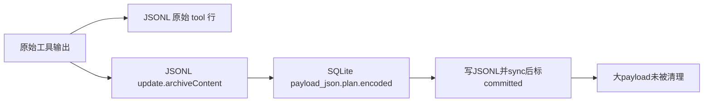

# 实际存储体积审计与优化方案

日期：2026-11-05（Asia/Shanghai）。审计路径：`C:/Users/wb.xielin02/AppData/Roaming/aether-code/engine/state`。本次检查实际文件、SQLite页分布和JSONL结构，只输出数量、字节和状态聚合；没有输出聊天正文、命令正文、凭据或会话ID，没有清理或修改现有数据。

**结论：当前数据库大的主要原因不是子代理，而是已完成历史维护留下的大恢复正文和安全审计日志。内存不是解决这些持久数据重复的首选；先消除重复保存，再给数据定义保留期。**

## 1. 截图里的“数据库3文件”是什么

当前aether-code的分类精确匹配 `agent.db`、`agent.db-wal`、`agent.db-shm`；因此是一个主数据库及两个辅助文件，不是三个业务数据库。WAL是写前日志，SHM是SQLite协调访问所用的共享内存映射文件；SHM文件不代表应用业务数据全在RAM。

“会话历史”统计sessions子树的所有普通文件，不筛扩展名，因此截图的13文件不能直接解释成13个会话。界面统计有60秒缓存和扫描上限。本次读到的文件数量/大小与截图不同，以下只使用本次实际测量，不能把两者混为同一时点或据此确定增长原因。

来源：[分类规则](D:/dev/aether-code/src/main/engine/diagnostics.ts:540)、[文件扫描](D:/dev/aether-code/src/main/engine/diagnostics.ts:827)、[缓存](D:/dev/aether-code/src/main/engine/diagnostics.ts:770)。

| 本次文件类别 | 大小 | 数量/说明 |
|---|---:|---|
| 会话JSONL | 338.68 MiB | 158文件；本次未发现该目录内bak/marker等其他文件 |
| 主数据库三文件 | 92.70 MiB | agent.db 87.29；WAL 5.38；SHM 0.031 |
| 长期记忆三文件 | 4.21 MiB | memory.db约0.215；WAL约3.965；SHM约0.031 |
| 文件变更快照 | 1.97 MiB | 32文件 |
| 其他 | 0.126 MiB | 6文件 |
| 合计 | 437.69 MiB | 当前state目录的普通文件逻辑长度，不含外部项目 |

## 2. SQLite里面到底什么最占空间

以下按SQLite `dbstat` 实际页面归属统计，**包含各表自己的索引**；分母是87.29 MiB主数据库逻辑页，不把WAL重复计入业务表。

| 数据域 | 页面占用 | 实际内容/数量 |
|---|---:|---|
| `collaboration_history_maintenance` | **54.09 MiB** | 116条历史维护恢复记录，全部committed；115批update、1批summary |
| `security_audit_log` | **20.43 MiB** | 31,379条策略审计；其中表17.56、索引2.86 MiB |
| `file_changes` | 4.02 MiB | 451条文件变更，含旧/新正文 |
| `command_jobs` + `command_job_output` | 4.11 MiB | 500条命令任务、4,566条输出记录 |
| 所有 `subagent_*` 表及索引合计 | **0.98 MiB** | 当前2个子运行、61条事件及相应检查点/工具版本等 |
| 其他表、索引和空闲页 | 3.65 MiB | 其中freelist约1.73 MiB |

额外直接验证：**`conversations` 表当前是0行**。因此这份数据库的大头确实不是旧SQLite聊天正文残留。

maintenance+audit占主库约85.4%；`subagent_*`约1.1%。`collaboration_`的表名前缀不等于“子代理聊天内容”：该维护表服务于绑定了协作执行边界的历史修改，主会话也可以产生。

子会话文件也不是当前主要占用：能与子运行表匹配的2个JSONL总共约0.115 MiB；另有4个subagent前缀但当前无对应记录的文件约2.26 MiB。后者只表示命名/关联状态，不能直接据此自动删除。

## 3. 为什么116条维护记录就占54 MiB

当前维护路径为了应对“JSONL写成功、SQLite确认丢失”，先把将要追加的**完整字节**保存到数据库，再写JSONL、fsync、核验，最后将记录标为committed。

具体问题在于microcompact：它把模型可见工具结果改成短占位符，却把完整旧内容放进更新行的 `archiveContent`。JSONL原始tool行仍保留；数据库恢复记录又保存整批更新行的 `plan.encoded`。

本次维护记录的精确聚合：

- update共115条，payload_json约53.73 MiB；其中解码后的plan.encoded约50.61 MiB。
- summary共1条，payload_json约38.4 KiB。
- 所有维护记录都为committed，没有pending；总payload_json约53.77 MiB。
- 成功提交代码只更新state/committed_at，没有移除大payload。
- 当前生产源码读取该payload的恢复查询只选择 `state='pending'`；未找到committed大正文的后续消费者或自动GC。

来源：[生成archiveContent](D:/dev/ai-agent-engine/src/storage/conversation/jsonl-history.ts:1420)、[生成完整encoded恢复计划](D:/dev/ai-agent-engine/src/storage/conversation/jsonl-history.ts:1760)、[保存恢复记录](D:/dev/ai-agent-engine/src/core/collaboration/history-maintenance.ts:78)、[读取pending和提交](D:/dev/ai-agent-engine/src/storage/conversation/jsonl-history.ts:1709)。

**优先改法：pending保留完整恢复数据；提交成功时把大正文转为小型终态凭据。** 必须先完成文件sync与验证，再在同一SQL事务中提交终态标记和正文瘦身，不能先删pending恢复材料。保留身份、epoch、anchor、文件身份、offset、bytes、hash、提交时间和格式版本。不要只把payload改成`{}`却留下含义不明的旧payload_hash；需要显式区分原始payload哈希和瘦身后的manifest。

这部分约53.77 MiB是明确的优化候选，不是本次已经释放的空间。存量迁移应只处理已提交/已确认失效且不再被恢复引用的数据；pending不能因“太大”放RAM或直接TTL删除。

## 4. JSONL比数据库更大，也存在同一类重复

| JSONL行类型 | 大小 | 行数 |
|---|---:|---:|
| tool | 198.31 MiB | 23,793 |
| update | 91.58 MiB | 8,644 |
| assistant | 48.60 MiB | 23,884，含工具调用声明，不等于这么多最终回答 |
| user | 0.183 MiB | 173 |
| summary/tombstone | 约0.016 MiB | 4 |

8,644条update的archiveContent逐条与其原始tool内容比较SHA-256，**全部相同**，合计重复的解码正文约75.95 MiB。原文在原始tool行中已经存在，可考虑让update只保存原文版本引用和内容hash，而非再次复制原文。

还识别出225次内嵌图片data URL，合计129.00 MiB编码文本；按完整data URL内容去重为119个、70.56 MiB。这个统计只覆盖已识别的image data URL，不保证覆盖所有图片编码形态。它与上面的archiveContent重复量互相重叠，**不能把两项直接相加当作可节约容量**。

这支持第二个优化：图片/大工具输出转成内容寻址的文件，消息只放blob引用、hash、类型、长度和简短展示内容。图片以PNG/JPEG等原始二进制保存，可同时避免Base64约4/3的编码膨胀与重复图片文本。

压缩试算也说明不能简单给一个“压缩十倍”的承诺：最大的JSONL105.96 MiB，gzip level6试算78.54 MiB；第三大的10.07 MiB则可到约0.406 MiB。已压缩图像和普通文本的压缩收益差异很大。本次只将压缩输出计数后丢弃，没有生成或替换归档文件。

现有协作回执依赖物理文件identity/offset/hash。**不能直接重写活跃JSONL来去重或gzip**；应先引入兼容的引用格式、不可变封存分段、索引与迁移代数，再迁移并验证检索/回放/回执。

## 5. 安全审计为什么有两万多重复目标

本次31,379条中，31,349条是cmd/allow；同category+decision+target有2,950种目标组合，重复出现28,429次。这只是重复正文统计，不代表28,429次评估都能删掉，重复执行本身也可能是合法行为。

源码可确定的写放大：一个正常允许执行的命令，依次经历批预检、registry入口预检、并发池内复检和工具执行前预检，每次都写完整target。`node -e`/`python -c`等内联脚本也会完整进入target。拒绝/等待会提前返回，不能将总行数直接除以4当作执行次数。

来源：[批预检](D:/dev/ai-agent-engine/src/core/agent-loop/tool-batch.ts:93)、[registry两次预检](D:/dev/ai-agent-engine/src/core/tool-registry/registry.ts:44)、[执行前预检](D:/dev/ai-agent-engine/src/tools/cmd/execute-command.ts:75)、[审计INSERT](D:/dev/ai-agent-engine/src/security/audit-log.ts:38)。

改法是**保留所有必要安全检查，减少重复正文保存**：以toolCall/run/attempt+phase关联审计事件；完整结构化命令证据只存一次，多个阶段引用同一证据；决策变化单独保留。不同租户不能通过内容hash绕过授权访问正文。

当前有手动purgeOlderThan和管理员清理接口，默认30天只是手动参数，没有自动TTL调度；aether-code中也未见对应清理入口。应加入可配置在线期限、归档和分批GC，保留ask/deny/error/权限变更及清理操作证据。现有清理SQL没有tenant条件，接入自动化前还需明确实例/租户权限边界。

来源：[清理方法](D:/dev/ai-agent-engine/src/security/audit-log.ts:105)、[手动API](D:/dev/ai-agent-engine/src/api/http/routes/security.ts:85)。

## 6. 什么放内存、什么放SQLite、什么放文件

先澄清概念：**SQLite的agent.db本身就在本地硬盘；memory/memory.db是长期记忆数据库，也在硬盘，不是易失内存库。** 真正的内存数据库（如SQLite `:memory:`）和进程缓存随进程退出会丢失。

| 层 | 建议内容 | 保留与恢复原则 |
|---|---|---|
| 有界进程内缓存 | 当前stream的短期delta、活动UI投影、近期消息窗口、最近查询结果、可重建索引缓存 | TTL/LRU和字节上限；丢失后从持久层重建 |
| SQLite持久控制与索引 | session/turn/run/attempt状态，message索引，pending审批，受理幂等，待投递outbox，恢复租约/回执，usage账单，小型审计事件，blob引用 | 需要事务/CAS/唯一约束的内容保留；不能只放RAM |
| 本地不可变内容文件 | 原始聊天归档，大工具输出，图片、附件、文件版本、命令完整输出、封存审计正文 | 内容hash去重；大文本压缩；SQL仅保存引用与必要摘要 |
| 长期记忆持久层 | 提炼出的记忆、来源、embedding、标签和关系 | 明确tenant/session scope与保留策略；访问缓存可在RAM，原始记忆须持久化 |

不是所有文本都必须移出SQLite。很小的正文直接入库更简单，外置的收益主要来自大对象、多处重复和历史版本。阈值应根据p95/p99大小、读频率、吞吐与恢复需求测量确定。

## 7. 推荐实施顺序与验收

| 顺序 | 优化 | 当前收益依据 | 必须验证 |
|---|---|---|---|
| 1 | committed maintenance正文瘦身；pending仍完整 | 本例约53.77 MiB payload候选 | 写入/commit ACK丢失、fsync失败、重启pending恢复、epoch撤销均不退化 |
| 2 | 新microcompact使用原文引用，不再复制archiveContent | 现有JSONL75.95 MiB重复解码正文 | 编辑后不引用过期内容、删除不复活、老格式兼容、原图检索正确 |
| 3 | 审计多阶段事件引用单份命令证据；保留期 | 表及索引20.43 MiB，target正文11.03 MiB | 安全检查次数不减少，执行事实/预检区分、清理权限和证据完整 |
| 4 | 图片/大工具结果blob化与去重 | 129.00 MiB图片URL出现量，唯一70.56 MiB | 先落blob并sync再提交引用；孤儿文件可回收；引用不可悬空 |
| 5 | 封存JSONL分段+索引+按需解压 | 现有338.68 MiB归档，文本压缩收益可观 | 精确归档搜索、固定版本分页、回执offset迁移、恢复一致性 |
| 6 | 空闲页回收与WAL运维、可解释的UI统计 | freelist1.73 MiB，WAL5.38 MiB | 配合连接/读者生命周期；维护作业不阻塞活跃写入 |

第1步不需要先做大规模“SQLite迁移到文件”的架构改造，是改动集中、收益已实测明确的切入点。第2、4步减少数据本体及重复，优于单纯改变文件归属。把同样的54 MiB从db原封不动搬到另一个文件，只会让数据库柱子变小，总存储没有相应减少。

删除/瘦身SQL记录之后SQLite页可被重用，但文件不一定立即缩小；当前auto_vacuum=0。VACUUM需要额外空间与合适的维护时机，WAL checkpoint也要考虑活跃读者。只做VACUUM消不掉仍有效的54 MiB恢复payload；本次没有执行这些操作。

## 8. 诊断面板应该新增什么

- DB/WAL/SHM分别显示，表+索引占用Top N，freelist可复用空间。
- maintenance按pending/committed/invalidated显示数量及正文大小，显示最老pending年龄。
- 会话文件区分JSONL/bak/marker/临时文件，单独统计真实会话和子会话。
- 工具输出、图片、microcompact重复原文、审计日志的大小和近期增长量。
- 逻辑删除、等待GC、可复用页、已物理释放四种状态分开显示。
- 明确统计缓存年龄和partial原因；不能用子代理命名表或文件数猜占用归属。

## 9. 实测方法与证据

SQLite采用Node内置DatabaseSync的readOnly=true和query_only，短只读事务，未初始化引擎store、未迁移schema、未执行checkpoint/VACUUM/DELETE。表大小由dbstat页面聚合；列大小仅用SQL length(cast(... AS BLOB))统计。后者不是独立物理页占用，不能和表页大小相加。

JSONL按扫描开始时文件长度读取，只输出结构及大小聚合，校验重复内容时只保留哈希。56,498行均可解析，扫描中未发现文件长度/mtime变化；这个结果不代表更强的跨所有文件事务快照保证。

材料：

- [主库与文件统计](D:/dev/ai-agent-engine/docs/research/session-storage-audit-2026-11-05/capacity-audit.json)
- [维护状态、审计分组和子会话统计](D:/dev/ai-agent-engine/docs/research/session-storage-audit-2026-11-05/capacity-detail.json)
- [JSONL类型、重复原文与压缩试算](D:/dev/ai-agent-engine/docs/research/session-storage-audit-2026-11-05/jsonl-capacity.json)
- [源码优化细节](D:/dev/ai-agent-engine/docs/research/session-storage-audit-2026-11-05/storage-optimization-source.md)
- 可复跑只读脚本：[capacity-audit.mjs](D:/dev/ai-agent-engine/docs/research/session-storage-audit-2026-11-05/capacity-audit.mjs)、[capacity-detail.mjs](D:/dev/ai-agent-engine/docs/research/session-storage-audit-2026-11-05/capacity-detail.mjs)、[jsonl-capacity.mjs](D:/dev/ai-agent-engine/docs/research/session-storage-audit-2026-11-05/jsonl-capacity.mjs)。

本文给出的是实测诊断和可实施方案，尚未对引擎代码或存量数据执行优化迁移。
