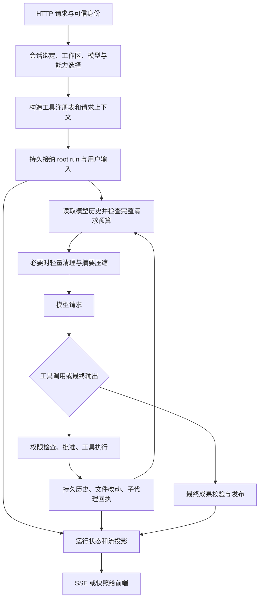

# 引擎运行与数据维护指南

本文按 2026-11-17 工作树源码核对，描述已实现行为。它是维护者指南，不是插件公开 API，也不替代具体接口 schema。运行默认值、部署覆盖值和模型能力是三种不同信息；接口返回的 effective 值比旧配置注释更可靠。本文更新未运行实际模型或生产数据测试。

## 一次请求经过哪些层

入口是 [chat.ts](../src/api/http/routes/chat.ts)，循环是 [react.ts](../src/core/agent-loop/react.ts)。`sessionId` 是长会话，`turnId/conversationId` 是一轮，`runId/attemptId` 是执行及其尝试，不能互换。补充输入通过协作接纳与历史投影进入当前执行；浏览器展示段落不代表新建了会话。

## 运行限制与模式

本节的 Work/Code 指历史工具 profile 和协议分支；当前 Aether 桌面只有一个默认界面，默认使用 general，不要求用户切换两套 UI。

| 项目 | 当前默认/边界 | 源码 |
| --- | --- | --- |
| 工具配置 | `general/code` 是服务端能力 profile，历史称 Work/Code；不代表当前客户端提供两个独立主界面，也不是安全级别 | [tool-profile.ts](../src/tools/tool-profile.ts) |
| OSM | 默认 `balanced`；`off/balanced/methodology/max`；只有后两者注入方法论 | [osm.ts](../src/core/osm.ts)、[osm-bootstrap.ts](../src/core/osm-bootstrap.ts) |
| 总迭代、累计请求 Token | 普通 chat 不设默认硬上限；`MAX_ITERATIONS/TOKEN_BUDGET` 为保留配置，不再约束产品请求；内部调用仍可显式传有限上限 | [react.ts](../src/core/agent-loop/react.ts)、[settings.ts](../src/api/http/routes/settings.ts) |
| 单请求上下文 | 默认 `CONTEXT_WINDOW_BUDGET=268000`；取它、已知模型窗口、Work 显式上下文预算的最小值 | [context-budget.ts](../src/core/context-budget.ts) |
| 压缩触发比 | 默认 `0.92`，有效正值最高 `0.95`；OSM max 使用 `0.7`，即更早触发 | [react.ts](../src/core/agent-loop/react.ts) |
| 工具输出投影 | `general` 基数 4000 字符，OSM off×1、balanced/methodology×2、max×4；`code` 默认 65536 字符；部分工具另有分页/文件大小限制 | [tool-output-limit.ts](../src/core/agent-loop/tool-output-limit.ts) |
| 子代理并发 | 每个父会话默认 5，最大 16；设置可热更新，降低不杀死正在运行的任务 | [concurrency.ts](../src/core/subagent/concurrency.ts)、[pool.ts](../src/core/subagent/pool.ts) |
| 安全模式 | 未配置为 `standard`；非法默认配置降为 `safe` | [policy-engine.ts](../src/security/policy-engine.ts) |

OSM 表仍保留旧倍率 helper；不能由此推导“所有任务预算自动乘 2/5”。无累计上限也不等于无限模型上下文、无限内存或无权限检查。

## 存储分层与备份范围

`DATA_DIR` 是主 SQLite **文件路径**，默认 `./data/agent.db`。默认历史是 JSONL，不是内存数据库，也不是“所有正文都在 SQLite”。

| 数据 | 当前存放位置/生命周期 |
| --- | --- |
| 主会话、子会话历史 | 主库同级 `sessions/<tenant>/<session>.jsonl`；追加消息、摘要、更新和删除标记。`HISTORY_BACKEND=sqlite` 可选另一实现 |
| 大历史正文 | 主库同级 `blobs/<tenantHash>/<hash前2>/<hash>.gz`；可外置字段从 16 KiB 起进行内容寻址，引用仍在历史行中 |
| 子代理任务、输出、工具详情正文 | `<主库文件>.subagent-payloads/` 下按租户哈希和内容哈希分片 gzip；单 payload 最大 128 MiB，范围读取最大 4 MiB |
| 命令 stdout/stderr 正文 | `<主库文件>.command-output/<tenantHash>/<sessionHash>/<jobHash>.log`；按接收顺序追加 UTF-8，SQLite 只存任务元数据、流类型与字节范围索引 |
| 运行索引/事件摘要/协调回执 | 主 SQLite 中 root runs、subagent 表及 collaboration 表；维持恢复身份、顺序、幂等和授权，不因正文外置而消失 |
| 已登记交付附件 | 主库同级 `result-assets/` 内容寻址副本，加 SQLite 成果记录；不是任意工作区文件列表 |
| 文件变更 | 主库 `file_changes` 的版本、归属和快照引用；大文件快照由变更存储管理，不能只备份成果副本代替 |
| 长期记忆 | 主库同级 `memory/memory.db`，持久图节点、边、标签和可选向量；不是会话 JSONL |
| 知识库 | 默认主库同级 `knowledge.db`；`KNOWLEDGE_DATA_DIR` 可指定数据库文件；测试/显式 shared 配置才使用主库 |
| 工作区文件 | 会话沙箱或明确绑定的外部项目目录；可能不在主库同级目录 |
| 易失运行态 | AbortController、真实进程句柄、并发池、SSE 重播队列、活动缓存、会话安全 Map；重启无法恢复原进程现场 |

源码：[历史工厂](../src/storage/conversation/factory.ts)、[JSONL](../src/storage/conversation/jsonl-history.ts)、[blob](../src/storage/conversation/history-blobs.ts)、[子代理文件](../src/core/subagent/payload-files.ts)、[成果](../src/storage/results/index.ts)、[记忆](../src/storage/memory/db.ts)、[知识库](../src/storage/knowledge/db.ts)。JSONL 活跃缓存有 64 会话和 64 MiB 双上限；这不是进程总内存上限，单次文件/模型请求仍会分配内存。

命令日志先写盘并同步，再提交 SQLite 索引；失败重试按已提交的字节边界与序号恢复，避免重复追加。启动不全量搬迁旧日志；访问旧任务时每批最多搬迁 64 条、256 KiB，单条过大的旧正文继续从 SQLite 有界读取。删除/过期清理先持久登记文件回收任务，删除失败可重试。默认保留终态命令最多 7 天、每会话 100 项、全局 500 项；正文落盘不表示无限保留。实现见[任务管理](../src/core/command-jobs/manager.ts)与[日志文件](../src/core/command-jobs/output-files.ts)。

客户端日志视图首次取末尾 64 KiB，后续按 UTF-8 游标增量读一页；隐藏或关闭后停止读取并释放正文缓存。每任务最多缓存 256 KiB、最多 4 个任务，总正文最多 1 MiB；这是正文缓存预算，不是整个应用内存上限。日志更新只通知对应任务，状态列表使用短期请求合并。存储监控把侧车目录计入“命令日志（磁盘）”，仍在进入时采样并由用户手动刷新。

SQLite 文件大小包含有效页、空闲页及 WAL 影响；删除逻辑行不保证文件立即变小。安全备份应停写并同时保留数据库、WAL 状态对应的数据、JSONL、blob、子代理 payload、命令日志目录、成果资产、文件快照及外部工作区。单独复制 `agent.db` 或 JSONL 不是完整备份。归档、GC 与离线 VACUUM 见[存储维护](operations/session-storage-maintenance.md)。

隔离性能验证入口：`npx tsx scripts/diagnostics/command-storage-benchmark.ts`。可用 `--baseline <旧版manager.ts>` 对比旧实现、`--mib 32` 调整每个命令的输出量；固定 3 个并发真实 Node 命令和独立 SQLite 子进程，验证完整回读 SHA-256、SQLite 正文清空及静默读取零写入。数据库、日志和报告统一写到 `.e2e-tmp/command-storage/`，不读取生产数据。报告中的 IPC 参数字节不是物理磁盘写入量，宿主 RSS/heap 不含 SQLite 与命令子进程。

2026-11-17 Windows 隔离样本（3 × 32 MiB，含中文、emoji、NUL；同一脚本依次测旧实现与文件实现）：

| 指标 | 旧 SQLite 正文 | 日志文件实现 |
| --- | ---: | ---: |
| checkpoint 后 SQLite | 113.89 MiB | 6.18 MiB |
| 日志侧车文件 | 0 | 96.01 MiB |
| SQLite 写入调用参数 | 221.64 MiB | 10.80 MiB |
| 命令输出与持久化完成 | 22.80 秒 | 17.30 秒 |
| 静默命令读取 20 次产生的写调用 | 20 | 0 |
| 逐页回读完整性 | 三个 SHA-256 全匹配 | 三个 SHA-256 全匹配 |

该样本总文件占用约下降 10.3%，不能把主库下降 94.6% 解释为全部日志空间也下降 94.6%。耗时会随宿主负载变化；正文预算、零重复写与完整性是验证约束。详细样本见本机 `.e2e-tmp/command-storage/comparison-2026-11-17T09-44-57-952Z.json`。

## 会话恢复、回退与成果

运行接纳、暂停问题、继续执行和公开状态由 [root-runs](../src/storage/root-runs/index.ts) 与 [chat 路由](../src/api/http/routes/chat.ts) 管理。SSE 读者断开不等于用户停止；流总线可以保留生产者并供重新订阅/快照恢复。电脑或引擎进程重启则失去原执行现场，持久记录用于确认中断及显式继续，不能把“记录状态 running”当作存活证明。

回退是三件不同的事：

- `/changes/revert-preview` 与 `/changes/revert-batch` 针对文件变更账本；检查当前哈希、后续写入、路径实际目标、快照和创建目录身份，拒绝覆盖后来保留的修改。命令观察不是独占写入证明，需要 `reviewedCommandChangeIds` 明确纳入相应变更。
- `/conversation/truncate` 删除选定消息及后续历史；不是文件回滚 API。
- `/conversation/rollback` 接收原始用户轮次 `messageId` 和幂等 `requestKey`，先冻结准确轮次/变更集合，再停止所拥有的执行、回退文件；只有全部目标成功或已回退才删对应主/子历史和 root runs。冲突/不可恢复时返回 `historyTruncated:false`。日志状态为 `pending → files_reverted → succeeded`，相同请求可重试，不能误删新分支。

新建目录仅在有创建归属且仍为空、身份未变时自底向上清理；不会为了“看起来干净”递归删除保留内容。源码：[conversation.ts](../src/api/http/routes/conversation.ts)、[ChangeStore](../src/storage/changes/index.ts)、[rollback-journal.ts](../src/storage/changes/rollback-journal.ts)。

成果是 `deliver_files` 显式登记的最终交付。主代理应检查子代理 `report_artifacts` 收据，再登记交付；有文本回复或写过文件不等于发布成果。最多 16 项，单项 32 MiB，总计 128 MiB；发布会验证实际版本。即使保留资产副本，产生该版本的变更已回退时，列表/历史投影和资产读取也要撤销相应附件，不能继续打开已撤回成果。部分回退可保留原回答作为证据，不代表附件仍有效。源码：[final-result.ts](../src/core/final-result.ts)、[results](../src/storage/results/index.ts)、[结果工具](../src/tools/results/index.ts)。

## 子代理协作

内置角色为 `research`（只读调研，不执行命令/脚本或制作文件）、`executor`（开发、办公、验证及产物制作）、`general`（混合任务）。它们是模板，不是只能有三个固定实例。子会话和单次 run 分开：已完成/中断任务可以通过目录中的可恢复状态复用原上下文，再产生后续执行记录。

| 能力 | 当前边界 |
| --- | --- |
| 新建与复用 | `subagent_directory` 查看模板、历史实例与 `canResume`；`subagent_start` 使用角色/Agent 或最新 `resumeRunId`；显式继续旧任务可省略 task |
| 新分工/补充 | `subagent_followup` 给子会话新任务；运行中走持久消息，终态按原上下文接纳后续执行 |
| 消息和状态 | `subagent_send/participants/inbox/request_input` 受当前根任务、可信参与者和发送者身份限制；`queued` 仅是接纳，不代表已读/已执行 |
| 等待与取消 | `subagent_wait` 批量 1–8 个目标，共同截止时间；pending 不取消；completed 只表示等待条件完成，成败看 status；取消 pending 不等于执行已停止 |
| 期限/上下文 | 默认无十分钟任务期限；仍受显式取消、模型窗口、权限、并发池和显式内部预算约束。子代理使用同类 ReAct 历史压缩 |
| 权限 | 继承已授权工具/工作区/模型边界；管理工具包不继承给执行子代理；研究角色的只读限制不是提示词建议而已 |
| 重启 | 持久历史可继续；旧 run 记录不会自动拥有新执行权限，进程句柄不可重建。用户单独停止的任务不应自动重跑 |

源码：[builtin-roles.ts](../src/core/subagent/builtin-roles.ts)、[runner.ts](../src/core/subagent/runner.ts)、[team-tools.ts](../src/tools/subagent/team-tools.ts)、[async-tools.ts](../src/tools/subagent/async-tools.ts)、[subagent-tool.ts](../src/tools/subagent/subagent-tool.ts)。

## 调度、队列与流程

会话计划、后台队列、定时自动化、Flow 和协作消息是不同机制，不能用相同的“任务 ID”互相控制。general/code 是服务端能力 profile，历史名称为 Work/Code；这些标识本身不代表当前桌面有两个独立主界面。

| 机制 | 数据与入口 | 执行及取消边界 |
| --- | --- | --- |
| 会话计划/待办 | `plan_update`、`/todos`；SQLite todos、task_plans、task_plan_items | 持久步骤状态与 revision；不会因为创建一条 todo 就自动启动模型 |
| 后台队列 | `/tasks`、SQLiteTaskQueue、jobs 与执行 claim | 只执行已注册 handler 的 type；cancel 只改 pending，不能终止运行中的命令/子代理 |
| 定时自动化 | `/cron`、`/cron/preview`、`/cron/capabilities`、运行历史与通知接口 | 时间到后取得 occurrence claim，再走内部 `/chat` 的持久 root run |
| Flow DAG | `POST /flows/run`、`POST /flows/:runId/stop` | 拓扑分层、层内并发 ReAct 节点；当前没有持久 Flow 恢复调度器 |
| 消息编辑/重生成 | `/messages/:messageId` 与 regenerate、tokens 接口 | 保留的消息级操作；不是协作消息发送接口，也不是文件回退 |
| 运行中协作消息 | chat admission/continuation 与 subagent_send/followup | 按 root/attempt、参与者和序号持久接纳；收件、读取、消费回执分开 |

**计划和队列。** 会话计划使用完整步骤快照更新、稳定步骤身份及 expectedRevision 检查；依赖唤醒钩子需要可信当前执行 authority。恢复计划供模型继续理解工作，不会单凭计划持久化自动重启一个已结束/中断的进程。旧 todo CRUD 仍保留，和 plan_update 共用底层待办数据，但不能代替运行身份。

`taskRoutes` 在 HTTP onReady 启动它拥有的队列、onClose 等待停止。当前路由实例未注册任何生产 handler，所以 `POST /tasks` 对未支持类型返回 501；不能将这个通用队列 API 宣称为任意任务执行器。独立使用 SQLiteTaskQueue 时需显式 registerHandler。默认每秒轮询、事务 claim 防重复执行；构造实例不把其他 running 行擅自改失败。停止会 abort 已有 handler 并最多等 3 秒确认；未确认时报告外部副作用未知。源码：[task routes](../src/api/http/routes/tasks.ts)、[queue](../src/storage/task-queue/sqlite-queue.ts)、[plan store](../src/storage/todo/index.ts)、[todo routes](../src/api/http/routes/todos.ts)，契约见 [task-queue](../openspec/specs/task-queue/spec.md)。

**定时自动化。** CronScheduler 随 HTTP 服务初始化启动，对齐分钟边界检查。支持 interval、带 IANA 时区的 calendar 与兼容 legacy cron；目标可为现有 session、独立会话或已绑定 workspace，重叠与错过的运行策略为 skip，没有手动立即运行接口。能力必须先看 `/cron/capabilities`：当前需要请求认证的部署不支持自动 dispatch，仅明确暂停的计划可保存；本地执行限制 default 租户和 loopback，不能冒用其他账号。

首次检查先协调既存运行：未取得 root 身份的旧 claim 标为 interrupted 且不重放；有 root 的记录按持久 root 状态投影并恢复期限检查，不因 SSE 首帧丢失再次 POST 任务。修改/删除计划不会停止已经开始的运行；取消具体 occurrence 用 `/cron/runs/:runId/cancel`，按精确 rootRunId 停止，不能误停后来手工创建的轮次。服务关闭先停止调度、取消并 join 所有拥有的 root，再结束读流；读流 abort 本身不证明任务停止。源码：[scheduler](../src/scheduler/cron-scheduler.ts)、[service/capabilities](../src/scheduler/cron-service.ts)、[dispatch/reconcile](../src/scheduler/cron-dispatch.ts)、[run store](../src/storage/cron/runs.ts)、[HTTP routes](../src/api/http/routes/cron.ts)。

**Flow。** 执行器先做环检查，再按依赖层推进；同层某节点失败不阻止其他兄弟完成，本层结算后失败会阻断后续层。每节点使用独立 flow-* 会话、当前租户和记忆策略、ReAct 与工具注册表；它不是 subagent_directory/followup 所管理的可复用协作子代理。节点读取 model/prompt/systemPrompt，模板可引用 input/output/上游节点结果；顶层共享 output 的值可能受同层完成顺序影响，不应视作稳定聚合器。

当前 Flow activeFlows、取消 controller 和事件总线都在进程内，SSE handler 结束时移除停止索引；断线后不能承诺仍可通过同一个停止接口找到运行，重启也没有自动恢复 DAG 的实现。DTO 虽接受 cwd、executionMode、securityMode、activeSkillIds、activeMcpServerIds、knowledgeBases、agentId 等字段，当前执行器没有完整消费这些绑定，不能仅凭字段存在宣称对应配置已经生效。源码：[flow routes](../src/api/http/routes/flows/flow-routes.ts)、[executor](../src/api/http/routes/flows/flow-executor.ts)、[types](../src/api/http/routes/flows/flow-types.ts)，边界见 [agent-loop](../openspec/specs/agent-loop/spec.md)。

**消息接口与协作。** `messages.ts` 保留消息/会话 token 查询、删除、编辑用户消息再生成和重生成 assistant 的实现；写操作对 code profile 返回 409，引导使用 conversation 与 chat。该旧通路部分定位仍直接查询 SQLite conversations，不应视作默认 JSONL、持久 root admission 和文件回退的通用替代。当前用户回退应使用上一节的 conversation/rollback；运行中补充按 [chat-admission](../src/api/http/routes/chat-admission.ts)、[root admission](../src/storage/root-admission/) 和 [collaboration](../src/core/collaboration/) 接纳。持久消息不意味着重启后自动取得原生产者权限，终态/重启继续必须重新校验执行归属。旧接口源码：[messages.ts](../src/api/http/routes/messages.ts)。

## 压缩与缓存

自动压缩比较整个请求的模型输入估计：历史、系统文本、工具定义、动态尾部和输出预留。超过阈值先 microcompact 旧工具结果，再请求 LLM 摘要，最多四次缩减保留预算；完整工具调用/结果边界保持成组。摘要生成期间历史变化则拒绝提交旧摘要；失败保留原历史，仍需通过最终准入检查才可请求模型。

默认 JSONL 追加 summary，保留原物理档案，显示历史/归档检索与模型工作历史不同。压缩不是用户回退，也不是删文件。不存在 TF-IDF/Jaccard “语义准确率至少 80%”实现或保证。详见[压缩说明](context-compression-design.md)。

上游 prompt cache 命中来自模型用量字段，取决于服务端规则和请求前缀。`SQLiteCacheStore` 是独立通用 TTL 字符串缓存，不是模型 KV cache；不能用其数据库大小解释上游缓存命中。记忆放动态请求尾部有利于稳定前缀，但模型切换、系统内容/工具定义/附件/RAG变化和摘要仍可能改变前缀。

## 记忆与知识库

新租户的全局记忆、会话默认记忆都关闭。`ENABLE_LONG_TERM_MEMORY=false` 统一关闭能力；未设不代表用户已授权。全局共享与会话记忆独立开关；会话 override 可为 null（随默认）、true、false。读取可以同时包含两个已启用范围；写入优先会话范围，不把私人内容自动提升到全局。

记忆召回先检查授权范围、查询与数据是否存在；纯问候可跳过。有数据时可用辅助模型分析意图、向量检索、关键词及有限图扩展；向量失败仍可词法召回。召回和客户端记忆引用合用 `min(2000, floor(contextWindow×0.08))` Token 投影预算，服务器授权召回优先。内容是历史数据，不授予权限；稳定说明在系统前缀、动态记录在请求尾部。完成后抽取/维护属于额外模型或 embedding 工作，不能承诺“开启记忆零额外请求”。关闭开关不会删除已存记忆。

源码：[settings.ts](../src/storage/memory/settings.ts)、[policy.ts](../src/middleware/memory/policy.ts)、[extractor.ts](../src/middleware/memory/extractor.ts)、[memory-request-context.ts](../src/core/memory-request-context.ts)、[embedding.ts](../src/storage/memory/embedding.ts)。

知识库当前使用全文索引 FTS 与 LIKE 回退，**没有知识库 sqlite-vec 语义检索链路**；记忆的向量能力不能套用到知识库。支持文本/代码、Excel、Word、PDF 和图片 OCR；上传原件最多 2 MiB，抽取正文最多 1 MiB；扫描 PDF 默认 OCR 前 3 页，可配置 1–10 页。查询最多 4000 字符，limit 1–100，显式资源选择最多 100 个。结构化选择赋予对应知识读取能力，无需打开管理工具包；写操作仍要管理能力与批准。引用 ID 不是文件路径，“检索无命中”不等于库为空。

源码：[kb-repo.ts](../src/storage/knowledge/kb-repo.ts)、[content-extractor.ts](../src/storage/knowledge/content-extractor.ts)、[types.ts](../src/storage/knowledge/types.ts)、[knowledge-context.ts](../src/core/knowledge-context.ts)。

## 模型、多模态、工具、技能与 MCP

模型解析以 [resolve-model.ts](../src/core/llm-adapter/resolve-model.ts) 为准；传输由显式 apiFormat、服务端协议与模型家族共同决议。支持 OpenAI compatible、Anthropic、Ollama 以及 DeepSeek/Qwen 家族适配。重试默认是初次加最多 3 次重试；408/429/5xx 和可重试连接错误可重试，流已发出进度后不自动重播。用量按实际物理尝试记账，未知用量不能当作免费。见[思考配置](thinking-mode-config.md)与[多模态输入](multimodal-design.md)。

工具存在于目录、允许执行、向模型公开定义是三层不同状态。`load_tools` 仅补充已有授权定义，不能恢复权限；当前 canonical 名称为 `read_file/execute_cmd/glob/grep`，旧名称只在配置归一化中处理。默认 `general` 会话的管理能力由[会话工具包](session-toolkits.md)显式选择；服务端 `code` profile 不启用管理包。会话计划 `plan_update` 是可信内置能力，不等于后台队列；后台命令用 `command_output/wait_command/wait_commands/cancel_command`，子代理用各自控制工具。当前清单见[系统工具](docs/system-tools.md)。

技能从部署、全局、项目及内置层合并，项目同名项覆盖，禁用项目项不会让全局同名项复活。生成配置使用 `.ae`，旧 `.aether` 层按读取规则保留。`os-*` 只在 methodology/max 可见；内置 `aether-office` 是另一类能力，不能说 Work 不使用任何 skill。`GET /skills?available=1` 给普通账号运行目录，管理列表/详情/修改仍受 admin/skill-manager 限制；无工作区时只列共享/部署/内置技能。路径不得越过授权工作区或跟随逃逸链接。源码：[skills-registry.ts](../src/skills/skills-registry.ts)、[project-skills.ts](../src/skills/project-skills.ts)、[skill-imports.ts](../src/api/http/routes/skill-imports.ts)。

MCP 支持 stdio、HTTP、SSE、streamableHttp；项目默认 `.ae/mcp.json`，全局 `~/.aether/mcp.json`，显式 `MCP_CONFIG_PATH` 优先。服务器绑定在构造客户端前过滤，`[]` 禁用发现。工具名为 `mcp_<serverId>_<tool>`；单服务失败不影响其余服务。发现阶段默认 15 秒；工具调用缺省不设 deadline，显式 `timeoutMs=0` 也为无期限；仍响应取消并受网络/扩展权限边界。stdio 和长 SSE 在发现后释放，调用时按需重连；没有按 spec 旧文案描述的定时刷新/自动重连守护循环。源码：[loader.ts](../src/tools/mcp/loader.ts)、[client.ts](../src/tools/mcp/client.ts)、[mcp-config.ts](../src/storage/mcp/mcp-config.ts)。

## 安全与可观测性

安全由可信身份、租户/会话工作区、工具选择、批准状态、命令策略和受控 HTTP 分层实现。工作区 cwd 和 `shell:false` 不是 OS 沙箱；解释器可产生宿主副作用。默认 standard 的普通 ask 规则可放行，deny/注入特征转为确认；full-access 仍保留删除命令硬拦截、参数校验及其他硬边界。远程普通 tenant-admin 不能自行开启 full-access；桌面持有实例凭据的 loopback 自有会话有明确例外。详见[安全说明](security-architecture.md)。

Pino 默认 info，生产 JSON，开发 pretty；请求 logger 注入身份字段，不保证启动日志也有 sessionId。`quotas` 是日聚合 Token/请求计数，`tool_metrics` 存工具耗时；主/子运行与历史还有各自的用量记录。不能宣称存在统一 `token_usage` 表、每次失败请求用量已知或所有工具都会自动写 metric。`QA_LOG_ENABLED=true` 才启用问答日志，默认目录 `logs/qa`，可能含正文；测试需显式放 `.e2e-tmp/`。

源码：[logger.ts](../src/observability/logger.ts)、[metrics.ts](../src/observability/metrics.ts)、[instrument-tool.ts](../src/observability/instrument-tool.ts)、[qa-logger.ts](../src/observability/qa-logger.ts)、[request-attempt.ts](../src/core/llm-adapter/request-attempt.ts)、[audit-log.ts](../src/security/audit-log.ts)。安全审计大正文/旧记录可外置或归档，审计清理不是无记录删除，也不是自动 VACUUM。

## 核对范围与未承诺事项

本指南每节链接当前实现；[OpenSpec 当前契约](../openspec/specs/)同步更新对应域。账号、插件、部署与 HTTP 总表由各自维护文档负责。源码中的旧注释、历史 research/test-reports 的成功数量和测量值不能当作本次验收。当前可见的注释漂移包括 osm.ts 的旧默认 off 描述、osm-bootstrap.ts 的缺失技能返回空描述、MCP loader 的内联仅远端描述；本文按实际执行分支记录，未在文档任务中修改产品源码。

未作承诺：跨机器完整恢复原进程、无人工授权恢复已停止任务、所有 shell 副作用可回滚、所有模型支持同一思考开关、知识库向量检索、OS 级强隔离、远端提供商缓存命中率或新鲜真实模型验证。需要这些能力时必须分别核对实现和运行证据。
